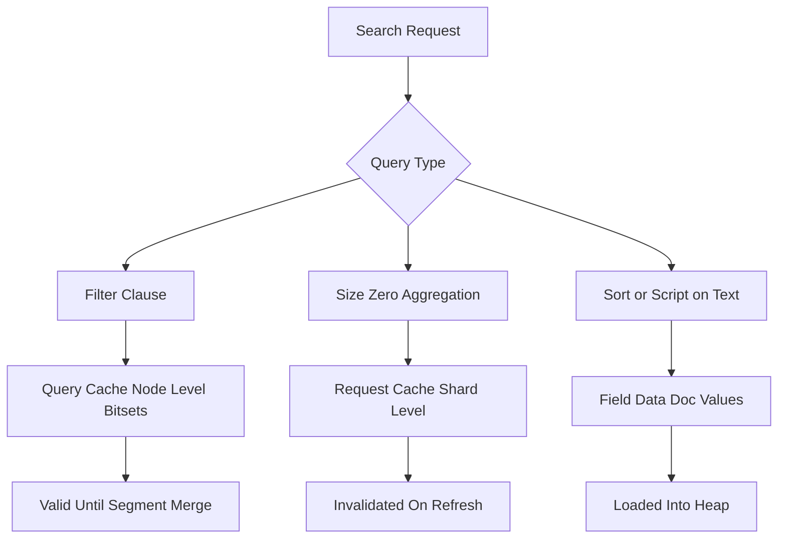

# Shard-Level Caching: Query Cache, Request Cache, and Field Data

## English

Elasticsearch does not have one cache; it has several, each attached to a different layer and each with its own invalidation rule. Knowing which is which explains why some queries feel instant on the second run and others never do. The big three are the node-level query cache, the shard-level request cache, and field data (now mostly replaced by doc values), plus the OS filesystem cache which quietly does more work than all of them.

The query cache lives at the node level and caches the results of filter clauses as bitsets — one bit per document saying 'matches' or 'does not match'. Because it is per-segment and segments are immutable, a cached bitset stays valid until a merge replaces the segment or the segment is deleted. This is why filters are cheap to repeat: a `term` or `range` inside a `bool.filter` can be answered by reading a few bitsets. It also explains a classic performance rule: put non-scoring conditions in `filter` rather than `must`, because `must` clauses contribute to the relevance score and therefore cannot use the bitset cache the same way.

The request cache is different and often misunderstood. It sits at the shard level and caches the entire search response body for a request whose `size` is 0 — in other words, aggregation-only and hit-count-only queries. It is invalidated whenever the shard refreshes, which by default is once per second. So a dashboard aggregation hammered by many users within the same second will hit the cache, but a query that runs every ten seconds will usually miss it. You can request it explicitly with `"request_cache": true` on the search body or `?request_cache=true` in the URL, and it is on by default for `size: 0` searches. The `indices.request_cache` stats endpoint shows hit and miss counts per index.

Field data is the old mechanism for sorting and aggregating on `text` fields. It loaded the whole field into heap as an uninverted structure, and because text fields are analyzed, it was enormously expensive and could blow up a node — which is why modern Elasticsearch refuses to do it unless you explicitly set `fielddata: true` on the mapping. The replacement is doc values: a columnar, on-disk structure built at index time for every non-text field. Doc values are memory-mapped by the operating system, so they live in the filesystem cache rather than the JVM heap, and they are the reason aggregations scale to billions of documents without heap pressure.

Finally, the filesystem cache is the unsung hero. Lucene reads index files through the OS page cache, so a warm index is served from RAM without any Elasticsearch-level bookkeeping. This is why the general advice is to leave roughly half a machine's RAM outside the JVM heap: the heap serves queries, the rest of RAM caches segments. If you see slow searches with a healthy heap, check whether the working set fits in the filesystem cache before tuning anything else.

## 中文

Elasticsearch 沒有單一快取，而是好幾個，各自掛在不同層級、各有不同的失效規則。搞清楚哪個是哪個，就能解釋為何某些查詢第二次跑起來感覺瞬時，另一些卻永遠不會。三大主角是節點層級的 query cache、分片層級的 request cache、以及 field data（現多已被 doc values 取代），外加作業系統的 filesystem cache——後者默默做的工作比它們全部加起來還多。

Query cache 位於節點層級，把 filter 子句的結果以 bitset 形式快取——每位元代表一份文件「符合」或「不符合」。因為它以 segment 為單位、而 segment 不可變，快取的 bitset 會一直有效，直到 merge 取代該 segment 或 segment 被刪除。這就是為何 filter 重複執行很便宜：`bool.filter` 裡的 `term` 或 `range` 可以靠讀幾個 bitset 就回答。它也解釋了一條經典效能法則：把不計分的條件放進 `filter` 而非 `must`，因為 `must` 子句會貢獻相關性分數，因此無法以同樣方式使用 bitset 快取。

Request cache 不同，且常被誤解。它位於分片層級，針對 `size` 為 0 的請求快取整個搜尋回應內容——換言之，只做聚合、只算命中數的查詢。每當分片 refresh 時它就失效，預設是每秒一次。所以一個在同一秒內被多位使用者猛打的儀表板聚合會命中快取，但每十秒才跑一次的查詢通常會落空。你可以在搜尋內容加 `"request_cache": true`、或在 URL 加 `?request_cache=true` 明確要求；對 `size: 0` 的搜尋它預設開啟。`indices.request_cache` 統計端點會顯示每個索引的命中與未命中次數。

Field data 是對 `text` 欄位做排序與聚合的舊機制。它把整個欄位以未倒排結構載入堆積，而由於 text 欄位經過分析，代價極高且可能撐爆節點——這就是現代 Elasticsearch 除非你在 mapping 明確設 `fielddata: true` 否則拒絕這麼做的原因。取代者是 doc values：一種在建索引時為每個非 text 欄位建立的列式、磁碟上結構。Doc values 由作業系統記憶體映射，因此住在 filesystem cache 而非 JVM 堆積，這正是聚合能擴展到數十億文件而不造成堆積壓力的原因。

最後，filesystem cache 是無名英雄。Lucene 透過作業系統 page cache 讀取索引檔，所以熱索引直接由 RAM 供應，不需任何 Elasticsearch 層級的記帳。這就是為何一般建議把機器約一半的 RAM 留在 JVM 堆積之外：堆積服務查詢，其餘 RAM 快取 segment。若你看到搜尋緩慢但堆積健康，先檢查工作集是否裝得進 filesystem cache，再調其他東西。

## Key Takeaway

Filters hit a per-segment bitset cache, `size: 0` aggregations hit a per-shard request cache that dies on every refresh, and doc values plus the OS filesystem cache carry the heavy lifting — so leave half your RAM outside the heap.

## Related Concepts
- The Cost of a Query: Understanding Search Phases and the Request Cache
- Index Sorting and Shard Sizing: The Physical Layout You Choose Up Front

## Diagram

