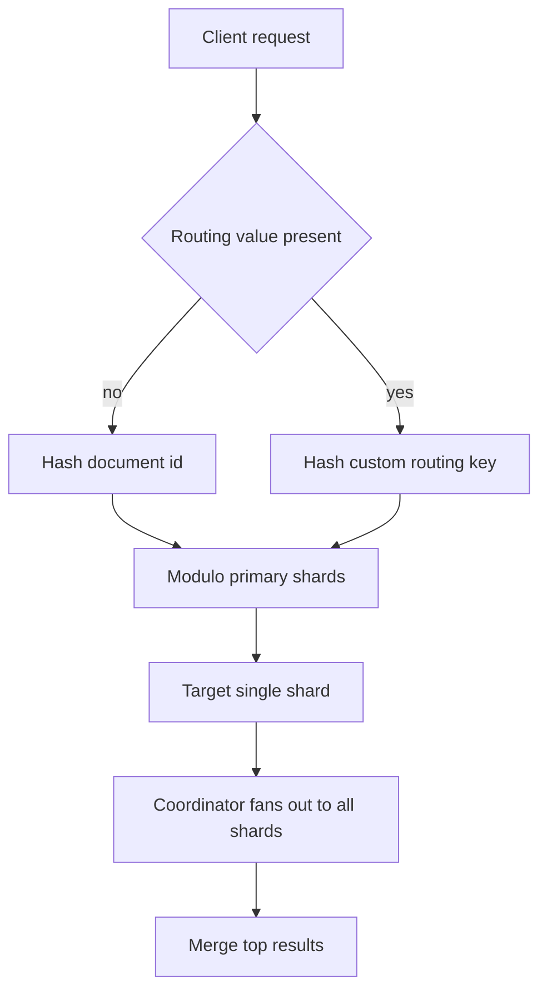

# Routing, Custom Routing Keys, and Why Some Queries Hit Every Shard

## English

Every document in Elasticsearch lands on exactly one primary shard, chosen by a routing value. By default the routing value is the document's `_id`, hashed and taken modulo the number of primary shards. This is why you can `GET /index/_doc/123` and know it will go to one specific shard: the same hash is computed on the way in and on the way out, so the coordinating node sends the lookup to that shard alone. It is a clean, stateless scheme with no central directory.

The interesting part is that you can override the routing value. If you index with `?routing=user42`, all documents sharing that routing value land on the same shard. This is enormously useful for multi-tenant or entity-centric data: if every document for a given customer is co-located, then a search scoped to that customer only needs to visit one shard instead of all of them. A cluster with twenty shards turns a fan-out of twenty into a fan-out of one. The cost is skew: if one routing value is far hotter than others, its shard becomes a hotspot while the rest sit idle, and shard sizes drift apart. Choose a routing key with high cardinality and roughly even document counts.

Routing also matters for `terms` lookups and `mget`. A `GET` by id is cheap because routing is deterministic; a `terms` query on `_id` with hundreds of values is not, because each id may live on a different shard and the coordinator has to fan out. Similarly, `_search` without a routing parameter always fans out to every shard of the index, gathers the top results from each, and merges them on the coordinating node. That merge is why deep pagination is expensive and why `search_after` exists: the coordinator cannot skip shards, it can only ask each one for its best N and then combine.

A subtlety worth knowing: the number of primary shards is fixed at index creation. Changing it means reindexing into a new index (often using an alias to flip over), and if you use custom routing, the new index must have the same or a compatible shard count, or your routing values will map to different shards. This is one reason people are cautious about over-sharding early: you cannot simply 'add a shard' later without a full copy.

Finally, routing interacts with `preference` on searches. You can ask Elasticsearch to prefer a particular shard copy with `?preference=_local` (prefer a shard on the same node) or a custom string that consistently maps a user to the same replica, which improves cache locality across repeated queries from the same user. None of this changes correctness — replicas hold identical data — but it changes which caches get warmed.

## 中文

Elasticsearch 中的每份文件都恰好落在一個主分片上，由一個 routing 值決定。預設 routing 值是文件的 `_id`，經雜湊後對主分片數取模。這就是為何你可以 `GET /index/_doc/123` 並確知它會去某個特定分片：進去與出來時算的是同一個雜湊，所以協調節點只把查詢送到那個分片。這是乾淨、無狀態、不需中央目錄的方案。

有趣的是你可以覆寫 routing 值。若你以 `?routing=user42` 索引，所有共用該 routing 值的文件都會落在同一分片。這對多租戶或實體為中心的資料極有用：若某客戶的所有文件都同址，那麼限定該客戶的搜尋只需拜訪一個分片而非全部。一個有二十個分片的叢集，就從二十路 fan-out 變成一路。代價是傾斜：若某個 routing 值遠比其他熱，它的分片就成了熱點，其餘分片閒置，分片大小也會漸行漸遠。請挑選基數高、文件數大致平均的 routing key。

Routing 對 `terms` 查詢與 `mget` 也有影響。依 id 的 `GET` 很便宜，因為 routing 是確定性的；但對 `_id` 下含數百個值的 `terms` 查詢就不便宜，因為每個 id 可能住在不同分片，協調節點必須 fan-out。同樣地，不帶 routing 參數的 `_search` 永遠會 fan-out 到索引的每個分片，從各分片收集前段結果，再於協調節點合併。這個合併正是深分頁昂貴、也是 `search_after` 存在的原因：協調節點無法跳過分片，只能向每個分片要它最好的 N 筆再組合。

一個值得知道的微妙點：主分片數在建立索引時就固定。要改變就得 reindex 到新索引（通常用 alias 切換），而若你用了自訂 routing，新索引必須有相同或相容的分片數，否則你的 routing 值會對應到不同分片。這是人們對早期過度分片保持謹慎的原因之一：你無法之後單純「加一個分片」而不做完整複製。

最後，routing 與搜尋的 `preference` 相互作用。你可以用 `?preference=_local`（偏好同節點上的分片副本）或一個自訂字串，把某位使用者穩定對應到同一個副本，藉此改善同一使用者重複查詢時的快取局部性。這些都不改變正確性——副本持有相同資料——但改變了哪些快取會被暖起來。

## Key Takeaway

Default routing by `_id` pins each document to one shard; a custom routing key can collapse a twenty-shard fan-out into one, at the price of hotspots and a fixed shard count you cannot change without reindexing.

## Related Concepts
- The Query Then Fetch Two-Phase Search
- Shard Allocation Awareness and Forced Awareness: Keeping Copies in the Right Places

## Diagram

