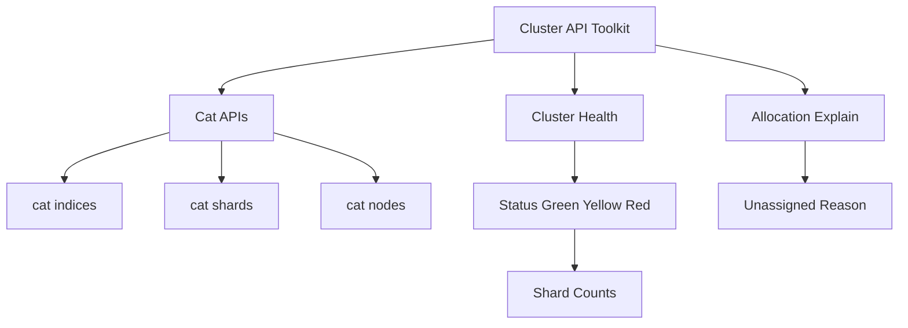

# The Cluster API Toolkit: Reading What the Cluster Is Actually Doing

## English

Elasticsearch exposes a family of diagnostic endpoints, all under the `_cluster` and `_cat` namespaces, that let you ask the cluster questions instead of guessing. The `_cat` APIs are the human-readable layer: `GET _cat/indices?v` gives one line per index with health, document count, size, and shard counts; `GET _cat/shards?v` lists every shard, which node holds it, and whether it is started or relocating; `GET _cat/nodes?v` shows heap usage, CPU, and roles per node. The `?v` flag simply prints the column headers, and `?format=json` switches the same data into machine-readable JSON so scripts can consume it. Think of `_cat` as the dashboard, and the underlying `_cluster/health`, `_cluster/stats`, and `_nodes/stats` APIs as the raw gauges the dashboard is reading.

The most important one to understand deeply is `_cluster/health`. It returns a `status` of green, yellow, or red. Green means all primary and replica shards are allocated. Yellow means all primaries are allocated but at least one replica is not — your data is safe but redundancy is reduced. Red means at least one primary shard is unallocated, so some data is simply not searchable right now. Crucially, yellow is not an error — a single-node cluster with replicas configured will always be yellow, because a replica cannot live on the same node as its primary. Reading `unassigned_shards`, `active_shards`, and `relocating_shards` alongside the status tells you whether the cluster is settling or genuinely stuck.

When something looks wrong, `GET _cluster/allocation/explain` is the single most useful call. It asks the master node: why is this shard (or any unassigned shard) not allocated? The response names a concrete reason — for example `no_valid_shard_copy`, `node_left`, `disk_threshold`, or `allocation_failed` — and lists the decisions the allocator made for each node. This turns a vague red status into an actionable sentence like "the disk watermark was exceeded on node-2, so shards were not moved there." Without it, operators tend to restart nodes blindly, which rarely fixes an allocation problem and often makes it worse.

The `_nodes/stats` API is where performance investigation lives. It reports JVM heap used and committed, garbage collection counts and time, thread pool queue depths (especially `search`, `write`, and `bulk`), and per-node breaker statistics. A `search` queue that keeps growing means searches are arriving faster than they complete; a `write` queue backed up usually points at merge pressure or slow disks. The circuit breaker numbers (`breakers.parent.tripped`) tell you when a query was rejected because it would have used too much heap — a common cause of mysterious `circuit_breaking_exception` errors on large aggregations.

Finally, `GET _tasks` and `GET _nodes/hot_threads` answer the "what is it doing right now" question. `_tasks` lists long-running operations such as reindex, force-merge, or snapshot with their progress; `hot_threads` samples JVM stacks and shows which threads are burning CPU. The practical habit is to build a small set of these calls into a runbook: check `_cluster/health` first, then `_cat/shards` for anything unassigned, then `allocation/explain` for the reason, then `_nodes/stats` for resource pressure. Each endpoint answers a different question, and knowing which one to reach for is most of the skill.

## 中文

Elasticsearch 提供了一整組診斷端點，全部位於 `_cluster` 與 `_cat` 命名空間之下，讓你直接向叢集提問，而不是靠猜。`_cat` API 是可讀性層：`GET _cat/indices?v` 每個索引一行，顯示健康狀態、文件數、大小與分片數；`GET _cat/shards?v` 列出每個分片、它落在哪個節點、以及它是已啟動還是正在遷移；`GET _cat/nodes?v` 顯示每個節點的堆積記憶體用量、CPU 與角色。`?v` 參數只是印出欄位標題，`?format=json` 則把同一份資料轉成機器可讀的 JSON，方便腳本取用。可以把 `_cat` 想成儀表板，而底層的 `_cluster/health`、`_cluster/stats`、`_nodes/stats` 則是儀表板正在讀取的原始指針。

最值得深入理解的是 `_cluster/health`。它回傳 `status`，值為 green、yellow 或 red。Green 表示所有主分片與副本分片都已分配；yellow 表示所有主分片都已分配，但至少有一個副本未分配——資料安全，但冗餘度下降；red 表示至少有一個主分片未分配，也就是部分資料此刻根本搜不到。關鍵在於：yellow 不是錯誤——單節點叢集若設定了副本，永遠會是 yellow，因為副本不能與其主分片放在同一節點。搭配讀取 `unassigned_shards`、`active_shards`、`relocating_shards`，你才能分辨叢集是在收斂中，還是真的卡住了。

當情況不對勁時，`GET _cluster/allocation/explain` 是最有用的一個呼叫。它問主節點：這個分片（或任何未分配分片）為何沒有被分配？回應會給出具體原因——例如 `no_valid_shard_copy`、`node_left`、`disk_threshold`、`allocation_failed`——並列出分配器對每個節點所做的判斷。這會把模糊的 red 狀態變成一句可執行的話，例如「node-2 超過磁碟水位，因此分片沒有被移過去」。沒有它，維運人員往往盲目重啟節點，這幾乎修不好分配問題，還常常弄得更糟。

`_nodes/stats` API 是效能調查的核心。它回報 JVM 堆積已用與已提交量、垃圾回收次數與時間、執行緒池佇列深度（尤其是 `search`、`write`、`bulk`），以及各節點的斷路器統計。`search` 佇列持續增長，代表搜尋進來的速度比完成的快；`write` 佇列積壓通常指向合併壓力或慢速磁碟。斷路器數字（`breakers.parent.tripped`）告訴你某個查詢因為會用掉太多堆積而被拒絕——這是大型聚合偶爾冒出 `circuit_breaking_exception` 的常見原因。

最後，`GET _tasks` 與 `GET _nodes/hot_threads` 回答「它現在正在做什麼」。`_tasks` 列出長時間執行的操作，例如 reindex、force-merge 或快照，並附上進度；`hot_threads` 取樣 JVM 堆疊，顯示哪些執行緒正在燒 CPU。實務上的習慣是把這幾個呼叫寫進 runbook：先看 `_cluster/health`，再用 `_cat/shards` 找未分配的分片，接著用 `allocation/explain` 問原因，最後用 `_nodes/stats` 看資源壓力。每個端點回答不同問題，知道該伸手拿哪一個，就是大半的功夫。

## Key Takeaway

Elasticsearch's diagnostic endpoints each answer a different question, and a small ordered runbook of health, shards, allocation explain, and node stats resolves most cluster mysteries.

## Related Concepts
- Cluster Operations: Health, Allocation, and Failure Modes
- Reading the Cluster: Interpreting Health, Stats, and Slow Logs

## Diagram

