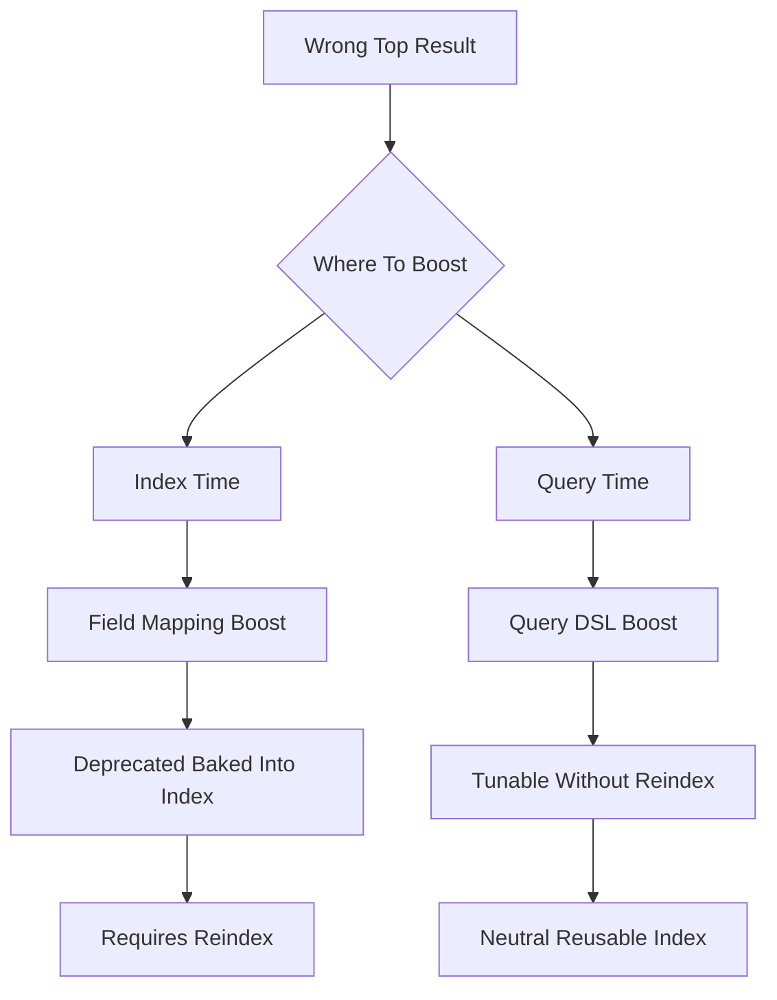

# Index-Time vs Query-Time Boosting: Where Relevance Decisions Live

## English

When a search returns the "wrong" top result, the instinct is to add a boost to the query. But Elasticsearch gives you two very different places to influence relevance: at index time (in the mapping) and at query time (in the query DSL). Understanding the trade-off is the difference between a relevance fix that lasts and one that quietly rots. Index-time boosting historically used a `boost` parameter on field mappings, which scaled the field's contribution to the score. That approach is deprecated in modern versions because the boost is baked into the index and cannot be changed without reindexing — and worse, it interacts badly with compression and scoring since Lucene stores norms (the per-document length normalisation) that already encode field importance.

The modern, recommended approach is query-time boosting. In a `multi_match` or `bool` query you can wrap any clause in `boost`, e.g. a `match` on `title` with `boost: 3` alongside a `match` on `body` with the default boost. The scores are multiplied by the boost factor at scoring time, so you can tune and re-tune without touching the index. This is the right default: relevance is a hypothesis, and hypotheses change as you see real queries. Keeping boosts in the query means the index stays neutral and reusable for different search experiences — one index can serve a "title-heavy" search page and a "body-heavy" search page simultaneously.

There is a subtler tool that resolves the index-time/query-time tension: `boost` inside a `field` mapping is deprecated, but the `norms` setting is not. Norms store the field-length normalisation used by BM25 — shorter fields score higher for the same term frequency, which is usually desirable. If a field is only used for filtering or sorting and never for scoring, disabling norms (`"norms": false`) saves disk and memory because Lucene no longer stores that per-document byte. This is an index-time decision about whether a field participates in scoring at all, and it is one of the highest-leverage mapping choices you can make.

A related index-time lever is `index_options`, which controls how much positional information is stored. Storing positions (`"index_options": "positions"`) enables phrase queries; storing offsets (`offsets`) enables highlighting without re-analysing the text. Each level costs more index space but unlocks query features. If you know a field will never be phrase-queried or highlighted, lowering `index_options` to `docs` (just document numbers, no frequencies or positions) makes the index smaller and faster to write. Again, this is a decision made once at index time that constrains what queries are possible later.

Function score queries and `rank_feature` fields sit at the boundary. A `function_score` query lets you combine the text relevance score with numeric signals — recency, popularity, a business rule — at query time, which keeps the logic visible and adjustable. `rank_feature` and `rank_features` fields, by contrast, pre-compute a compact structure at index time so that ranking on numeric features is very cheap at query time. The rule of thumb: use query-time boosting for anything you expect to tune, use index-time structures (`norms`, `index_options`, `rank_feature`) for anything that is stable and where you want to trade index size for query speed. Mixing the two without understanding which is which is how relevance systems become unmaintainable.

## 中文

當搜尋回傳「錯誤」的第一名結果時，直覺反應是替查詢加 boost。但 Elasticsearch 提供兩個截然不同的地方來影響相關性：索引時（mapping 裡）與查詢時（query DSL 裡）。理解這個取捨，就是「持久的相關性修正」與「悄悄腐壞的修正」之間的差別。索引時 boosting 歷史上是在欄位 mapping 上使用 `boost` 參數，放大該欄位對分數的貢獻。這種做法在現代版本已棄用，因為 boost 被烤進索引裡，不改索引就改不了——更糟的是，它與壓縮和評分的互動很差，因為 Lucene 儲存的 norms（每份文件長度正規化）本身已編碼了欄位重要性。

現代建議做法是查詢時 boosting。在 `multi_match` 或 `bool` 查詢中，你可以把任何子句包在 `boost` 裡，例如對 `title` 的 `match` 設 `boost: 3`，與對 `body` 使用預設 boost 的 `match` 並列。分數在評分時乘以 boost 係數，所以你可以反覆調整而不必碰索引。這是正確的預設：相關性是一種假設，而假設會隨著你看到真實查詢而改變。把 boost 留在查詢裡，索引就保持中立、可被不同搜尋體驗重用——同一個索引可以同時服務「偏重標題」的搜尋頁與「偏重內文」的搜尋頁。

有一個更細緻的工具可化解索引時與查詢時的張力：欄位 mapping 裡的 `boost` 已棄用，但 `norms` 設定沒有。Norms 儲存 BM25 使用的欄位長度正規化——相同詞頻下，較短的欄位得分較高，這通常是我們想要的。若某欄位只用於過濾或排序、從不用於評分，關閉 norms（`"norms": false`）可節省磁碟與記憶體，因為 Lucene 不再儲存那份每份文件一個位元組的資料。這是關於「該欄位是否參與評分」的索引時決定，也是你能做的最高槓桿 mapping 選擇之一。

另一個相關的索引時槓桿是 `index_options`，它控制儲存多少位置資訊。儲存位置（`"index_options": "positions"`）可啟用片語查詢；儲存偏移量（`offsets`）可讓高亮不必重新分析文字。每一級都花更多索引空間，但解鎖查詢功能。若你知道某欄位永遠不會被片語查詢或高亮，把 `index_options` 降到 `docs`（只有文件編號，沒有詞頻或位置）會讓索引更小、寫入更快。這又是一個在索引時做一次、卻限制了日後能做什麼查詢的決定。

Function score 查詢與 `rank_feature` 欄位則位於邊界上。`function_score` 查詢讓你在查詢時把文字相關性分數與數值訊號——新鮮度、熱門度、業務規則——結合，邏輯可見且可調。相對地，`rank_feature` 與 `rank_features` 欄位在索引時預先計算出精簡結構，讓查詢時以數值特徵排序非常便宜。經驗法則：任何你預期會調整的東西用查詢時 boosting；任何穩定、且你願意用索引大小換查詢速度的東西用索引時結構（`norms`、`index_options`、`rank_feature`）。搞不清哪個是哪個就混著用，正是相關性系統變得難以維護的原因。

## Key Takeaway

Put anything you expect to tune in the query, and put anything stable that trades index size for query speed in the mapping — knowing which lever is which keeps relevance maintainable.

## Related Concepts
- Relevance Tuning and Deep Pagination: Fuzzy Matching, Highlighting, PIT and `search_after`
- The Cost of a Field: Why Mapping Choices Shape Performance

## Diagram

