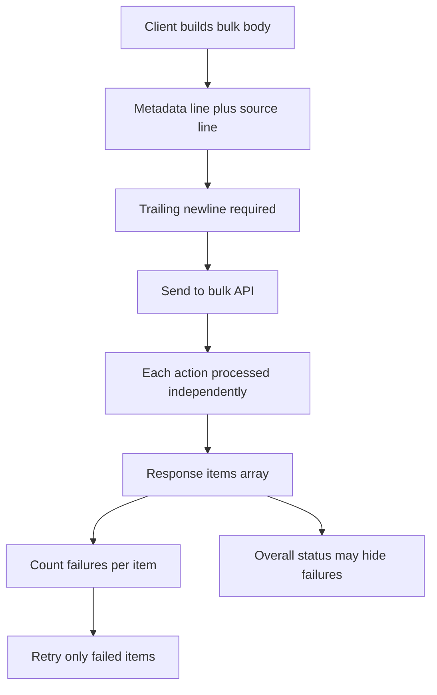

# The Bulk API Contract: Batching, Partial Failures, and Backpressure

## English

Almost every document that enters Elasticsearch in production arrives through the `_bulk` API, not through single-document `PUT` or `POST` calls. The reason is mechanical: each single-document request is a full HTTP round trip plus a Lucene commit-like operation on the shard, and the per-request overhead dwarfs the cost of indexing the document itself. The `_bulk` endpoint accepts a newline-delimited body where each action is described by a metadata line followed by an optional source line — `{"index":{"_index":"logs","_id":"1"}}` then the JSON document, then the next action, and so on. The body must end with a trailing newline; forgetting it is one of the most common causes of a `400` from bulk.

The API is deliberately not transactional. Each action in the batch is processed independently, and the response contains an `items` array with a per-action status. A bulk request can return HTTP 200 overall while some items inside have failed with a `429` (too many requests, meaning the write queue is full) or a `version_conflict_engine_exception` (optimistic concurrency). Treating the top-level status as success is a classic bug: you must iterate `items`, count the failures, and retry only those. This partial-failure model is why bulk is fast — it does not roll back the whole batch when one document is malformed — but it means the client must own the retry logic.

The size of a bulk batch is a tuning parameter with real consequences. Too small (say, a few hundred documents) and you pay HTTP and coordination overhead per batch; too large (tens of thousands, or hundreds of megabytes) and you risk long garbage-collection pauses, timeouts, and a write queue that backs up on every node. The practical guidance is to start around 5–15 MB per request or a few thousand documents, then measure. Watch the `bulk` thread pool queue and rejection count in `_nodes/stats`; if rejections climb, either reduce batch size or add nodes, because the cluster is telling you it cannot absorb the rate. The `?refresh=false` default is correct for bulk — you do not want to force a refresh after every batch.

Backpressure is the discipline that separates a stable ingestion pipeline from one that periodically falls over. When Elasticsearch rejects a bulk item with `429`, the correct response is to slow down and retry with exponential backoff, not to hammer harder. Many clients (the official ones included) implement this, but custom pipelines often do not. A simple and effective pattern is a bounded queue in front of the bulk sender: if the queue is full, the producer blocks or drops, which propagates pressure upstream instead of letting it pile up inside the cluster. Without backpressure, a burst of logs becomes a wave of `429`s, then timeouts, then a red cluster as merges fall behind.

Finally, idempotency matters. If you supply your own `_id`, retrying a failed bulk item is safe because indexing the same document again just overwrites it (with an incremented version). If you let Elasticsearch generate the `_id`, a retry creates a duplicate document, and your counts quietly drift. For log and event data where duplicates are tolerable, auto-generated IDs are fine; for anything where a document must appear exactly once, generate a deterministic ID from the source (a hash of stable fields) so retries are naturally idempotent. Combine that with `version` or `if_seq_no`/`if_primary_term` for optimistic concurrency when updates must not clobber each other. The bulk API is simple on the surface, but the contract — newline framing, per-item status, batch sizing, backpressure, idempotency — is what production reliability is built on.

## 中文

生產環境中進入 Elasticsearch 的檔案，幾乎全部透過 `_bulk` API 抵達，而不是單筆 `PUT` 或 `POST`。原因很機械：每個單筆請求都是一次完整 HTTP 往返，加上分片上近似提交的操作，每請求的固定開銷遠大於索引檔案本身的成本。`_bulk` 端點接受以換行分隔的內容，每個動作由一行 metadata 描述，後面接一行可選的來源——先是 `{"index":{"_index":"logs","_id":"1"}}`，然後是 JSON 檔案，再接下一個動作，依此類推。內容必須以結尾換行結束；忘記它，是 bulk 回 `400` 最常見的原因之一。

這個 API 刻意不是交易式的。批次中每個動作獨立處理，回應包含 `items` 陣列，附上每個動作的狀態。一個 bulk 請求整體可能回 HTTP 200，但裡面有些專案以 `429`（請求過多，代表寫入佇列已滿）或 `version_conflict_engine_exception`（樂觀併發）失敗。把最上層狀態當成成功是典型 bug：你必須走訪 `items`、計算失敗數、只重試那些失敗的。這種部分失敗模型正是 bulk 快的原因——某份檔案格式錯誤時不會回滾整個批次——但也代表重試邏輯必須由客戶端負責。

bulk 批次大小是有實際後果的調校引數。太小（例如幾百份檔案）則每批都付 HTTP 與協調開銷；太大（數萬份，或數百 MB）則有長時間垃圾回收停頓、逾時，以及每個節點寫入佇列積壓的風險。實務建議是從每請求約 5–15 MB 或數千份檔案開始，再實測。觀察 `_nodes/stats` 裡 `bulk` 執行緒池的佇列與拒絕次數；若拒絕次數攀升，就縮小批次或加節點，因為叢集正在告訴你它吸收不了這個速率。bulk 的預設 `?refresh=false` 是正確的——你不會想在每批之後強制 refresh。

背壓（backpressure）是區分穩定擷取管線與週期性崩潰管線的紀律。當 Elasticsearch 以 `429` 拒絕某個 bulk 專案，正確反應是放慢並以指數退避重試，而不是更用力地打。許多客戶端（包含官方客戶端）已實作這點，但自製管線常常沒有。一個簡單有效的模式是在 bulk 傳送器前面放有界佇列：佇列滿了，生產者就阻塞或丟棄，把壓力往上游傳，而不是讓它在叢集內部堆積。沒有背壓，一陣日誌爆發就會變成一片 `429`、接著逾時、最後因為合併落後而叢集變紅。

最後，冪等性很重要。若你自帶 `_id`，重試失敗的 bulk 專案是安全的，因為再次索引同一份檔案只是覆寫它（版本號加一）。若讓 Elasticsearch 產生 `_id`，重試就會產生重複檔案，計數悄悄漂移。對於重複可容忍的日誌與事件資料，自動產生的 ID 沒問題；對於必須恰好出現一次的檔案，就從來源產生確定性 ID（穩定欄位的雜湊），讓重試自然冪等。搭配 `version` 或 `if_seq_no`/`if_primary_term` 做樂觀併發，當更新不能互相覆蓋時使用。bulk API 表面簡單，但那份契約——換行框架、逐項狀態、批次大小、背壓、冪等——正是生產可靠性的基石。

## Key Takeaway

Bulk is fast because it is not transactional, so production reliability depends on parsing per-item failures, sizing batches sensibly, applying backpressure, and making retries idempotent.

## Related Concepts
- The Write Path: Refresh, Translog, Bulk and Snapshots
- Tuning the Merge and Refresh Knobs for Write-Heavy Workloads

## Diagram

