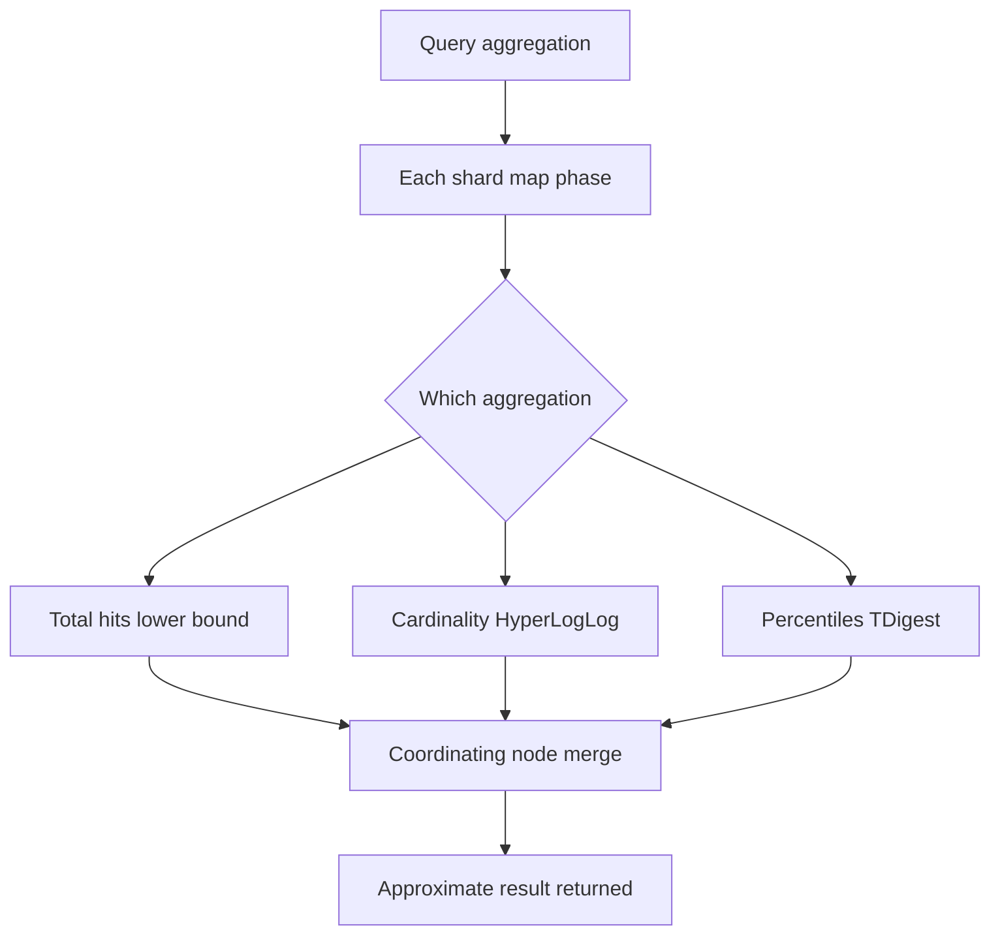

# Counts, Cardinality and Percentiles: How Aggregations Cheat Honestly

## English

An aggregation that says "2,431,908 documents match" does not actually count every document. Elasticsearch returns `hits.total` as a lower bound by default (the `track_total_hits` parameter controls this), stopping the count early once it is confident the number is large enough, because counting all matches across every shard costs real time for a number nobody reads precisely. Setting `track_total_hits: true` forces an exact count; leaving it at the default of 10,000 gives you a fast "at least this many" answer. Knowing which you asked for matters when a dashboard shows a suspiciously round number.

The more interesting cheats live in metric aggregations. `cardinality` (distinct count) uses HyperLogLog++, a probabilistic sketch that estimates uniqueness by hashing values into buckets and observing the pattern of leading zeros. It is dramatically cheaper than keeping a set of every distinct value, but it is approximate: small cardinalities are usually exact because the algorithm keeps a precise list until it grows, and large ones carry a small relative error. For "how many unique visitors today" that is fine; for "exactly how many accounts" it is not.

`percentiles` has a similar bargain. Computing a true 99th percentile requires holding every value and sorting, which is memory-hungry on millions of samples. Elasticsearch instead uses TDigest, a sketch that compresses the distribution into a bounded set of centroids, giving accurate percentiles near the tails (where people care) and slightly rougher ones in the middle. This is why a p99 latency chart can wobble between refreshes even when the underlying traffic is stable.

There is also the question of where the work happens. Aggregations run on each shard first (the map phase) and are then merged on the coordinating node (the reduce phase). Some aggregations are perfectly mergeable — sums, min, max, counts — because combining partial results gives the same answer. Others, like `cardinality` and `percentiles`, are only approximately mergeable, and the error compounds slightly with more shards. A single-shard index gives tighter estimates than a fifty-shard one.

Finally, `terms` aggregations have their own trap: by default they fetch more than the top ten buckets from each shard, then merge. The `size` parameter sets the final bucket count (ten by default), while `shard_size` controls how many candidates each shard contributes — it defaults to `size * 1.5 + 10`, so 25 buckets per shard at the default size. That over-fetch exists for good reason: a term that is common overall might sit just below the threshold on every individual shard, so each shard sends more candidates than strictly needed to give the coordinator a chance to find it. The cost is memory and network on the coordinating node, and even then a term's `doc_count` can be approximate. Raising `shard_size` widens the net at the cost of memory. The lesson is that aggregations are engineered answers, not raw arithmetic — powerful, fast, and worth understanding before you trust the last digit.

## 中文

一個聚合結果顯示「有 2,431,908 份檔案符合」，其實它並沒有真的逐份點算。Elasticsearch 預設回傳的 `hits.total` 只是一個下界（由 `track_total_hits` 引數控制），當它確信數目夠大就會提早停止計數，因為跨所有分片精確點算全部符合的檔案既耗時，而得出的精確數字也沒多少人會細看。把 `track_total_hits` 設為 `true` 會強制精確點算；保持預設的 10,000 則會給你一個快速的「至少這麼多」答案。當儀錶板顯示一個可疑地齊整的數字時，搞清楚你當初要求的是哪一種，就非常重要。

更有趣的「取巧」出現在度量聚合（metric aggregation）之中。`cardinality`（去重計數）採用 HyperLogLog++，這是一種機率式草圖（probabilistic sketch），把數值雜湊進桶子，再觀察前導零的分佈模式來估算唯一值數量。它比儲存每一個去重值便宜得多，但結果是近似的：基數小的時候通常精確，因為演演算法在規模還小時會保留一份精確清單；基數大時則帶有少許相對誤差。用來回答「今日有多少獨立訪客」沒問題；用來回答「準確有多少個帳戶」就不行。

`percentiles` 也有類似的取捨。要計算真正的第 99 百分位，必須儲存每一個數值再排序，面對幾百萬個樣本時非常耗記憶體。Elasticsearch 改用 TDigest，一種把分佈壓縮成有限數量質心（centroid）的草圖，在分佈尾部（也就是大家最關心的地方）給出準確的百分位，中段則稍為粗糙。這就解釋了為何即使底層流量穩定，p99 延遲圖表在每次重新整理之間仍會有些微跳動。

還有一個問題是運算在哪裡發生。聚合會先在每個分片上執行（map 階段），然後在協調節點上合併（reduce 階段）。有些聚合完全可合併——sum、min、max、count——因為把部分結果組合起來會得到相同答案。其他如 `cardinality` 和 `percentiles` 則只是近似可合併，而且分片越多，誤差會略為累積。單分片索引的估算會比五十個分片的索引更緊密。

最後，`terms` 聚合有它自己的陷阱：預設它會從每個分片抓取多過前十個候選桶，再合併。`size` 參數決定最終回傳的桶數量（預設十個），而 `shard_size` 控制每個分片貢獻多少候選——它預設是 `size * 1.5 + 10`，所以在預設 size 之下等於每分片 25 個桶。這個超額抓取是有意為之：某個詞可能整體上很常見，卻在每個個別分片都剛好卡在門檻之下，所以每個分片多送一些候選，讓協調節點有機會找得到它。代價是協調節點的記憶體與網絡流量，而且即使這樣，某個詞的 `doc_count` 仍可能只是近似值。調高 `shard_size` 可以擴大網羅範圍，代價是記憶體。教訓是：聚合是經過工程設計的答案，不是原始算術——強大、快速，但在你信任最後一位數字之前，值得先理解它。

## Key Takeaway

Aggregations trade exactness for speed through sketches and per-shard merging, so know which numbers are exact, which are approximate, and which can silently go missing.

## Related Concepts
- HyperLogLog and TDigest sketches
- Map-reduce aggregation phases

## Diagram

