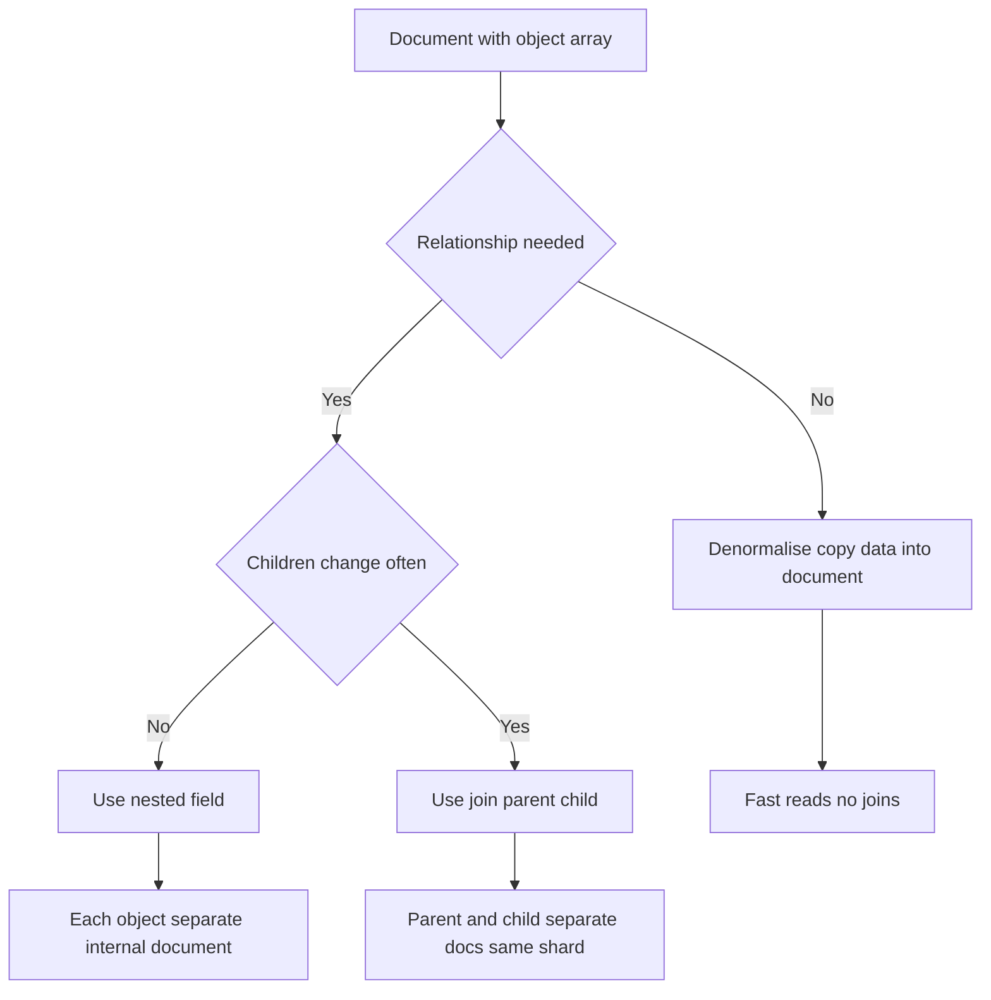

# Parent-Child, Nested, and Denormalisation: Modelling Relationships in a Document Store

## English

Elasticsearch stores documents, not rows, and it has no joins. A document is a self-contained JSON blob that lives entirely on one shard, so any relationship between entities must be expressed either by copying data into the same document (denormalisation) or by using one of two specialised structures. Choosing wrongly is one of the most common sources of slow queries and wrong results.

The first option is `nested`. If a document contains an array of objects — say an order with several line items, each having a `product` and a `price` — the default behaviour flattens them into parallel arrays: `line.product: [A, B]` and `line.price: [10, 20]`. A query asking for product A priced at 20 would then match, even though no single line item has that combination. This is the famous "cross-object match" problem. Declaring the field as `nested` makes each object an invisible separate document internally, so queries stay within one object. The cost is that each nested document is a separate Lucene document, so a parent with 100 nested children is really 101 documents, and joins between them are slower.

`join` fields (parent-child) take a different approach: parent and child are separate documents in the same index, routed to the same shard by the parent's ID, and linked by a `join` field. This is good when children change frequently and you do not want to reindex the whole parent — you can update a child without touching the parent. The trade-off is that parent-child queries are slower than nested ones because they must consult a separate in-memory structure, and a child cannot exist without its parent.

The third option is to avoid relationships entirely. Because Elasticsearch is optimised for read-heavy search, the usual advice is to denormalise: when you index an order, embed the customer's name and address directly in the order document. Yes, that duplicates data and means an address change requires reindexing all that customer's orders. But every query becomes a simple single-document lookup with no joins, which is exactly what the engine is built for.

The decision rule is roughly: if the child objects are small, bounded, and always fetched with the parent, use `nested`. If children are large, numerous, or updated independently, use `join` fields. If you can afford to duplicate and reindex, denormalise — it is usually the fastest. Whichever you pick, remember that the mapping must be declared before indexing, because changing a field to `nested` later requires a full reindex.

## 中文

Elasticsearch 儲存的是文件，不是資料列，而且它沒有 join。一份文件是一個自成一體的 JSON 物件，完全存放在單一分片上，所以實體之間的關係只能用兩種方法表達：把資料複製進同一份文件（反正規化），或者使用兩種專門結構之一。選錯了，就是慢查詢和錯誤結果最常見的來源。

第一種選擇是 `nested`。如果一份文件內含物件陣列——例如一張訂單有多個訂單項目，每個項目有 `product` 和 `price`——預設行為會把它們攤平成平行陣列：`line.product: [A, B]` 和 `line.price: [10, 20]`。這時查詢「產品 A 且價格 20」就會命中，即使根本沒有任何一個訂單項目同時具備這個組合。這就是著名的「跨物件匹配」（cross-object match）問題。把欄位宣告為 `nested`，內部就會把每個物件當成一份隱形的獨立文件，查詢便會留在單一物件之內。代價是每個 nested 文件都是一份獨立的 Lucene 文件，所以一個有 100 個 nested 子項的父文件，實際上是 101 份文件，它們之間的關聯查詢也較慢。

`join` 欄位（父子關係）採用另一種做法：父與子是同一索引內的獨立文件，靠父文件的 ID 路由到同一分片，並以 `join` 欄位連結。當子項經常變動、而你不想重新索引整個父項時，這方法很好——你可以更新子項而不碰父項。取捨是父子查詢比 nested 查詢慢，因為它必須查閱一個獨立的記憶體結構，而且子項不能沒有父項而存在。

第三種選擇是完全避開關係。由於 Elasticsearch 是為讀多寫少的搜尋而優化，一般建議是反正規化：索引訂單時，把客戶的姓名和地址直接嵌入訂單文件。沒錯，這會重複資料，也意味著地址一改就要重新索引該客戶的所有訂單。但每個查詢都變成簡單的單文件查找，完全沒有 join，而這正是這個引擎擅長的事。

決策規則大致是：如果子物件細小、數量有限、而且總是與父項一併取出，用 `nested`。如果子項龐大、數量多、或獨立更新，用 `join` 欄位。如果你負擔得起重複資料和重新索引，就反正規化——它通常最快。無論選哪一種，記住 mapping 必須在索引之前宣告，因為日後要把欄位改成 `nested` 需要整個重新索引。

## Key Takeaway

Elasticsearch has no joins, so relationships are modelled by denormalising, nested objects, or join fields — and the mapping decision is locked in at index time.

## Related Concepts
- Cross-object matching problem
- Denormalisation trade-offs

## Diagram

