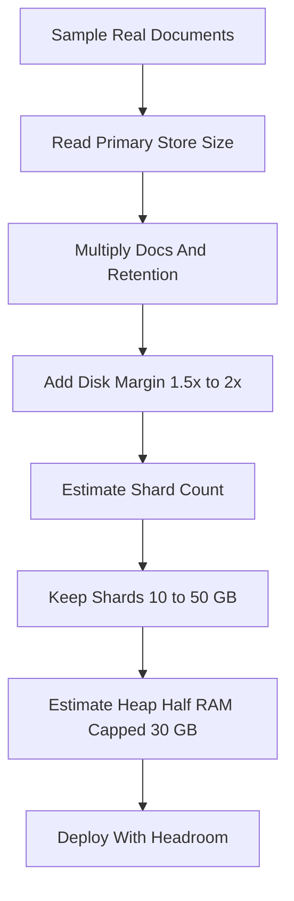

# Cluster Sizing by Arithmetic: Estimating Shards, Heap and Disk Before You Deploy

## English

Most Elasticsearch pain is self-inflicted at design time: too many shards, too little heap, or a disk that fills up because nobody multiplied. A little arithmetic before deployment prevents most of it. The three numbers to estimate are data volume, shard count, and heap, and they are linked.

Start with data volume. Take a sample of real documents, index them into a test index, and read `_cat/indices?v` to see the actual `pri.store.size` — the on-disk size of primary shards, excluding replicas and excluding the extra headroom Lucene needs for merges. Multiply by your expected document count and by your retention period. Then add margin: Lucene's segment merges temporarily need extra disk (roughly the size of the segments being merged), and Elasticsearch refuses to allocate shards to a disk above the low watermark (default 85% used). A common rule of thumb is to plan for about 1.5 to 2 times the raw size.

Next, shard count. Each shard is a Lucene index with its own fixed overhead — file handles, memory structures, and a slice of cluster state that every node must track. Tens of thousands of shards on a cluster is a known failure mode: master node updates become slow and the cluster can wobble. A widely used guideline is to keep shard size in the range of tens of gigabytes (roughly 10–50 GB is often cited), and to keep the number of shards per GB of heap bounded. For time-series data, prefer fewer, larger shards rolled over by ILM rather than thousands of tiny daily indices.

Heap is the third number. The JVM heap holds the segment metadata, the query and request caches, field data for aggregations on `text` fields, and the translog buffers. A common starting point is to give the JVM about half of the machine's RAM, capped around 30 GB (because compressed ordinary object pointers stop working above that and the JVM cannot address more efficiently). The other half is left for the operating system's filesystem cache, which Lucene relies on heavily to read segments from disk. Giving the JVM 90% of RAM is a classic mistake: it starves the page cache and queries slow down.

Finally, remember replicas multiply disk. One primary plus one replica means every byte is stored twice. Budget for that, and for the fact that during a node failure the remaining copies must hold the whole dataset. Sizing is not glamorous, but a spreadsheet with three columns — bytes, shards, heap — will save you more incidents than any query tuning.

## 中文

大部分 Elasticsearch 的痛苦，都是在設計階段自己造成的：分片太多、heap 太少，或者磁碟因為沒有人做過乘法而爆滿。部署前做一點算術，就能避免大部分問題。要估算的三個數字是資料量、分片數和 heap，而它們互相關聯。

先由資料量開始。拿一批真實文件樣本，索引進測試索引，然後讀 `_cat/indices?v` 看實際的 `pri.store.size`——主分片的磁碟大小，不包括副本，也不包括 Lucene 合併時所需的額外空間。乘以預期的文件數和保留期。然後加上餘裕：Lucene 的分段合併會臨時需要額外磁碟（大約等於被合併分段的大小），而 Elasticsearch 不會把分片分配到使用率超過低水位線（預設 85%）的磁碟。常見的經驗法則是按原始大小的 1.5 至 2 倍來規劃。

接著是分片數。每個分片都是一個 Lucene 索引，有自己固定的開銷——檔案句柄、記憶體結構，以及每個節點都要追蹤的一份叢集狀態。叢集上有幾萬個分片是眾所周知的失敗模式：主節點更新變慢，叢集會搖擺不定。廣泛使用的指引是把分片大小維持在數十 GB 的範圍（常被引用的約 10–50 GB），並限制每 GB heap 對應的分片數。對於時序資料，寧願用較少、較大的分片配合 ILM 滾動，也不要幾千個細小的每日索引。

Heap 是第三個數字。JVM heap 存放分段元資料、查詢與請求快取、`text` 欄位聚合用的 field data，以及 translog 緩衝區。常見的起點是給 JVM 大約機器 RAM 的一半，上限約 30 GB（因為超過之後壓縮的普通物件指標就失效，JVM 無法更有效率地定址）。另一半留給作業系統的檔案系統快取，Lucene 非常依賴它從磁碟讀取分段。給 JVM 90% 的 RAM 是經典錯誤：它會餓死頁快取，查詢隨之變慢。

最後，記住副本會令磁碟倍增。一個主分片加一個副本，代表每個位元組都存兩次。要為此預留預算，也要為節點故障時剩餘的副本必須承載整個資料集而預留。容量規劃並不光鮮，但一張有三欄的試算表——位元組、分片、heap——比起任何查詢調優，能替你省下更多事故。

## Key Takeaway

Estimate bytes, shards and heap with simple arithmetic before deploying — most cluster failures are sizing mistakes made long before the first slow query.

## Related Concepts
- Shard sizing guidelines
- JVM heap and filesystem cache

## Diagram

