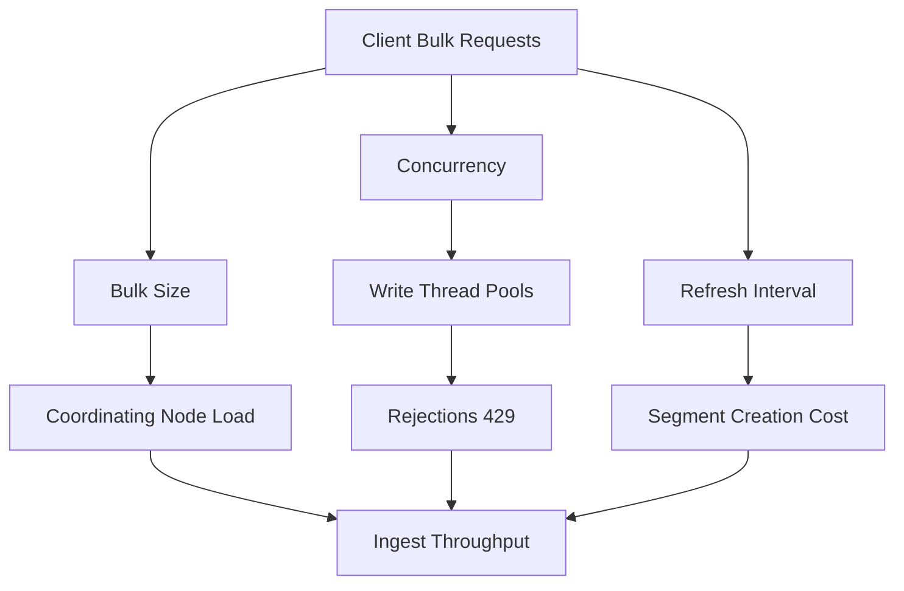

# Indexing Throughput: Why Bulk Size, Threads, and Refresh Interval Fight Each Other

## English

When people first push data into Elasticsearch, they usually blame the cluster for being slow. In practice, most ingest bottlenecks come from the client side: how many documents go into a single bulk request, how many concurrent bulk requests you fire, and how often the cluster is asked to make new data visible. A bulk request is a single HTTP round trip that carries many index operations. Too small (say a few hundred small docs) and you pay network and coordination overhead per document. Too large (tens of megabytes) and you risk timeouts, huge memory spikes on the coordinating node that assembles the request, and rejected bulk items when queues fill up. A practical starting point is to benchmark a few sizes — often somewhere in the low single-digit megabytes per request — and watch the response for per-item errors rather than assuming success.

Concurrency matters just as much. Each bulk request is handled by a thread pool on the nodes that own the target shards. If you send far more concurrent requests than the write thread pools can absorb, the cluster pushes back with rejections (HTTP 429) and `es_rejected_execution_exception`. The healthy pattern is a bounded client-side concurrency with backoff and retry, not an unbounded flood. This is the same backpressure idea as a queue at a checkout: adding more shoppers does not make the cashier faster, it just makes the line longer.

Refresh is the third lever. By default an index refreshes roughly every second, which is what makes newly indexed documents searchable quickly, but each refresh opens a new Lucene segment and that has a cost. During a large one-off backfill, it is common to temporarily set `index.refresh_interval` to `-1` (disable scheduled refresh) and optionally raise `index.translog.durability` setting only if you accept the trade-off, then restore defaults afterwards. For ongoing writes you rarely want to disable refresh, because searchability is the point of the system.

Finally, remember that merges run in the background to consolidate segments. Heavy indexing produces many segments and heavy merge activity, which competes for disk I/O with search. Watching `_nodes/stats` for indexing, refresh, and merge times tells you whether you are actually limited by CPU, disk, or by the client. Tuning without measurement is guesswork; the numbers tell you which of the three levers to pull.

## 中文

很多人第一次把資料灌進 Elasticsearch 時，通常會怪叢集太慢。實際上，大部分寫入瓶頸都來自客戶端：一個 bulk 請求要塞多少文件、同時送出多少個 bulk 請求，以及叢集多常被要求讓新資料變得可搜尋。bulk 請求是一個 HTTP 往返，裡面夾帶許多索引操作。太小（例如幾百份小文件）就等於每份文件都要付網路與協調開銷；太大（幾十 MB）就可能逾時、讓負責組裝請求的協調節點記憶體暴衝，佇列滿了還會出現被拒絕的 bulk 項目。實務上可先試幾個大小——通常落在每個請求低個位數 MB 附近——並且要檢查回應中逐項的錯誤，而不是假設全部成功。

併發量同樣關鍵。每個 bulk 請求會由擁有目標分片的節點上的執行緒池處理。如果你送出的併發請求遠超過寫入執行緒池能吸收的量，叢集就會用拒絕（HTTP 429）和 `es_rejected_execution_exception` 反推回來。健康的做法是客戶端設定有上限的併發，加上退避與重試，而不是無限制地灌。這跟超市結帳排隊是同一個道理：多派人排隊不會讓收銀員變快，只會讓隊伍更長。

第三個槓桿是 refresh。索引預設大約每秒 refresh 一次，這正是新文件能快速被搜尋到的原因，但每次 refresh 都會開一個新的 Lucene segment，是有成本的。做大規模一次性回填時，常見做法是暫時把 `index.refresh_interval` 設成 `-1`（關閉排程 refresh），若你能接受取捨，也可視情況調整 `index.translog.durability` 相關設定，做完再還原預設值。至於持續寫入的情境，你通常不會想關掉 refresh，因為可搜尋性正是這套系統存在的目的。

最後要記得，背景會跑 merge 來合併 segment。大量寫入會產生很多 segment 和密集的 merge 活動，跟搜尋搶磁碟 I/O。看 `_nodes/stats` 裡的 indexing、refresh、merge 時間，就能判斷你究竟卡在 CPU、磁碟，還是客戶端。沒有量測的調參只是猜測；數字會告訴你該拉哪一個槓桿。

## Key Takeaway

Ingest speed is governed by three interacting levers — bulk request size, bounded client concurrency with backoff, and refresh interval — and you should measure before tuning any of them.

## Related Concepts
- Bulk API
- Refresh interval

## Diagram

