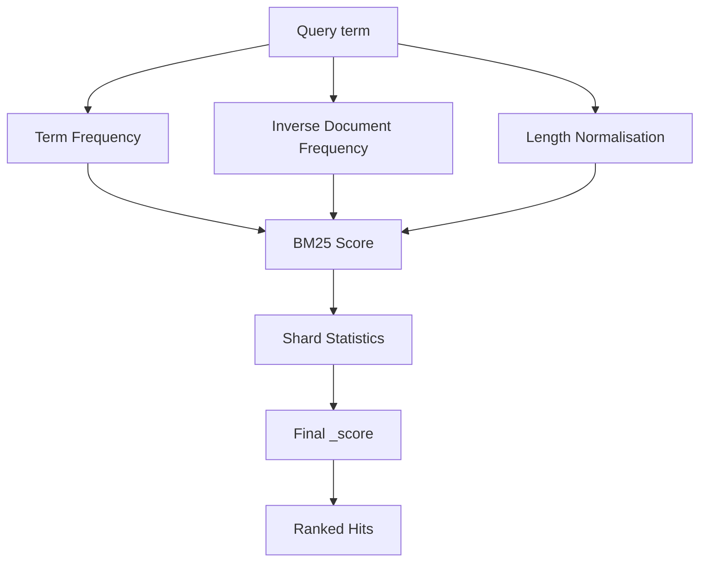

# How Elasticsearch Scores Relevance: TF-IDF, BM25, and the `_score` You See

## English

Every hit in a search response carries a `_score`, and most users ignore it until results look wrong. That number comes from a similarity model, and since Elasticsearch 5.x the default for `text` fields is BM25 (Best Matching 25), which replaced the older TF-IDF-based model. Understanding roughly what it computes helps you predict why one document outranks another, and why boosting or field choice changes the order.

BM25 combines three intuitions. First, term frequency (TF): a document that mentions the query term more often is more relevant — but with diminishing returns, so the tenth occurrence adds much less than the second. That saturation is what stops keyword-stuffed documents from dominating. Second, inverse document frequency (IDF): rare terms are more informative than common ones, so matching 「quasar」 counts more than matching 「the」. Third, length normalisation: a short document that contains the term is generally more focused than a long one that happens to contain it once, so longer fields are penalised. BM25 exposes two tunable parameters, `k1` (how quickly term frequency saturates) and `b` (how strongly length normalisation applies), which you can adjust per field in the mapping if your data has unusual length distributions.

The score is computed per shard, using that shard's statistics for IDF. This is a subtle but important point: because each shard has its own view of how common a term is, scores from different shards are not strictly comparable. In practice this rarely matters for ranking within a shard, but it explains occasional oddities when a term is rare in one shard and common in another. Using a single shard, or accepting the approximation, is the usual trade-off.

You can influence scoring without rewriting queries by combining `bool` clauses with `boost`, using `function_score` to multiply by a numeric field (recency, popularity), or switching to `constant_score` when you only care about filtering and want every match to score equally. Multi-field queries like `multi_match` let you weight fields differently, so a title match can outweigh a body match. All of these are just ways of nudging the same underlying arithmetic.

A practical habit: when rankings surprise you, ask `explain` on a specific document. The `_explain` API returns a breakdown of how each clause contributed to the final score, which turns relevance tuning from superstition into something you can actually inspect.

## 中文

搜尋回應裡的每一筆命中都帶著一個 `_score`，大多數使用者會直接忽略它，直到結果看起來不對勁。這個數字來自相似度模型；自 Elasticsearch 5.x 起，`text` 欄位的預設模型是 BM25（Best Matching 25），取代了較舊的 TF-IDF 系列模型。大致理解它在算什麼，能幫你預測為什麼某份文件排在另一份前面，以及為什麼 boost 或欄位選擇會改變排序。

BM25 結合了三個直覺。第一是詞頻（TF）：一份文件提到查詢詞越多次就越相關——但邊際效益遞減，所以第十次出現的貢獻遠小於第二次。這種飽和機制正是關鍵字堆砌的文件無法稱霸的原因。第二是逆文件頻率（IDF）：罕見詞比常見詞更有資訊量，所以命中「quasar」比命中「the」更有份量。第三是長度正規化：一份短文件含有該詞，通常比一份長文件剛好提到一次更聚焦，所以較長的欄位會被懲罰。BM25 有兩個可調參數：`k1`（詞頻飽和的速度）與 `b`（長度正規化的強度），若你的資料長度分布特殊，可以在 mapping 中逐欄位調整。

分數是在每個分片上各自計算的，用的是該分片自己的 IDF 統計。這一點微妙但重要：因為每個分片對「某詞有多常見」的看法不同，不同分片算出的分數並非嚴格可比。實務上這對分片內的排序很少造成問題，但它解釋了為何某詞在一個分片罕見、在另一個分片常見時，偶爾會出現怪異結果。用單一分片，或接受這個近似，是常見的取捨。

你不必重寫查詢也能影響評分：在 `bool` 子句上加 `boost`、用 `function_score` 乘上數值欄位（例如新近度、熱門度），或在你只在乎過濾、想讓每筆命中同分時改用 `constant_score`。像 `multi_match` 這類多欄位查詢可以給不同欄位不同權重，讓標題命中壓過內文命中。這些都只是在同一個底層算術上輕輕推一把。

一個實用習慣：當排序讓你意外時，對特定文件執行 `explain`。`_explain` API 會回傳每個子句如何貢獻最終分數的拆解，讓相關性調校從憑感覺變成可以實際檢視的事。

## Key Takeaway

BM25 scores combine term frequency saturation, inverse document frequency, and length normalisation — and `_explain` lets you see exactly how a document earned its score.

## Related Concepts
- BM25
- Function score query

## Diagram

