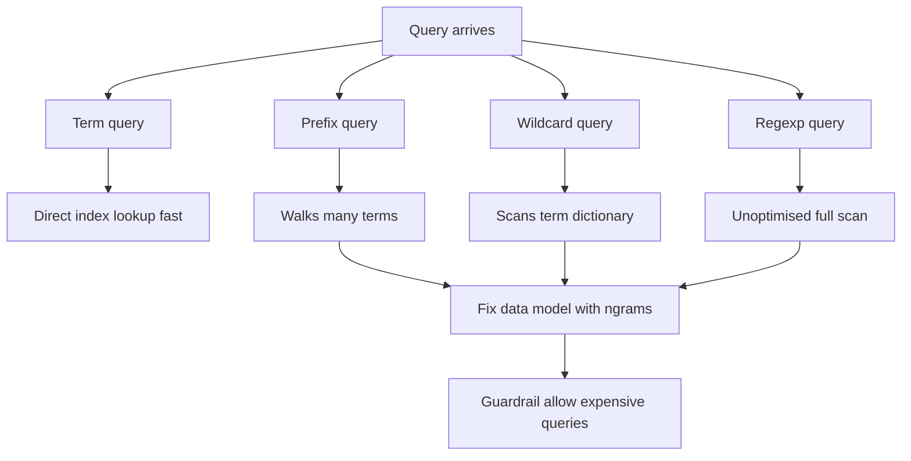

# Wildcards, Regex, and Prefix Queries: The Queries That Quietly Scan Everything

## English

Most queries are fast because the inverted index maps terms to documents directly. But some query types bypass that shortcut and have to examine many terms or many documents. Knowing which ones do this is the difference between a snappy search box and a cluster that melts under a single user's typing.

A `term` query looks up an exact term in the index — very fast. A `prefix` query finds all terms starting with a given string; the index is sorted, so this can be efficient, but a short prefix like 「a」 matches a huge number of terms and forces the engine to walk them all. A `wildcard` query with a leading wildcard (e.g. `*phone`) is worse, because the sorted order no longer helps and the engine must scan the term dictionary. A `regexp` query can be even more expensive, since arbitrary patterns cannot be optimised at all. These are fine on small indices and dangerous on large ones.

The usual fix is to change the data model rather than the query. If you need substring matching, consider an `ngram` or `edge_ngram` tokenizer at index time, which precomputes the fragments so queries become ordinary term lookups. If you need case-insensitive exact matching, use a `keyword` field with a `normalizer` rather than a wildcard. If you need to search inside identifiers (SKUs, order numbers), an `edge_ngram`-based sub-field is often the right tool. The trade-off is index size — ngrams multiply the number of terms — so you should scope them to the fields that need it.

There is also a `search.allow_expensive_queries` cluster setting that, when disabled, rejects queries like leading wildcards and regexps outright. This is a useful guardrail on shared clusters: it forces query authors to justify expensive patterns instead of accidentally shipping them. Many teams also add a query-time check in their application layer to reject user input that starts with a wildcard.

Finally, watch the slow log. Setting a threshold on `index.search.slowlog.threshold.query.warn` will surface queries that take unusually long, and wildcard or regexp queries are frequent offenders. Combined with `_nodes/stats` search metrics, the slow log tells you whether a slow experience is caused by one pathological query or by overall load — a distinction that changes what you fix.

## 中文

大多數查詢之所以快，是因為倒排索引直接把詞對應到文件。但有些查詢類型會繞過這條捷徑，必須檢視大量詞項或大量文件。搞懂哪些查詢會這樣做，就是搜尋框順暢與叢集被單一使用者打字拖垮之間的差別。

`term` 查詢會在索引中查一個確切的詞——非常快。`prefix` 查詢會找出所有以某字串開頭的詞；索引是有序的，所以這可以很有效率，但像「a」這種短前綴會命中海量詞項，逼引擎逐一走過。帶前導萬用字元的 `wildcard` 查詢（例如 `*phone`）更糟，因為排序順序幫不上忙，引擎必須掃描整個詞典。`regexp` 查詢可能更貴，因為任意樣式根本無法最佳化。這些在小索引上沒問題，在大索引上則很危險。

常見解法是改資料模型，而不是改查詢。若你需要子字串比對，考慮在索引時使用 `ngram` 或 `edge_ngram` 分詞器，把片段預先算好，查詢就變成普通的詞項查找。若你需要不分大小寫的精確比對，用帶 `normalizer` 的 `keyword` 欄位，而不是萬用字元。若你要在識別碼（SKU、訂單號）內部搜尋，基於 `edge_ngram` 的子欄位通常才是對的工具。取捨是索引大小——ngram 會讓詞項數量倍增——所以應該只套用在真正需要的欄位上。

另外有個叢集設定 `search.allow_expensive_queries`，關閉後會直接拒絕前導萬用字元與 regexp 這類查詢。這在共用叢集上是很好的護欄：它逼查詢作者為昂貴的樣式提出理由，而不是不小心就上線。很多團隊也會在應用層加檢查，拒絕以萬用字元開頭的使用者輸入。

最後，要盯慢速日誌。在 `index.search.slowlog.threshold.query.warn` 設一個門檻，就能浮出耗時異常的查詢，而萬用字元或 regexp 查詢正是常客。搭配 `_nodes/stats` 的搜尋指標，慢速日誌能告訴你慢的體驗是來自某個病態查詢，還是整體負載——這個區別會改變你該修什麼。

## Key Takeaway

Prefix, wildcard, and regexp queries can bypass the inverted index's direct lookup; precompute fragments with ngrams or guardrails like `search.allow_expensive_queries` instead of scanning at query time.

## Related Concepts
- Edge n-gram tokenizer
- Slow log

## Diagram

