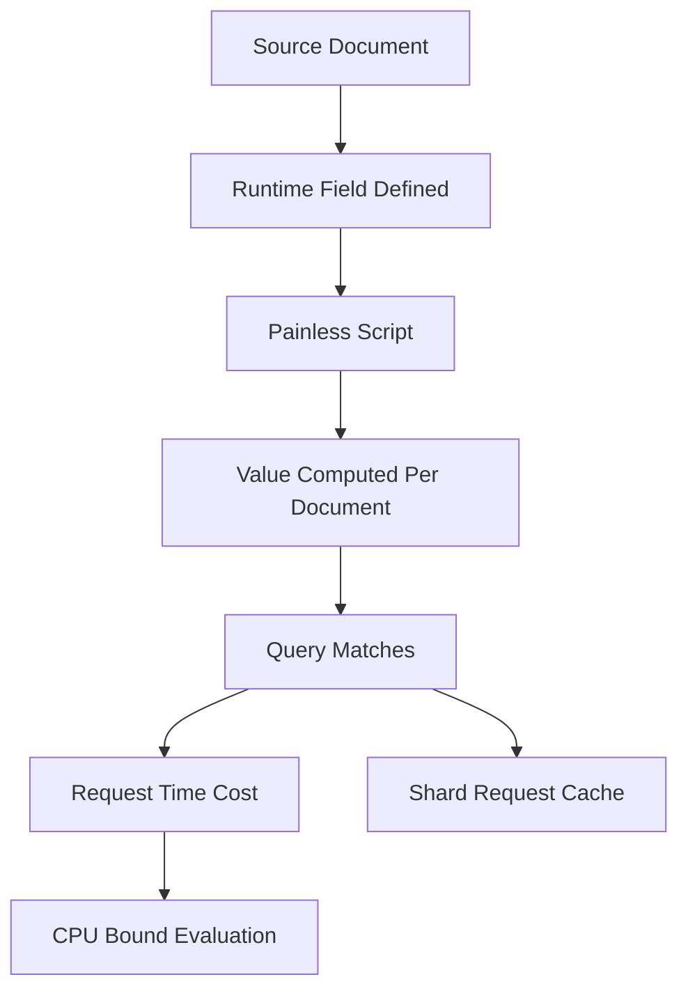

# Painless Runtime Fields vs Stored Fields: Debugging Schema Regrets Without Reindexing

## English

One of the most common operational stories in Elasticsearch is discovering, months after launch, that a field was mapped in a way that no longer fits how you query it. Maybe a `keyword` should have been a `text` with an analyzer, or a numeric field should have been a `scaled_float`, or a date string was ingested as text. The classic answer is to create a new index with a corrected mapping and reindex everything, which can take hours and requires double the disk space. Runtime fields, introduced in Elasticsearch 7.11, offer a middle path: you define a field in the search request itself (or in the index mapping with `"runtime"`) whose value is computed on the fly by a Painless script from the `_source` document, so you can experiment with a new interpretation of existing data without touching a single byte on disk.

The trade-off is stark and worth internalising. A stored field is indexed at write time: the inverted index or doc values are built once, and every query afterwards is cheap. A runtime field is evaluated per document, per query, at request time. For a query that touches a million documents, that means a million script executions, and the cost is CPU-bound on the coordinating and shard nodes rather than amortised across the cluster's lifetime. Runtime fields are therefore excellent for exploration, prototyping, and low-volume ad-hoc analysis, but they are not a substitute for a proper reindex on a hot query path. Elasticsearch does cache some runtime field results in the shard request cache, but you should treat that as a bonus, not a guarantee.

The most valuable use of runtime fields is often for fields you want only occasionally. Imagine a log index where you occasionally need to extract a user ID from a URL path with a regex. Rather than paying the indexing cost of a `grok`-style pattern for every document, you define a runtime field `user_id` with a Painless `emit()` call that parses `_source.url` when queried. Most queries never touch it, so most queries pay nothing. When you do need it, you accept the slower scan in exchange for a schema that stays lean. This is the same idea as a database view or a computed column, but applied lazily at query time.

A useful debugging technique is to define a runtime field, query it, and compare its results against the stored field you are unhappy with. If the runtime version returns the rows you expect, you have validated the new mapping before committing to a reindex. You can also use runtime fields to backfill a new field gradually: define the runtime field, run an update-by-query or a reindex with the new mapping in the background, and switch queries over once the new index is ready. That gives you a safe, reversible path from a bad mapping to a good one.

Finally, remember that runtime fields participate in aggregations, sorting, and `fields` retrieval, not just queries. You can group by a runtime field, sort by one, or ask for it in the response with `"fields": ["user_id"]`. That makes them genuinely useful for analytics on data whose shape you did not anticipate. The discipline is to keep scripts small, avoid regex where a simple substring will do, and monitor `search` thread pool rejections when you lean on them heavily.

## 中文

在 Elasticsearch 的運維故事中，最常見的情節之一，就是上線幾個月後才發現某個欄位的 mapping 已經不符合現在的查詢方式。也許一個 `keyword` 本該是帶 analyzer 的 `text`，也許一個數值欄位該用 `scaled_float`，也許日期字串被當成文字吸了進來。經典的解法是建一個 mapping 正確的新索引，把資料全部 reindex 過去——這可能要花好幾小時，而且需要雙倍磁碟空間。Elasticsearch 7.11 引入的 runtime fields 提供了一條中間路線：你可以在搜尋請求裡（或在索引 mapping 的 `"runtime"` 區塊）定義一個欄位，它的值由 Painless 指令碼從 `_source` 檔案即時計算出來。這樣你就可以用新的方式解讀既有資料，而完全不用改動磁碟上的任何一個 byte。

取捨非常鮮明，值得牢牢記住。stored field 是在寫入時就建立索引的：倒排索引或 doc values 只建一次，之後每次查詢都很便宜。runtime field 則是每次查詢、每份檔案、在請求當下才計算。若一個查詢要掃過一百萬份檔案，就代表一百萬次指令碼執行，成本是 CPU 綁在協調節點與分片節點上，而不是攤提在整個叢集的生命週期裡。因此 runtime fields 非常適合探索、原型製作與低量的臨時分析，但在熱查詢路徑上，它不能取代一次正正經經的 reindex。Elasticsearch 確實會把部分 runtime field 結果快取在 shard request cache，但那是紅利，不是保證。

runtime fields 最有價值的用法，往往是那些「偶爾才需要」的欄位。想像一個 log 索引，你偶爾需要用 regex 從 URL 路徑裡抽出 user ID。與其為每份檔案都付出 `grok` 式樣式的索引成本，不如定義一個 runtime field `user_id`，用 Painless 的 `emit()` 在查詢時才解析 `_source.url`。大多數查詢根本不會碰它，所以大多數查詢一毛錢都不用付。真的需要時，你接受較慢的掃描，換來一個保持精簡的 schema。這跟資料庫的 view 或 computed column 是同一個概念，只是套用在查詢時惰性計算上。

一個很實用的除錯技巧，是定義 runtime field、查詢它，再拿結果跟你原本不滿意的 stored field 對照。如果 runtime 版本回傳你預期的那些檔案，你就等於在真正投入 reindex 之前驗證了新 mapping。你也可以用 runtime fields 來逐步回填新欄位：先定義 runtime field，在背景跑 update-by-query 或用新 mapping 做 reindex，等新索引就緒再把查詢切過去。這給你一條安全、可逆的路，從壞 mapping 走到好 mapping。

最後要記得，runtime fields 不只參與查詢，也參與聚合、排序與 `fields` 取值。你可以用 runtime field 分群、排序，或在回應中用 `"fields": ["user_id"]` 取出它。這讓它在分析那些你當初沒預料到形狀的資料時，真的很好用。紀律是：指令碼寫小一點、能用簡單 substring 就別用 regex，而且當你大量倚賴它們時，要盯著 `search` thread pool 的 rejection。

## Key Takeaway

Runtime fields let you prototype and debug new field interpretations against existing _source without reindexing, but they trade write-time cost for per-query script execution and should be a stepping stone, not a permanent hot-path solution.

## Related Concepts
- Painless scripting
- Reindex and mapping migration

## Diagram

