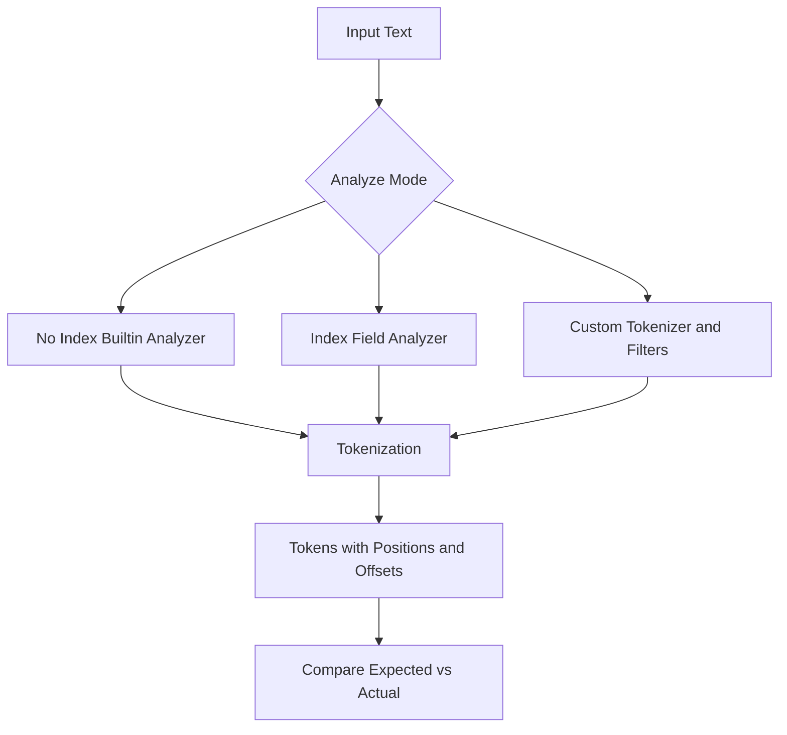

# The `_analyze` API: Seeing Your Text the Way the Index Sees It

## English

The single most useful debugging tool in Elasticsearch that beginners rarely discover is the `_analyze` API. It answers a question that is otherwise invisible: given this text and this analyzer, what tokens does Elasticsearch actually store in the inverted index, and at what positions and offsets? Almost every mysterious search failure — a query that returns nothing, a phrase match that should work but doesn't, a `keyword` field that behaves differently from a `text` field — can be diagnosed by running the same text through `_analyze` and comparing what you expected with what came out.

You can call it in three modes. With no index, `POST /_analyze` uses a built-in analyzer by name, e.g. `{"analyzer": "standard", "text": "The Quick Brown Foxes"}`. With an index, `POST /my_index/_analyze` uses the analyzer configured in that index's mapping for a given field, so you see exactly what the field stores: `{"field": "title", "text": "..."}`. And with a custom tokenizer/filter chain, you can pass `tokenizer` and `filter` arrays directly to experiment before you commit a mapping change. The response lists each token with its `position`, `start_offset`, and `end_offset`, which is the ground truth for phrase queries and highlighting.

A concrete example makes the value obvious. Suppose you index the title `"Running with the Wolves"` under the standard analyzer. `_analyze` returns tokens `running`, `with`, `the`, `wolves`, all lowercased, with `the` and `with` still present because the standard analyzer does not remove stopwords by default in modern versions. If your query is `"run with wolves"`, the term `run` will not match `running` unless you added a stemmer. If your query is a `match_phrase` for `"running wolves"`, it will fail because `with the` sits between them in the position stream. Seeing the positions makes the failure obvious in a way that staring at the query DSL never will.

The `_analyze` API also reveals surprises with `keyword` fields. A `keyword` field is not analyzed at all; `_analyze` on it returns the entire input as a single token with `position: 0`. That is why `term` queries work on `keyword` fields but `match` queries behave differently: `match` will analyze the query text, and if the field is `keyword`, the analyzed query becomes a single token that must match the whole field value exactly. If you have ever wondered why a `match` query on a `keyword` field is case-sensitive and requires an exact match, `_analyze` shows you why in one call.

Beyond debugging, `_analyze` is a design tool. Before you add a `keyword` sub-field with `normalizer` to lowercase and strip diacritics, run your sample values through the proposed normalizer and check the output. Before you add an `edge_ngram` filter for autocomplete, verify that the token explosion is what you expected — an `edge_ngram` with `min_gram: 2, max_gram: 10` on a 20-character word produces 9 tokens, and that multiplies across your whole corpus. A five-minute session with `_analyze` routinely saves a multi-hour reindex later.

## 中文

Elasticsearch 裡最有用、但初學者很少發現的除錯工具，就是 `_analyze` API。它回答一個原本看不見的問題：給定這段文字與這個 analyzer，Elasticsearch 到底往倒排索引裡存了哪些 token，位置與位移又是多少？幾乎每一個神秘的搜尋失敗——查詢回傳空結果、本該成功的片語比對卻失敗、`keyword` 欄位行為跟 `text` 欄位不一樣——都可以把同一段文字丟進 `_analyze`，拿你預期的結果跟實際輸出的結果對照來診斷。

它有三種呼叫模式。不指定索引時，`POST /_analyze` 用名稱呼叫內建 analyzer，例如 `{"analyzer": "standard", "text": "The Quick Brown Foxes"}`。指定索引時，`POST /my_index/_analyze` 會用該索引 mapping 中某個欄位設定的 analyzer，所以你看到的就是該欄位真正存的內容：`{"field": "title", "text": "..."}`。而自訂 tokenizer/filter 鏈時，你可以直接傳 `tokenizer` 與 `filter` 陣列，在真正改 mapping 之前先做實驗。回應會列出每個 token 的 `position`、`start_offset` 與 `end_offset`，這就是片語查詢與 highlighting 的事實依據。

一個具體例子就能看出價值。假設你用 standard analyzer 索引標題 `"Running with the Wolves"`。`_analyze` 回傳的 token 是 `running`、`with`、`the`、`wolves`，全部轉小寫，而且 `the` 與 `with` 都還在，因為現代版本的 standard analyzer 預設不移除停用詞。如果你的查詢是 `"run with wolves"`，除非你加了 stemmer，否則 `run` 不會對上 `running`。如果你的查詢是 `match_phrase` 找 `"running wolves"`，它會失敗，因為位置序列中間卡著 `with the`。看到位置，失敗原因就一目瞭然，這是盯著 query DSL 看再久也看不出來的。

`_analyze` 也會揭露 `keyword` 欄位的意外行為。`keyword` 欄位完全不做分析；對它跑 `_analyze`，會把整段輸入當成單一 token 回傳，`position: 0`。這就是為什麼 `term` 查詢在 `keyword` 欄位上很直覺，而 `match` 查詢行為卻不一樣：`match` 會分析查詢文字，若欄位是 `keyword`，分析後的查詢就變成單一 token，必須與整個欄位值完全相符。如果你曾經疑惑為什麼對 `keyword` 欄位用 `match` 查詢會大小寫敏感、必須完全一致，`_analyze` 一次呼叫就能告訴你為什麼。

除了除錯，`_analyze` 也是設計工具。在你為 `keyword` 子欄位加上 `normalizer` 來轉小寫、去變音符號之前，先把樣本值丟進預計的 normalizer 看輸出。在你為自動完成加上 `edge_ngram` filter 之前，先確認 token 爆炸量符合預期——一個 `min_gram: 2, max_gram: 10` 的 `edge_ngram` 套在 20 字元的字上會產生 9 個 token，而這會乘上整個語料庫。花五分鐘用 `_analyze`，經常能省下之後好幾小時的 reindex。

## Key Takeaway

The `_analyze` API shows you the exact tokens, positions, and offsets Elasticsearch stores, making it the fastest way to diagnose why a query fails and to validate analyzer changes before committing them.

## Related Concepts
- Analyzer pipeline
- Phrase and match queries

## Diagram

