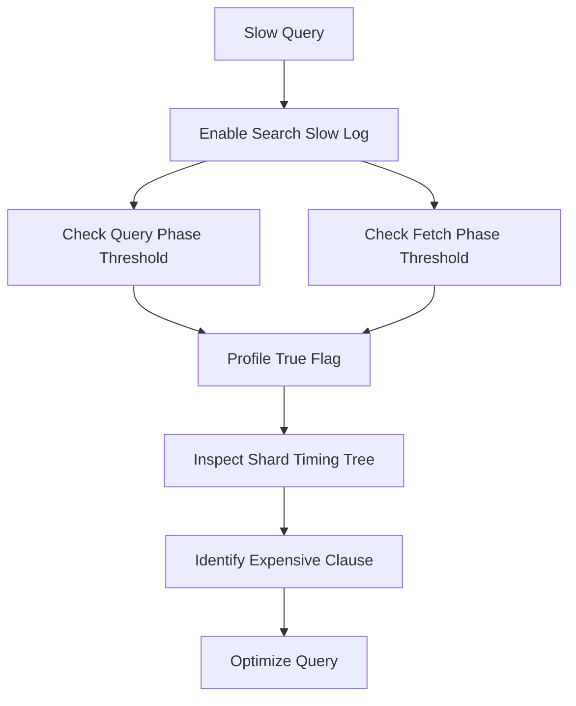

# Search Slow Logs, Profiling, and the `profile: true` Flag: Finding Where Time Goes

## English

When a query is slow, the instinct is to guess. Guessing is usually wrong, because Elasticsearch queries can be slow for reasons that are invisible in the query text: a wildcard that expands to millions of terms, a script that runs per document, a shard that is doing a merge, a field with no doc values forcing a scan. The right approach is to measure, and Elasticsearch gives you three complementary measurement tools: the search slow log, the `profile: true` flag, and the `_nodes/stats` and `_tasks` APIs.

The search slow log is configured per index and records queries that exceed a threshold, splitting them into a query phase and a fetch phase. You set thresholds like `index.search.slowlog.threshold.query.warn: 10s` and `index.search.slowlog.threshold.fetch.warn: 1s`, either in `elasticsearch.yml` for defaults or dynamically via the `_settings` API for a specific index. The log entry includes the full query body, the shard, the time taken, and — crucially — which phase was slow. A query that is fast in the query phase but slow in the fetch phase usually means you are retrieving huge `_source` documents or too many hits; a query that is slow in the query phase usually means expensive scoring, wildcards, or scripts. Knowing which phase to attack narrows the problem immediately.

For a single query you want to dissect, add `"profile": true` to the search body. Elasticsearch then returns a tree of timing information: for each shard, for each query clause, how many documents were matched, how long the `create_weight`, `build_scorer`, and `next_doc` phases took, and which Lucene scorer was used. This is the closest thing to a query plan that Elasticsearch offers, and it is indispensable for understanding why a `bool` query with many `should` clauses is slow: you can see each clause's contribution and spot the one that is scanning everything. The output is verbose, so use it once, understand the hotspot, and remove the flag.

Slow logs and profiling answer different questions. Slow logs tell you which queries are slow across the cluster over time, so you can find patterns: the same dashboard endpoint firing every 30 seconds, an aggregation that grew as data grew, a `wildcard` that used to be fine. Profiling tells you why one specific query is slow, at the level of individual Lucene scorers. Use the slow log for monitoring and triage, and `profile: true` for deep investigation of a single problematic query. Together they replace guesswork with evidence.

Two more tools round out the picture. The `_tasks` API shows currently running searches and their elapsed time, which is useful when the cluster feels slow but you do not know which queries are responsible. And `_nodes/stats` with `indices.search` and `indices.query_cache` shows aggregate search rates, cache hit ratios, and rejections, which tells you whether the problem is per-query or systemic. A common failure mode is not a slow query but too many concurrent queries hitting the `search` thread pool and getting rejected; `_nodes/stats` reveals that in a way that no single query profile can. The discipline is to always measure before optimising, and to keep the slow log on in production with sensible thresholds so that regressions surface as log entries rather than as user complaints.

## 中文

當一個查詢變慢，直覺反應是猜。但猜通常是錯的，因為 Elasticsearch 查詢變慢的原因，往往在查詢文字裡完全看不出來：一個展開成數百萬個 term 的 wildcard、一段對每份文件執行的腳本、一個正在做 merge 的分片、一個沒有 doc values 而被迫掃描的欄位。正確做法是量測，而 Elasticsearch 提供三個互補的量測工具：search slow log、`profile: true` 旗標，以及 `_nodes/stats` 與 `_tasks` API。

search slow log 是按索引設定的，會記錄超過門檻的查詢，並分成 query phase 與 fetch phase。你可以設定像 `index.search.slowlog.threshold.query.warn: 10s` 與 `index.search.slowlog.threshold.fetch.warn: 1s` 這樣的門檻，可以寫在 `elasticsearch.yml` 當預設值，也可以用 `_settings` API 針對特定索引動態設定。日誌條目包含完整查詢內容、分片、耗時，以及——關鍵地——哪個階段慢。query phase 快但 fetch phase 慢的查詢，通常代表你在取回巨大的 `_source` 文件或太多命中；query phase 慢的查詢，通常代表昂貴的評分、wildcard 或腳本。知道該攻哪個階段，問題範圍馬上縮小。

對於想解剖的單一查詢，在搜尋 body 裡加上 `"profile": true`。Elasticsearch 會回傳一棵計時樹：對每個分片、每個查詢子句，比對到多少文件、`create_weight`、`build_scorer`、`next_doc` 各花多久、用了哪個 Lucene scorer。這是 Elasticsearch 最接近 query plan 的東西，對於理解為什麼一個帶很多 `should` 子句的 `bool` 查詢很慢，它不可或缺：你可以看到每個子句的貢獻，找出那個正在掃描一切的子句。輸出很囉唆，所以用一次、搞懂熱點、然後把旗標拿掉。

slow log 與 profiling 回答的是不同問題。slow log 告訴你叢集長期下來哪些查詢慢，讓你能找出模式：同一個 dashboard 端點每 30 秒打一次、一個隨資料成長而變慢的聚合、一個以前還好的 `wildcard`。profiling 告訴你某一個特定查詢為什麼慢，細到個別 Lucene scorer 的層級。用 slow log 做監控與分流，用 `profile: true` 深入調查單一問題查詢。兩者合起來，把猜測換成證據。

還有兩個工具補齊全貌。`_tasks` API 顯示目前正在跑的搜尋與已耗時間，當叢集感覺很慢但你不知道是哪些查詢造成時很有用。而 `_nodes/stats` 搭配 `indices.search` 與 `indices.query_cache`，顯示整體搜尋速率、快取命中率與 rejection，告訴你問題是單一查詢還是系統性的。常見的失敗模式不是某個慢查詢，而是太多並行查詢打爆 `search` thread pool 被拒絕；`_nodes/stats` 能揭露這點，這是任何單一查詢 profile 都看不出來的。紀律是：優化之前先量測，並在生產環境用合理門檻常開 slow log，讓效能回歸以日誌條目浮現，而不是以使用者抱怨浮現。

## Key Takeaway

Slow logs tell you which queries are slow over time, `profile: true` tells you why one query is slow at the Lucene scorer level, and `_nodes/stats` reveals systemic problems like thread pool rejections — always measure before optimising.

## Related Concepts
- Search phases and request cache
- Cluster API toolkit

## Diagram

