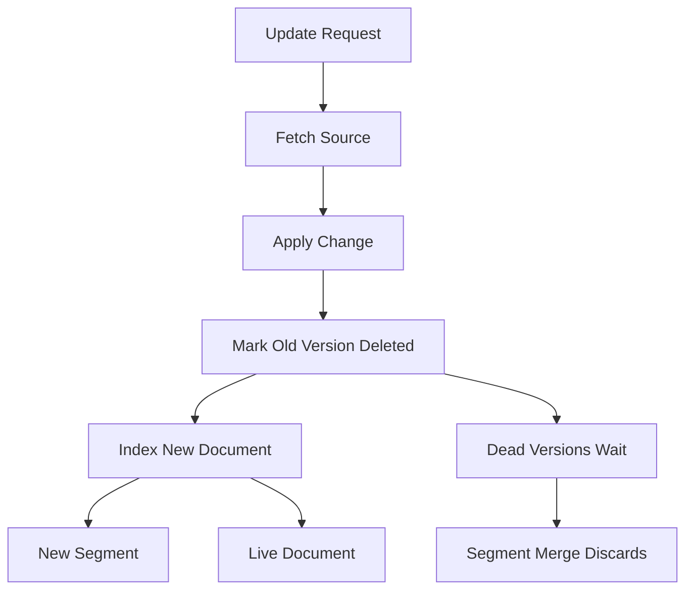

# Document Updates Are Really Deletes and Inserts: The Immutability Rule

## English

A common mental model treats an Elasticsearch document like a row in a relational table: you change a field and the row is updated in place. That is not what happens. Documents in a Lucene index are immutable — once written, a segment never gets edited. When you send an update to `_update` or `_doc`, Elasticsearch internally performs a delete-and-reindex: it marks the old document version as deleted in its segment and writes a brand-new copy of the document, with your changed field, into a fresh segment.

The deleted old version is not physically removed immediately. It lingers as a tombstone until a segment merge rewrites the segments and discards the dead documents. This is why `_update` is not cheaper than indexing a new document — it is often more expensive, because the engine does the same indexing work plus bookkeeping. The `_update` API is convenient (it lets you do partial updates and scripted changes), but internally it is a read-modify-write: fetch the `_source`, apply the change, index the result.

A concrete consequence: if you update the same document ten thousand times in a day, you do not have one document on disk — you have ten thousand versions waiting to be merged away, plus the live one. Disk usage and merge pressure both grow. The `_version` field and the `if_seq_no`/`if_primary_term` parameters exist precisely because every write is a new version, and you need a way to say 'only write if nobody else changed it first' — a form of optimistic concurrency control.

The practical lesson is to model data so that documents change rarely. If a field changes constantly (a view counter, a live status, a rapidly updated price), consider whether it belongs in the searchable document at all, or whether it should live in a separate system and be joined at query time — or be updated in batches rather than per-event. Elasticsearch is optimised for append-and-search, not for hot in-place mutation.

Finally, this is why reindexing is a normal operation rather than an emergency one. Because documents are immutable, changing a mapping (say, from `text` to `keyword`) cannot be done in place — you must build a new index and copy documents across. The immutability rule is the root cause of several behaviours that surprise newcomers: update cost, merge load, mapping changes, and the value of `_source` as the canonical copy of each document.

## 中文

很多人會把 Elasticsearch 的文件想像成關聯式資料表的一行：改一個欄位，那一行就原地更新。事實並非如此。Lucene 索引中的文件是不可變的（immutable）——一旦寫入，segment 就永遠不會被編輯。當你向 `_update` 或 `_doc` 發出更新請求時，Elasticsearch 內部其實執行「刪除再索引」：它在 segment 中把舊版本標記為已刪除，然後把帶有你修改後欄位的整份新文件寫入一個全新的 segment。

被刪除的舊版本不會立即從磁碟消失。它會以墓碑（tombstone）的形式暫留，直到 segment 合併（merge）重寫 segment、把死文件丟棄為止。這就是為何 `_update` 並不比直接索引一份新文件便宜——它往往更貴，因為引擎要做同樣的索引工作，再加上額外的記錄維護。`_update` API 很方便（可做部分更新與腳本化修改），但它本質上是「讀—改—寫」：取出 `_source`、套用變更、再索引結果。

一個具體後果：如果你一天內把同一份文件更新一萬次，磁碟上不會只有一份文件——而是有一萬個等待被合併掉的版本，加上那一份現行版本。磁碟用量與合併壓力都會上升。`_version` 欄位以及 `if_seq_no`／`if_primary_term` 參數之所以存在，正是因為每次寫入都是一個新版本，你需要一種方式說「只有在別人還沒改過時才寫入」——這是一種樂觀併發控制（optimistic concurrency control）。

實務上的教訓是：把資料模型設計成文件很少變動。如果某個欄位經常變（瀏覽計數、即時狀態、快速變動的價格），就要考慮它是否該放在可搜尋的文件裡，還是應該放在另一個系統、在查詢時再結合——或者以批次方式更新，而非逐事件更新。Elasticsearch 是為「附加與搜尋」而最佳化的，不是為頻繁的原地變更。

最後，這也解釋了為何重建索引（reindex）是常規操作而非緊急事故。因為文件不可變，要更改 mapping（例如從 `text` 改成 `keyword`）就無法原地完成——你必須建立新索引，再把文件複製過去。不可變規則正是幾個令新手意外的行為的根源：更新成本、合併負載、mapping 變更，以及 `_source` 作為每份文件權威副本的價值。

## Key Takeaway

Every Elasticsearch update is a delete plus a fresh insert, so design documents to be append-mostly and treat mapping changes as reindex events.

## Related Concepts
- Segment merging
- Optimistic concurrency control

## Diagram

