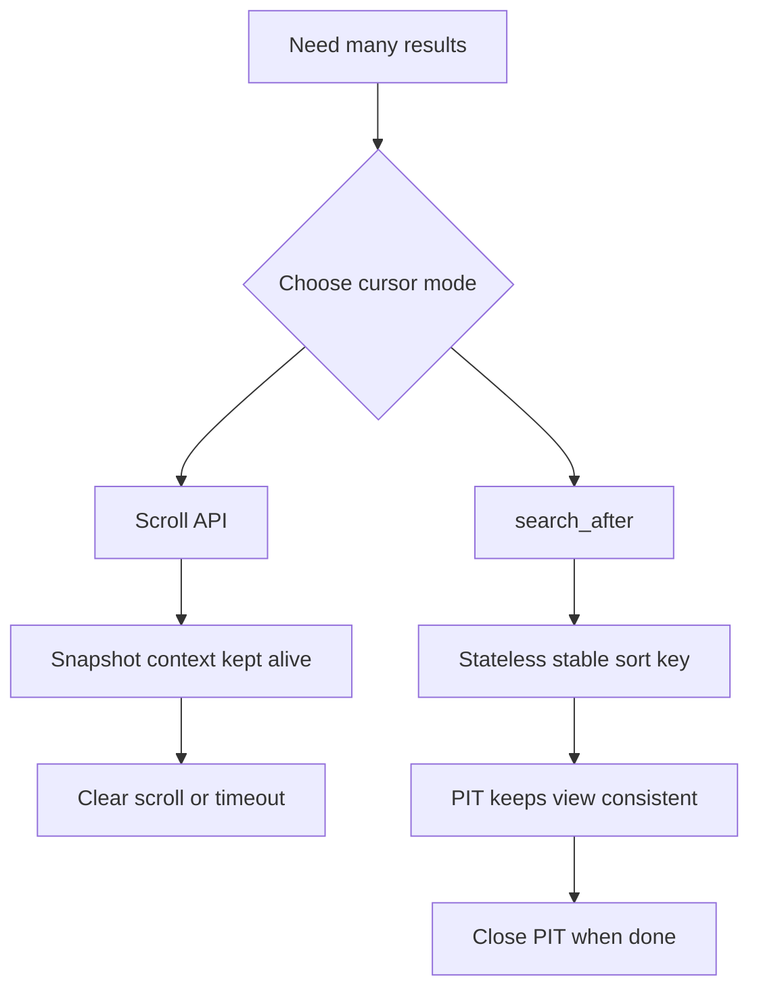

# Scroll, search_after, and PIT: Three Ways to Walk Through Results

## English

Ordinary search returns one page at a time. When you need to process many results — exporting a dataset, running a batch job, feeding a report — you need a cursor. Elasticsearch historically offered the scroll API for this, and later added point-in-time (PIT) with `search_after`. They solve similar problems with very different trade-offs, and picking the wrong one is a classic source of cluster pain.

Scroll works by taking a snapshot of the search context at the moment you start. It keeps that context alive on the coordinating node for a configurable window (for example `?scroll=1m`), and each subsequent call returns the next batch. Because the snapshot is frozen, scroll is consistent and can be efficient for a full scan. But the context consumes heap and file handles, and if a client forgets to clear it (via `clear_scroll`), those resources leak until the timeout. Scroll is also not great for user-facing pagination: it is slow to start and holds state.

`search_after` takes a different approach: no server-side cursor at all. You sort results by a stable key (often a timestamp plus a tiebreaker such as `_id`), and each page tells the client the sort values of the last hit. The next request passes those values in `search_after`, and the engine returns results strictly after that point. This is stateless, cheap on the cluster, and works well for deep pagination. The catch: it requires a deterministic sort, and without a PIT the underlying index can change between pages, causing skipped or duplicated results.

PIT (point-in-time) solves that. It creates a lightweight view of the index as of a moment, and you pass its ID with each `search_after` call. The view stays consistent while you page through, and you close it when done. Together, PIT plus `search_after` is the modern recommended pattern for deep pagination and bulk export — it replaces scroll for most use cases.

A useful rule of thumb: use `from`/`size` for shallow pagination (first few pages), `search_after` with PIT for deep pagination and exports, and scroll only for legacy tooling or specific snapshot-like scans. And always close what you open — scroll IDs and PIT IDs both expire, but relying on expiry means holding resources longer than necessary.

## 中文

一般搜尋一次只回傳一頁。當你需要處理大量結果——匯出資料集、跑批次工作、產生報表——你就需要一個遊標。Elasticsearch 歷史上提供 scroll API 來做這件事，後來又加入 point-in-time（PIT）搭配 `search_after`。兩者解決類似問題，但取捨大不相同，選錯是叢集痛苦的經典來源。

Scroll 的運作方式是在你開始搜尋的那一刻，對搜尋上下文拍一張快照。它把這個上下文保留在協調節點上，維持一段可設定的時間（例如 `?scroll=1m`），之後每次呼叫都回傳下一批。因為快照是凍結的，scroll 具一致性，對全量掃描也可能很有效率。但這個上下文會佔用堆積記憶體與檔案控制程式碼；若客戶端忘記清除（透過 `clear_scroll`），這些資源就會一直外洩到逾時為止。Scroll 也不適合面向使用者的分頁：啟動慢，而且持有狀態。

`search_after` 走另一條路：完全沒有伺服器端遊標。你以一個穩定的鍵排序結果（通常是時間戳加上 `_id` 之類的決勝鍵），每一頁都告訴客戶端最後一筆命中項的排序值。下一個請求把這些值放進 `search_after`，引擎就回傳嚴格位於該點之後的結果。這是無狀態的、對叢集很便宜，也很適合深度分頁。要注意的是：它需要一個確定性的排序，而且若沒有 PIT，底層索引可能在頁與頁之間變動，導致結果被跳過或重複。

PIT（point-in-time）正好解決這點。它建立索引在某個時刻的輕量檢視，你在每次 `search_after` 呼叫時帶上它的 ID。檢視在你翻頁期間保持一致，用完就關閉。PIT 加 `search_after` 合起來，就是深度分頁與大量匯出的現代建議做法——它在多數用途上取代了 scroll。

一個實用的經驗法則：淺分頁（前幾頁）用 `from`／`size`；深度分頁與匯出用 PIT 搭配 `search_after`；只有在舊工具或特定的快照式掃描時才用 scroll。而且永遠要關閉你開啟的東西——scroll ID 與 PIT ID 都會過期，但依賴過期意味著資源被持有得比必要更久。

## Key Takeaway

Use PIT plus search_after for deep pagination and exports, reserve scroll for legacy scans, and always close cursors explicitly.

## Related Concepts
- Point-in-time snapshots
- Deep pagination limits

## Diagram

