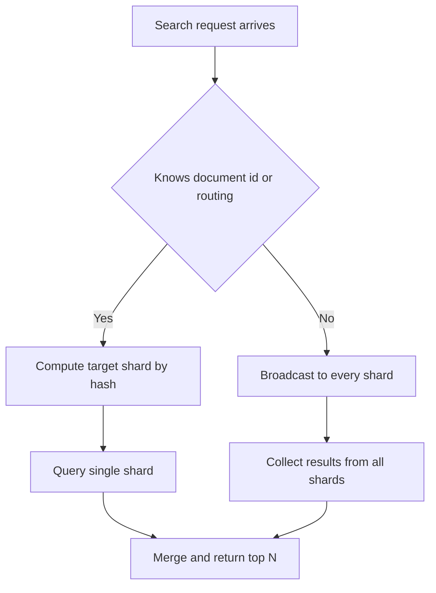

# Why Your Query Hit Every Shard: Routing and the Broadcast Fan-Out

## English

When you send a search request, a coordinating node has to decide which shards to ask. If it can narrow the set, the query is fast; if it must ask every shard, the cost grows with shard count. Understanding routing is the key to knowing which of these happens.

By default, Elasticsearch routes a document to a shard using a hash of its `_id`: `hash(_id) % number_of_primary_shards`. This is deterministic, so indexing and retrieval of a single document by ID go to exactly one shard. But a search query usually does not know the `_id` — it is matching on field values. Unless you tell it otherwise, the coordinating node must broadcast the query to every shard of the index, collect the top results from each, merge them, and return the global top N. This is the fan-out phase of the query-then-fetch pattern, and it is why a query against a 100-shard index touches 100 shards even if only one holds matching documents.

You can often avoid the fan-out by providing a custom routing key. If you index documents with `?routing=user123`, the document is placed on a shard derived from that key. If every subsequent query for that user also passes `routing=user123`, the coordinating node can compute the same shard and ask only that one. This is a powerful optimisation for multi-tenant data where queries are naturally scoped to a tenant. The trade-off: routing keys can create hot shards if one tenant is much larger than the others, and you cannot change a document's routing key without reindexing it.

Another lever is index organisation. If you split data into many small indices by time (daily or monthly), a query that targets only one index never fans out across the others. This is why time-based indices and data streams are common: the query can prune entire indices by date before it even reaches the shard level. Conversely, cramming everything into one giant index with hundreds of shards guarantees every query pays the fan-out cost.

A final subtlety: even when a query technically hits every shard, it may still be cheap if each shard can answer quickly — for example, a filter on a `keyword` field that matches nothing. Fan-out is not automatically slow; it is slow when each shard has real work to do and the results must be merged. Profiling with `profile: true` shows you the per-shard cost, and the search slow log reveals queries that fan out widely and take long. Reading those together tells you whether routing, index layout, or per-shard cost is the real problem.

## 中文

當你送出搜尋請求，協調節點必須決定要問哪些分片。如果它能縮小範圍，查詢就快；如果它必須問每一個分片，成本就隨分片數增長。理解路由（routing）就是理解這兩種情況何時發生的關鍵。

預設情況下，Elasticsearch 用文件 `_id` 的雜湊來把文件路由到某個分片：`hash(_id) % number_of_primary_shards`。這是確定性的，所以依 ID 索引與取回單一文件只會到一個分片。但搜尋查詢通常不知道 `_id`——它是在比對欄位值。除非你另有指示，協調節點必須把查詢廣播到索引的每一個分片，從每個分片收集前幾名結果，合併後回傳全域前 N 名。這就是 query-then-fetch 模式中的 fan-out（扇出）階段，也是為何對一個有 100 個分片的索引查詢會碰到 100 個分片，即使只有一個分片存有符合的文件。

你常常可以透過提供自訂路由鍵來避開扇出。如果你用 `?routing=user123` 索引文件，文件就會被放到由該鍵推導出的分片上。若之後每個針對該使用者的查詢也帶上 `routing=user123`，協調節點就能算出同一個分片，只問那一個。這對查詢天然侷限於某租戶的多租戶資料是強大的最佳化。取捨是：若某租戶遠大於其他租戶，路由鍵可能造成熱分片；而且不重建索引就無法更改文件的路由鍵。

另一個槓桿是索引組織。若你依時間把資料切成許多小索引（每日或每月），只針對其中一個索引的查詢就永遠不會扇出到其他索引。這就是為何依時間切分的索引與 data stream 很常見：查詢可以在到達分片層之前，就依日期剪除整個索引。反過來說，把所有東西塞進一個有數百個分片的巨大索引，就保證每個查詢都得付扇出成本。

最後一個微妙之處：即使查詢技術上碰到每個分片，若每個分片都能快速回答，它仍可能很便宜——例如對一個 `keyword` 欄位做完全沒有命中的過濾。扇出本身不會自動變慢；當每個分片都有實際工作要做、而且結果必須合併時才慢。用 `profile: true` 做剖析可以看到每個分片的成本，搜尋慢日誌則能揭露那些廣扇出又耗時的查詢。兩者合讀，就能告訴你真正的問題是路由、索引佈局，還是每個分片本身的成本。

## Key Takeaway

Default searches fan out to every shard, so use custom routing keys or time-based index layouts when queries can be scoped.

## Related Concepts
- Custom routing keys
- Query-then-fetch fan-out

## Diagram

