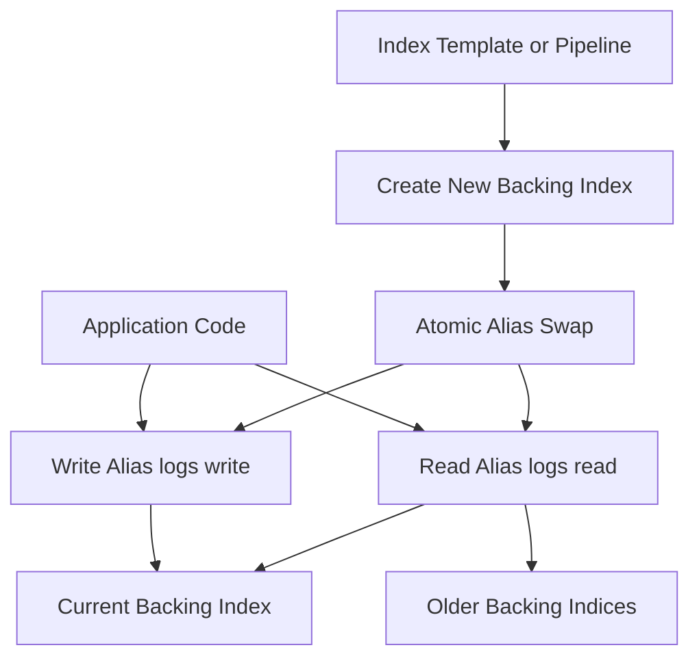

# Index Naming and Aliases: The Contract Between Code and Cluster

## English

A surprising amount of day-to-day Elasticsearch pain comes not from query complexity but from how you name things. An index name is a hard-coded string baked into application code, dashboards, saved searches, and alert rules. If your code writes to `logs-2024-05-01` directly, then tomorrow's data goes somewhere your application does not know about. This is why nearly every production setup puts an alias — a virtual name that points to one or more concrete indices — between the application and the physical index. Your code talks to `logs-write` and `logs-read`; the cluster decides which real indices those names resolve to.

Aliases come in two flavours that behave very differently. A read alias can point to many indices at once, and a search against it fans out across all of them and merges the results — this is how a single query can span months of daily indices. A write alias must point to exactly one index, because Elasticsearch needs an unambiguous destination for a document. The standard pattern is to have an ingest pipeline or index template create a new backing index on a schedule, attach it to the write alias, and simultaneously move the write alias off the old index while leaving the old index attached to the read alias. Rolling over this way means the application never learns a date-stamped name.

The real superpower of aliases is atomic switching. Reindexing into a fresh index with a better mapping is the classic example: you build `products_v2`, let it finish, then issue a single `_aliases` request that removes `products_v1` from the alias and adds `products_v2` in the same operation. Clients querying the alias see no downtime and no partial state, because alias updates are applied as one cluster-state change. If something is wrong, you swap back the same way.

Aliases also carry filters and routing. An alias can embed a filter that is silently ANDed into every query sent through it, which lets you expose a "tenant view" without changing application code. It can also pin routing values so that queries against that alias only hit the shards that hold the relevant data. These are powerful but invisible — someone debugging a query that returns fewer results than expected may spend hours before discovering the alias itself is filtering.

Finally, aliases are metadata, not data. They live in the cluster state, cost essentially nothing to create, and are visible via the `_cat/aliases` API and the `_alias` endpoint. Naming discipline — a `-write` alias, a `-read` alias, and versioned backing indices — is one of the cheapest reliability investments you can make. Treat the alias as a stable public interface and the concrete index as a private implementation detail.

## 中文

在 Elasticsearch 的日常運維中，很多令人頭痛的麻煩並非來自查詢本身有多複雜，而是來自「命名」這件事。索引名稱是一串硬編碼的字串，會寫進應用程式碼、儀表板、已儲存的搜尋，以及告警規則裡。如果你的程式直接寫入 `logs-2024-05-01`，那麼明天的資料就會跑到應用程式不知道的地方去。這就是為什麼幾乎所有生產環境都會在應用程式與實體索引之間，加一層「別名」（alias）——一個指向一或多個具體索引的虛擬名稱。你的程式只跟 `logs-write` 和 `logs-read` 對話，由叢集決定這些名字實際解析到哪些索引。

別名有兩種，行為截然不同。讀取別名可以同時指向多個索引，對它發出搜尋時會擴散到所有這些索引並合併結果——這正是單一查詢能橫跨好幾個月每日索引的做法。寫入別名則必須恰好指向一個索引，因為 Elasticsearch 需要一個明確無歧義的文件目的地。標準做法是：由 ingest pipeline 或索引範本定期建立新的底層索引，把它掛上寫入別名，同時把寫入別名從舊索引移走，但讓舊索引繼續掛在讀取別名上。這種「輪替」（rollover）方式讓應用程式永遠不必知道帶日期的名稱。

別名真正的殺手級能力是原子切換。用更好的 mapping 重建索引就是經典例子：你先建好 `products_v2`，等它完成，然後發出單一一個 `_aliases` 請求，在同一個操作裡把 `products_v1` 從別名移除、把 `products_v2` 加進去。透過別名查詢的用戶端不會看到停機，也不會看到半完成的狀態，因為別名的更新是當作一次叢集狀態變更來套用的。如果出了問題，用同樣方式換回去就好。

別名還能攜帶過濾條件與路由。別名可以內嵌一個 filter，它會被默默地 AND 進每一個透過該別名送出的查詢，讓你不用改應用程式碼就能提供「租戶檢視」。它也可以固定路由值，讓針對該別名的查詢只打到存放相關資料的分片上。這些功能很強大，但也是隱形的——有人在除錯一個回傳結果比預期少的查詢時，可能花了好幾小時才發現原來是別名本身在過濾。

最後，別名是中介資料（metadata），不是資料本身。它們存在於叢集狀態中，建立的成本幾乎為零，可以透過 `_cat/aliases` API 與 `_alias` 端點查看。命名紀律——一個 `-write` 別名、一個 `-read` 別名，加上帶版本號的底層索引——是你所能做最便宜的可靠性投資之一。把別名當成穩定的公開介面，把具體索引當成私有的實作細節。

## Key Takeaway

Put a stable alias between your code and the physical index so that reindexing, rolling over, and filtering become invisible, atomic operations.

## Related Concepts
- Index Templates and Component Templates
- Index Aliases and Zero-Downtime Reindexing

## Diagram

