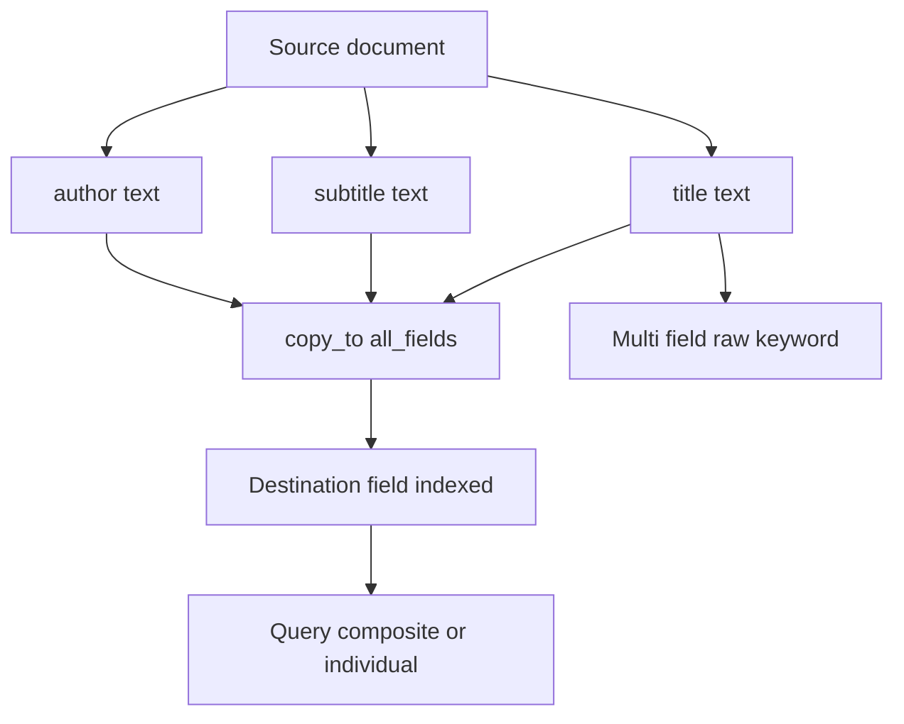

# Copy_to and Multi-Fields: Building Composite Search Fields Without Duplicating Data

## English

A common requirement is "search across the title, subtitle, and author as if they were one field, but also keep them searchable individually." The naive answer is to store the same text several times, but Elasticsearch gives you two mapping mechanisms that solve this cleanly: multi-fields and the `copy_to` parameter. Understanding both, and when to reach for each, removes a lot of accidental duplication from your index.

A multi-field indexes the same input value in more than one way. The canonical example is a `text` field with a `keyword` sub-field: `{ "type": "text", "fields": { "raw": { "type": "keyword" } } }`. The `text` version is analysed into tokens for full-text search; the `keyword` version is stored as a single unanalysed term for exact matching, sorting, and aggregations. Both live in the same document, and you address them as `name` and `name.raw`. The same mechanism lets you attach different analysers — for instance an English analyser for search and a standard one for another purpose — to the same source text.

`copy_to` works in the opposite direction: it takes the value of one field and copies it into another field at index time. You declare a destination field (often named something like `all_fields`) and mark the source fields with `"copy_to": "all_fields"`. The destination is not returned in `_source` — it exists only in the index — but it can be queried like any other field. This is how you build a composite search field across several inputs without the application having to concatenate strings before indexing.

A crucial subtlety: `copy_to` copies the original values, not the analysed tokens, and the destination field runs its own analyser. So if `title` uses an English analyser and `all_fields` uses a standard analyser, the tokens in `all_fields` will differ from those in `title`. Another subtlety is that `copy_to` does not work on every field type, and copying large text into many destinations multiplies index size, because each destination stores its own postings. Use it deliberately, not as a default catch-all.

A practical pattern is to combine both: copy `title`, `subtitle`, and `author` into `all_fields` for a general search box, while keeping each original field with its own multi-field so that you can still do exact matches, sorting, and highlighting on the individual pieces. This gives users one search box and gives you precise control when you need it, without storing the same string three times.

When debugging, remember that `_source` shows what you sent, not what was indexed. If a query against `all_fields` returns nothing, check that `copy_to` is present on the source fields in the mapping and that the destination field exists in the same mapping — a missing destination is silently ignored in some versions, so verifying with the `_mapping` API and the `_analyze` API is worth the two minutes.

## 中文

一個常見需求是「把標題、副標題、作者當成同一個欄位來搜尋，但同時又要能個別搜尋它們」。天真的做法是把同一段文字存好幾份，但 Elasticsearch 提供了兩種 mapping 機制來乾淨地解決這個問題：多欄位（multi-fields）與 `copy_to` 參數。搞懂這兩者、以及各自該在什麼時候使用，能替你的索引去掉大量不必要的重複。

多欄位會用多種方式為同一個輸入值建立索引。最典型的例子是帶有 `keyword` 子欄位的 `text` 欄位：`{ "type": "text", "fields": { "raw": { "type": "keyword" } } }`。`text` 版本會被分析成詞元（token）以供全文搜尋；`keyword` 版本則以單一未分析詞項儲存，用於精確比對、排序與聚合。兩者都存在同一份文件裡，你分別用 `name` 與 `name.raw` 來存取。同樣的機制讓你可以在同一段來源文字上掛不同的分析器——例如一個英文分析器供搜尋、一個標準分析器供其他用途。

`copy_to` 的方向相反：它在索引時把某個欄位的值複製到另一個欄位。你宣告一個目的欄位（通常命名為像 `all_fields` 這樣），並在來源欄位上標記 `"copy_to": "all_fields"`。目的欄位不會出現在 `_source` 中——它只存在於索引裡——但可以像其他欄位一樣被查詢。這就是你在多個輸入之間建立複合搜尋欄位、而不必讓應用程式在索引前自行串接字串的方法。

一個關鍵的細節：`copy_to` 複製的是原始值，不是分析後的詞元，而且目的欄位會執行它自己的分析器。所以如果 `title` 用英文分析器、`all_fields` 用標準分析器，`all_fields` 裡的詞元就會與 `title` 不同。另一個細節是 `copy_to` 並非對所有欄位型別都有效，而且把大量文字複製到多個目的欄位會讓索引變大，因為每個目的欄位都儲存自己的倒排表（postings）。要有意識地使用它，別把它當成預設的萬用解。

一個實用模式是把兩者結合：把 `title`、`subtitle`、`author` 複製到 `all_fields` 供一般搜尋框使用，同時保留每個原始欄位及其多欄位設定，這樣你仍然能對個別片段做精確比對、排序與高亮。這讓使用者只有一個搜尋框，而你在需要時保有精確控制，且不必把同一段字串存三次。

除錯時要記得：`_source` 顯示的是你送進去的內容，不是被索引的內容。如果針對 `all_fields` 的查詢什麼都回傳不了，請檢查 mapping 中來源欄位上是否有 `copy_to`，以及目的欄位是否存在於同一份 mapping 中——某些版本會默默忽略不存在目的欄位，所以用 `_mapping` API 與 `_analyze` API 驗證一下，值得花這兩分鐘。

## Key Takeaway

Use multi-fields to index one value several ways and copy_to to merge several values into one searchable field, avoiding duplicated source data.

## Related Concepts
- Mappings, text vs keyword, and Custom Analyzers
- The _analyze API: Seeing Your Text the Way the Index Sees It

## Diagram

