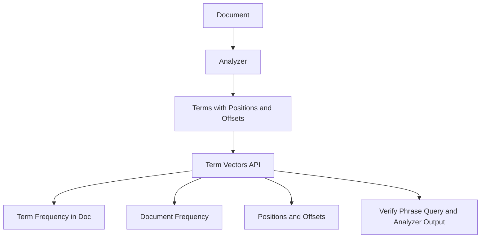

# Term Vectors and Term Statistics: Peeking Inside a Single Document's Index

## English

Most Elasticsearch learning focuses on queries and aggregations, but there is a family of APIs that lets you look directly at what the index knows about individual terms. The `_termvectors` API returns, for one document, the terms produced by analysis along with per-term statistics: term frequency in that document, total document frequency, and the positions and offsets of each occurrence. This is enormously useful when you need to understand why a document scored the way it did, or why a phrase query failed to match.

Consider a phrase query like `"quick brown fox"`. It only matches if those three terms appear in that exact order with no gap larger than the slop allows, which requires the index to store term positions. If your mapping has `"index_options": "docs"` or `"freqs"` on a field, positions are not stored, and phrase queries on that field simply cannot work. Term vectors let you confirm whether positions are present and see them directly. This turns a mysterious "my phrase query never matches" bug into a one-line mapping fix.

Term vectors also reveal the difference between what you think you indexed and what actually got indexed. If a custom analyser is stripping stop words, lowercasing, applying stemming, or splitting on unexpected boundaries, the term vector shows the final tokens. You can request term vectors for a document that does not exist yet by supplying the text yourself in the request body, which is a quick way to test an analyser against realistic content without reindexing anything.

Beyond a single document, Elasticsearch has a separate multi-term-vectors endpoint (`_mtermvectors`) that takes a list of document IDs and returns statistics aggregated across them. This is a lighter-weight alternative to a full aggregation when you just want to know how often a term appears in a small set of documents. For aggregate term statistics across an entire index, the `_stats` and field-level statistics endpoints give counts and sizes of the postings, which is useful for capacity planning and for spotting a field whose index has grown unexpectedly.

A caution: term vectors are not free. Requesting them for large documents or many IDs can be expensive, and by default they are generated on the fly from stored data. If you need them frequently, mapping supports `"term_vector"` settings that store them at index time, at the cost of disk space. As with most Elasticsearch features, the useful question is not "can I get this information" but "is it worth paying for it on every document, or only when I ask?"

## 中文

大部分 Elasticsearch 的學習都集中在查詢與聚合，但其實還有一系列 API 讓你直接檢視索引對個別詞項（term）究竟知道些什麼。`_termvectors` API 會針對某一份文件，回傳分析後產生的詞項，以及每個詞項的統計資料：在該文件中的詞頻、整體的文件頻率，以及每次出現的位置（position）與位移（offset）。當你需要理解某份文件為何得到那樣的分數，或某個片語查詢為何比對不到時，這功能極為有用。

想想像 `"quick brown fox"` 這樣的片語查詢。它只有在這三個詞項以完全相同的順序出現、且間隔不超過 slop 允許的範圍時才會比對成功，而這需要索引儲存詞項位置。如果你的 mapping 在該欄位上設了 `"index_options": "docs"` 或 `"freqs"`，位置就沒有被儲存，該欄位上的片語查詢根本無法運作。詞項向量讓你確認位置是否存在，並直接看到它們。這能把一個神祕的「我的片語查詢永遠比對不到」的 bug，變成一行 mapping 的修正。

詞項向量也揭露了你以為索引了什麼、與實際索引了什麼之間的差異。如果某個自訂分析器正在移除停用詞、轉小寫、套用詞幹化，或以意想不到的邊界切分，詞項向量會顯示最終的詞元。你甚至可以在請求主體中自行提供文字，為一份還不存在的文件取得詞項向量，這是用真實內容快速測試分析器、而不必重建任何索引的好辦法。

除了單一文件，Elasticsearch 另有專門的多文件詞項向量端點（`_mtermvectors`），它接受一份文件 ID 清單，並回傳跨這些文件彙總的統計。當你只想知道某詞項在一小批文件中出現幾次時，這是比完整聚合更輕量的替代方案。若要在整個索引上取得彙總的詞項統計，`_stats` 與欄位層級的統計端點會給出倒排表的數量與大小，對容量規劃以及找出某個欄位索引意外膨脹很有幫助。

一個提醒：詞項向量不是免費的。對大型文件或大量 ID 請求詞項向量可能很昂貴，而且預設它們是從已儲存的資料即時產生的。如果你需要經常取得，mapping 支援 `"term_vector"` 設定，可在索引時就儲存它們，代價是磁碟空間。就像 Elasticsearch 的大多數功能一樣，有用的問題不是「我能不能拿到這個資訊」，而是「它值不值得對每份文件都付出代價，還是只在我要求時才付出？」

## Key Takeaway

Term vectors expose the exact tokens and positions stored for a document, turning scoring and phrase-matching mysteries into observable facts.

## Related Concepts
- The _analyze API: Seeing Your Text the Way the Index Sees It
- How Elasticsearch Scores Relevance: TF-IDF, BM25, and the _score You See

## Diagram

