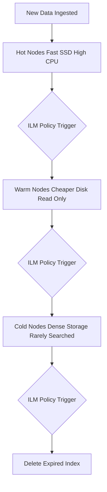

# Hot-Warm-Cold Architecture: Tiering Data by Temperature

## English

A hot-warm-cold architecture splits your cluster into node groups that hold data at different stages of its life, and it is one of the most reliable ways to cut hardware cost without hurting search quality. The idea starts from an observation about access patterns: freshly ingested data (logs from the last hour, orders from today) is queried constantly and written to constantly, while data from six months ago is almost never touched but must still be searchable for compliance or investigation. Treating both the same way means you pay SSD prices for cold bytes.

In practice you tag nodes with a custom attribute, for example node.attr.data: hot, warm, or cold, and use index allocation filtering (index.routing.allocation.include.data) or, more commonly these days, an index lifecycle policy that moves indices between tiers automatically. Hot nodes get fast local SSDs, plenty of CPU and heap, and hold the actively written indices. Warm nodes use larger, cheaper spinning disks or slower SSDs and hold read-only indices that have been force-merged into fewer segments; they still serve queries but no longer absorb writes. Cold nodes go further: they hold indices that are rarely searched, often on dense storage, and the searchable snapshots feature can even keep the data in object storage and fetch only the parts a query needs, so the local disk is a cache rather than the source of truth.

The lifecycle piece is what makes this practical. An ILM policy says something like: roll over the write alias when the index reaches 50 GB or 30 days, then after 7 days move to warm and force-merge to one segment, after 90 days move to cold, after 365 days delete. Elasticsearch executes those transitions on its own, so no human has to remember that last March's logs can now live on the cheap tier. The force-merge on the warm transition matters because merging many small segments into one large segment dramatically reduces per-segment overhead (each segment has its own dictionary, doc values, and file handles), which is exactly what you want for data that will never be written again.

Two caveats are worth knowing. First, moving a shard between tiers is a real data copy over the network, so tiering works best when transitions are infrequent and batched, not when data ping-pongs. Second, tiering does not fix a bad shard count: if you have thousands of tiny shards, cold storage will still be expensive because each shard carries fixed overhead regardless of how little data it holds. Tiering is a cost lever, not a substitute for sensible shard sizing.

The mental model: think of a library where new arrivals sit on a display shelf by the door, popular backlist lives on open shelves, and the archive is in a basement retrieved by request. Same catalogue, different cost per retrieval. That is exactly what hot-warm-cold gives you.

## 中文

熱-溫-冷（hot-warm-cold）架構把叢集分成幾個節點組，各自存放處於不同生命階段的資料，是其中一個最可靠、可以在不犧牲搜尋質素的前提下降低硬件成本的方法。這個想法源於對存取模式的觀察：剛寫入的資料（過去一小時的日誌、今天的訂單）被頻繁查詢、也持續被寫入；而半年前的資料幾乎無人碰，但為了合規或事後調查仍然必須可搜尋。若兩者一視同仁，就等於用 SSD 的價錢去儲存冷冰冰的位元組。

實際做法是為節點加上自訂屬性，例如 node.attr.data: hot、warm 或 cold，然後用索引分配過濾（index.routing.allocation.include.data），或者更常見的是用索引生命週期政策（ILM）自動在層級之間搬移索引。熱節點配備快速本地 SSD、充足的 CPU 與堆積記憶體，負責承載正在寫入的索引。溫節點用容量更大、較便宜的硬碟或較慢的 SSD，存放已設為唯讀、並經強制合併成較少段（segment）的索引；它們仍然回應查詢，但不再吸收寫入。冷節點更進一步：存放極少被搜尋的索引，通常用高密度儲存；而 searchable snapshots 功能甚至可以把資料留在物件儲存，查詢時只取回需要的那部分，本地磁碟變成快取而非資料的真實來源。

真正令這套架構可行的是生命週期那一環。一條 ILM 政策可以這樣寫：當索引達到 50 GB 或 30 日就 rollover，7 日後移到溫層並強制合併為單一段，90 日後移到冷層，365 日後刪除。Elasticsearch 會自行執行這些轉換，不需要任何人記住「去年三月的日誌現在可以放在便宜層了」。在轉到溫層時做強制合併（force-merge）很重要，因為把許多小段合併成一個大段能大幅減少每段的重複開銷（每段都有自己的字典、doc values 和檔案句柄），而這正是永不再寫入的資料最需要的。

有兩點要留意。第一，分片在層級之間搬移是真正的網路資料複製，所以分層最好在轉換不頻繁、可批次處理時使用，而不是讓資料在層級之間彈來彈去。第二，分層不能修正不良的分片數量：若你有幾千個極小的分片，冷儲存依然昂貴，因為每個分片無論裝多少資料都有固定開銷。分層是成本槓桿，不是合理分片大小的替代品。

心智模型：想像一座圖書館，新到的書放在門口的展示架，熱門的舊書放在開放書架，檔案則放在地庫，需要時才調取。同一個目錄，不同的取用成本。熱-溫-冷給你的正是這個。

## Key Takeaway

Tiering data by access temperature (hot, warm, cold) with ILM and allocation filtering lets you pay SSD prices only for the bytes that actually need SSD speed.

## Related Concepts
- Index Lifecycle Management
- Searchable Snapshots

## Diagram

