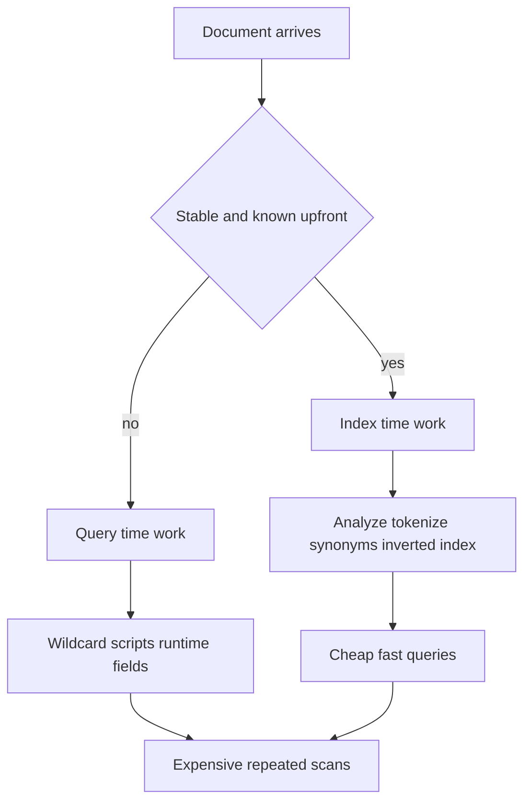

# Index-Time vs Query-Time Cost: The Trade You Make Without Noticing

## English

Every decision in Elasticsearch pushes work either into the write path (when a document is indexed) or the read path (when a query runs). Understanding this trade is the single most useful lens for performance tuning, because most "Elasticsearch is slow" problems are really "we chose the wrong side of the trade." The write path runs once per document; the read path runs once per query, and a single query may touch millions of documents. That asymmetry is the whole game.

A concrete example: if you store a field as text with the standard analyzer, Elasticsearch tokenises it, lowercases it, removes stop words, and builds an inverted index at index time. A later match query for "running shoes" becomes a cheap dictionary lookup. If instead you store the raw string as keyword and query it with a wildcard like *running*, Elasticsearch cannot use the inverted index at all and must scan every term in the field, at query time, for every query. Same data, wildly different cost profile. The first choice pays at write time; the second defers the cost to every single read, forever.

Analyzers, multi-fields, copy_to, and custom tokenisers are all index-time investments. If you know users will search by product name with synonyms ("sneaker" should match "trainer"), you can expand synonyms at index time so queries stay simple and fast, at the cost of a bigger index and slower writes. Conversely, runtime fields and scripted queries are query-time investments: they compute values on the fly, which is perfect for debugging a schema mistake or exploring data ad hoc, but ruinous if the same computation runs on every request in production. The rule of thumb: anything stable and known up front belongs at index time; anything exploratory or frequently changing belongs at query time, and should be promoted to index time once it stabilises.

Boosting follows the same logic. Index-time boosting (via boost in the mapping) bakes the weight into term frequencies, so it is cheap at query time but rigid. Query-time boosting lets you tune relevance per request, which is far more flexible but costs a little more per query. In modern versions, index-time boosting is discouraged in favour of query-time boosting precisely because flexibility is usually worth more than the marginal saving.

The practical habit: whenever a query feels slow, ask "what work did we defer to read time, and could we have paid it once at write time instead?" And whenever indexing feels slow, ask the mirror question. There is no free lunch, only a choice of which meal to pay for, and how often.

## 中文

Elasticsearch 裡的每個決定，都會把工作推到寫入路徑（文件被索引時）或讀取路徑（查詢執行時）。理解這個取捨，是效能調校最有用的一副眼鏡，因為大部分「Elasticsearch 很慢」的問題，其實是「我們選錯了取捨的那一邊」。寫入路徑每份文件執行一次；讀取路徑每次查詢執行一次，而單一查詢可能觸及數百萬份文件。這種不對稱就是整個遊戲的核心。

具體例子：若你把欄位存成 text 並用標準分析器，Elasticsearch 會在索引時分詞、轉小寫、移除停用詞，並建立倒排索引。之後一個 match 查詢「running shoes」就變成便宜的字典查詢。相反，若你把原始字串存成 keyword，再用 *running* 這種 wildcard 查詢，Elasticsearch 根本無法使用倒排索引，必須在查詢時、對每一次查詢、掃描欄位裡的每一個詞項。同樣的資料，成本結構天差地別。第一個選擇在寫入時付費；第二個把成本延後到每一次讀取，永遠如此。

分析器、multi-fields、copy_to 和自訂分詞器，全都是索引時的投資。若你知道用戶會用同義詞搜尋產品名（「sneaker」應該匹配「trainer」），可以在索引時展開同義詞，令查詢保持簡單快速，代價是索引變大、寫入變慢。反過來，runtime fields 和 scripted queries 是查詢時的投資：它們即時計算數值，用來除錯 schema 錯誤或臨時探索資料非常合適，但若同一個計算在生產環境每次請求都跑，就是災難。經驗法則：任何穩定、事先已知的東西屬於索引時；任何探索性、經常改變的東西屬於查詢時，並且一旦穩定下來就應該升級為索引時。

Boosting 也遵循同一邏輯。索引時 boosting（在 mapping 裡設 boost）把權重烘焙進詞頻，查詢時便宜但僵硬。查詢時 boosting 讓你每次請求調整相關性，靈活得多，但每次查詢成本略高。在現代版本，索引時 boosting 已被勸退，改用查詢時 boosting，正因為靈活性通常比那點邊際節省更值錢。

實用習慣：每當查詢覺得慢，就問「我們把什麼工作延後到讀取時了？能不能改為在寫入時一次付清？」每當索引覺得慢，就問鏡像的問題。世上沒有免費午餐，只有選擇付哪一餐、以及付多少次。

## Key Takeaway

Every mapping and query choice moves cost to write time or read time; since writes happen once per document and reads happen once per query, push stable work to index time and keep reads cheap.

## Related Concepts
- Analyzer Pipeline
- Runtime Fields

## Diagram

