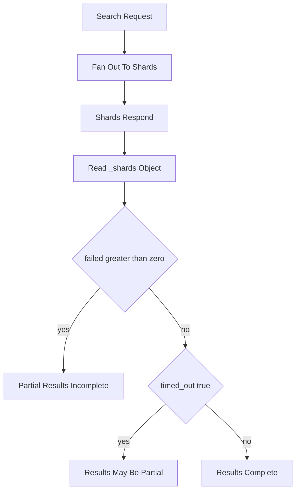

# Reading Failures Honestly: Partial Results, Timeouts, and Shard-Level Errors

## English

Elasticsearch is a distributed system, and distributed systems fail partially. A search request fans out to every shard of every index it touches, and some of those shards may be slow, busy, or unavailable while others answer fine. The most common mistake beginners make is reading only the hits array and ignoring the rest of the response, because Elasticsearch by default returns HTTP 200 with partial results rather than failing the whole request. That is a deliberate design choice for availability, but it means you must read the response honestly.

Three fields tell the story. The _shards object reports total, successful, skipped, and failed counts: if failed is greater than zero, some shards did not answer and your result set is incomplete. The timed_out boolean tells you whether the request hit its timeout; note that a timed-out request may still return hits, because shards that finished before the deadline contribute results. And each failed shard appears in the failures array with its index, shard number, and the reason, which is where you find out whether a shard was unassigned, the node was overloaded, or a query hit an error. A dashboard that shows "1,234 results" while silently dropping a third of the shards is worse than useless.

Timeouts deserve particular care. A search timeout does not cancel work that is already running; it tells coordinating nodes to stop waiting and return what they have. The shards may keep churning in the background, consuming resources for a query nobody will read. This is why timeouts are a safety valve, not a query optimiser: if you routinely hit them, the fix is to make the query cheaper (fewer fields, tighter filters, better shard sizing), not to raise the timeout. Similarly, partial failures during a bulk write are normal and expected: the bulk response lists per-item errors, and a client that treats the whole bulk as failed because one document had a mapping conflict will retry everything and amplify the problem.

The right operational posture is to treat partial results as a signal, not noise. Alert when failed shard counts exceed a threshold, log the failures array with enough context to reproduce, and decide per-use-case whether partial results are acceptable. For a user-facing search box, showing slightly fewer results is fine; for a financial reconciliation report, a missing shard means the number is wrong and the job must fail loudly. The same response can be acceptable in one context and unacceptable in another, and only you know which.

The broader lesson: in a distributed search engine, "no error" does not mean "complete answer." Learn to read _shards, timed_out, and failures the way you read a compiler warning, as information you act on rather than dismiss.

## 中文

Elasticsearch 是分散式系統，而分散式系統會局部失敗。一個搜尋請求會發散到它所觸及的每個索引的每個分片，其中一些分片可能緩慢、繁忙或不可用，而其他分片正常回應。初學者最常犯的錯誤，是只讀 hits 陣列而忽略回應的其他部分，因為 Elasticsearch 預設會回傳 HTTP 200 加部分結果，而不是令整個請求失敗。這是為了可用性的刻意設計，但這意味著你必須誠實地讀回應。

三個欄位說明一切。_shards 物件報告 total、successful、skipped 和 failed 的數目：若 failed 大於零，就有分片沒有回應，你的結果集並不完整。timed_out 布林值告訴你請求是否觸及逾時；要注意逾時的請求仍可能回傳 hits，因為在期限前完成的分片會貢獻結果。而每個失敗的分片會出現在 failures 陣列，附有索引、分片編號和原因，你就是在這裡得知分片是未分配、節點過載，還是查詢本身出錯。一個儀表板顯示「1,234 個結果」卻靜靜丟掉三分之一的分片，比無用更糟。

逾時值得特別小心。搜尋逾時不會取消已在執行的工作；它只是叫協調節點停止等待並回傳手上已有的東西。分片可能繼續在背景運轉，為一個無人會讀的查詢消耗資源。這就是為何逾時是安全閥而非查詢優化器：若你經常觸及逾時，解法是令查詢更便宜（更少欄位、更緊的過濾、更好的分片大小），而不是調高逾時。同樣地，bulk 寫入期間的部分失敗是正常且預期的：bulk 回應會列出逐項錯誤，若客戶端因為一份文件有 mapping 衝突就把整個 bulk 當作失敗而全部重試，只會放大問題。

正確的營運姿態，是把部分結果當作訊號而非噪音。當失敗分片數超過門檻就告警，記錄 failures 陣列並附上足夠上下文以便重現，並按使用場景決定部分結果是否可接受。對用戶面前的搜尋框，少幾個結果沒問題；對財務對帳報告，少一個分片就代表數字錯了，任務必須大聲失敗。同一個回應在一種情境可接受，在另一種不可接受，只有你知道是哪一種。

更宏觀的教訓：在分散式搜尋引擎裡，「沒有錯誤」不等於「答案完整」。學會像讀編譯器警告那樣讀 _shards、timed_out 和 failures，視之為要行動的資訊，而非可以忽略的東西。

## Key Takeaway

Elasticsearch returns HTTP 200 with partial results by default, so always inspect _shards.failed, timed_out, and the failures array before trusting a result set.

## Related Concepts
- The Query Then Fetch Two-Phase Search
- Cluster Health

## Diagram

