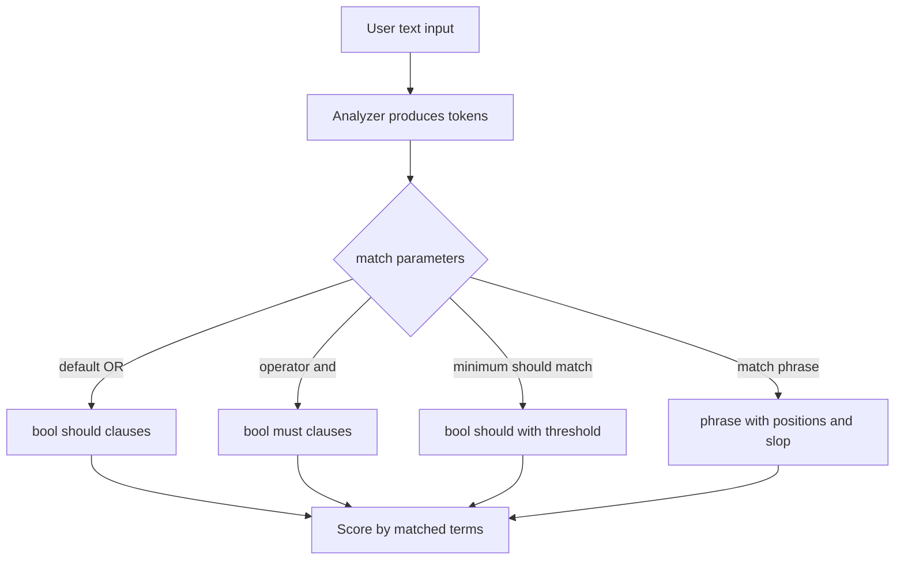

# The `match` Query Is Not One Query — It Is a Family

## English

Many people assume that typing a phrase into a `match` query simply means 'find documents containing these words'. In practice, `match` is a convenient wrapper that rewrites itself into a different internal query depending on its parameters, and each rewrite changes what actually gets scored. By default, `match` runs the input text through the field's search analyzer, producing a list of tokens, and then builds a `bool` query with one `should` clause per token. Those clauses combine with the `OR` operator by default, so a document containing only one of the words still matches — it just scores lower because BM25 rewards documents that hit more terms. Switching `operator` to `and` flips that into mandatory `must` clauses, which is a completely different scoring situation: every term must be present, and the score reflects how well the document matches the combined requirement rather than how many terms happened to appear.

The `minimum_should_match` parameter gives you a middle ground that is often more useful than either extreme. You can say 'at least 70% of the terms must match', which is invaluable for long user queries where requiring every word would return nothing. Internally this becomes a constraint on the `should` clause set, and the scoring still uses all matched terms. This is why the same query text can return wildly different result orders depending on a single parameter — you are not tuning a knob on one algorithm, you are choosing a different algorithm.

A second family member is `match_phrase`, which does not just require all the terms but requires them to appear in the given order with no intervening terms (subject to `slop`, which allows a configurable number of position moves). Because the index stores token positions, the engine can verify adjacency cheaply. `match_phrase_prefix` goes further, treating the last token as a prefix that expands against the term dictionary — handy for search-as-you-type, but risky on large shards because the expansion can be enormous.

Finally, `multi_match` is the same family again but broadcast across several fields, with `best_fields`, `most_fields`, `cross_fields`, and `phrase` modes each producing different internal query trees. `cross_fields` in particular is the one that treats multiple fields as if they were one big field, which matters when a person's name is split across `first_name` and `last_name`. The practical lesson: when a `match` query misbehaves, do not tweak it blindly — ask which internal query it became. The `_validate` API and `profile: true` will show you the rewritten form, and the rewritten form is what the shards actually execute.

## 中文

很多人以為在 `match` 查詢中輸入一段文字，就等於「找出包含這些字的文件」。實際上，`match` 只是一層方便的包裝，它會根據參數把自己改寫成不同的內部查詢，而每一種改寫都會改變真正被計分的東西。預設情況下，`match` 會先把輸入文字送進該欄位的搜尋分析器，產生一串 token，然後建立一個 `bool` 查詢，每個 token 對應一個 `should` 子句。這些子句預設以 `OR` 運算子組合，所以只包含其中一個詞的文件仍然會命中——只是分數較低，因為 BM25 會獎勵命中更多詞的文件。把 `operator` 改成 `and`，就會變成必須滿足的 `must` 子句，這是完全不同的計分情境：每個詞都必須存在，分數反映的是文件對整體要求的符合程度，而不是碰巧出現了幾個詞。

`minimum_should_match` 參數提供了介於兩者之間的中間路線，往往比任何一個極端更有用。你可以說「至少要有 70% 的詞命中」，這對於冗長的用戶查詢特別有價值——如果要求每個詞都命中，可能一筆結果都回不來。在內部，這會變成對 `should` 子句集合的約束，而計分仍然使用所有命中的詞。這就是為什麼同一段查詢文字，只因為一個參數不同，回傳的結果排序可以天差地遠——你不是在調整同一個演算法上的旋鈕，而是在選擇另一個演算法。

這個家族的第二位成員是 `match_phrase`，它不只要求所有詞都出現，還要求它們按給定順序、中間不能夾雜其他詞（可透過 `slop` 允許一定數量的位置移動）。因為索引儲存了 token 位置，引擎可以便宜地驗證相鄰性。`match_phrase_prefix` 更進一步，把最後一個 token 當作前綴，對詞典進行展開——對即時搜尋很方便，但在大型分片上很危險，因為展開的範圍可能非常龐大。

最後，`multi_match` 也是同一個家族，只是把查詢廣播到多個欄位，其中 `best_fields`、`most_fields`、`cross_fields` 和 `phrase` 模式各自產生不同的內部查詢樹。特別是 `cross_fields`，它把多個欄位當成一個大欄位來處理，這在一個人的名字被拆成 `first_name` 和 `last_name` 兩個欄位時非常重要。實用的教訓是：當 `match` 查詢行為不如預期，不要盲目微調——先問它變成了哪一種內部查詢。`_validate` API 和 `profile: true` 會顯示改寫後的形態，而改寫後的形態才是分片真正執行的東西。

## Key Takeaway

A `match` query is a generator of internal query trees, so understanding which tree your parameters produce is more useful than tweaking scores blindly.

## Related Concepts
- BM25 scoring
- bool query clauses

## Diagram

