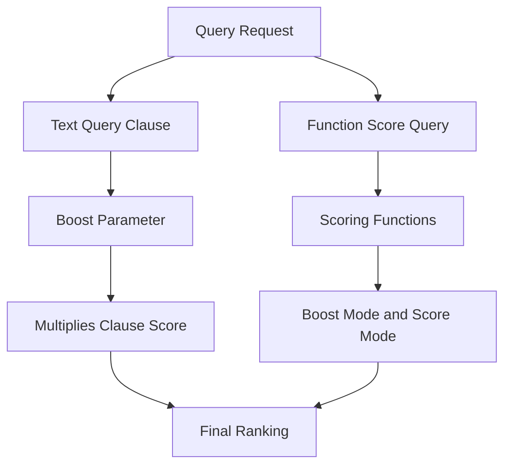

# Index-Time Boosting Is Deprecated — Here Is What Replaced It

## English

Older Elasticsearch tutorials still show `boost` inside a mapping, like `"title": { "type": "text", "boost": 2.0 }`. That syntax was removed years ago, and understanding why is a useful lesson in how relevance actually works. Index-time boosting tried to bake a multiplier into the stored term statistics, but term statistics are shared across all documents in a shard, so a per-field multiplier could not really be applied per document without corrupting the statistics that BM25 depends on. The feature was confusing, hard to reason about, and largely redundant. Today, all boosting happens at query time, where you have the document's full context in hand.

Query-time boosting works through several distinct mechanisms, and mixing them up is a common source of surprise. The simplest is the `boost` parameter on a query clause, which multiplies that clause's contribution to the score. Because BM25 scores are not normalised, a `boost` of 2.0 does not mean 'twice as relevant' in any absolute sense — it just shifts the relative ordering. This is why boosting is best treated as a ranking tool, not a measurement tool. If you find yourself wanting a boost of 17.3, you probably want a different query structure instead.

A more principled approach is `function_score`, which lets you combine the BM25 score with arbitrary functions: field values, random noise, decay functions based on distance or recency, or scripted logic. This is how you express ideas like 'prefer recent documents' (a `gauss` decay on a date field) or 'prefer documents from the user's region' (a filter plus a weight). `function_score` supports `boost_mode` and `score_mode`, which control how the function output is merged with the base score — multiply, sum, replace, and so on. These two parameters are the difference between a sensible ranking and a nonsensical one, and they are easy to overlook.

Finally, there is `rank_feature` and `rank_features`, which are designed for machine-learning-style signals. Instead of re-scoring every hit after retrieval, they let the index store per-document numeric features that participate in scoring during the initial retrieval, using a compact data structure. This is the modern replacement for the old index-time boost idea, and it is far more honest: the feature is stored explicitly, its effect is explicit, and you can inspect it. The general principle holds across all of these: relevance is decided at query time, by code you can read and change, not by magic numbers buried in a mapping.

## 中文

舊的 Elasticsearch 教學仍然會示範在 mapping 裡寫 `boost`，例如 `"title": { "type": "text", "boost": 2.0 }`。這個語法多年前已被移除，而理解它為何被移除，是理解相關性運作方式的一堂好課。索引時 boosting 試圖把一個乘數烘焙進儲存的詞統計裡，但詞統計是分片內所有文件共用的，所以針對單一欄位的乘數其實無法真正套用到個別文件，除非破壞 BM25 所依賴的統計。這個功能令人困惑、難以推理，而且大致多餘。今天，所有 boosting 都發生在查詢時，在那裡你手上握有文件的完整上下文。

查詢時 boosting 透過幾種不同的機制運作，把它們混為一談是常見的意外來源。最簡單的是查詢子句上的 `boost` 參數，它會乘上該子句對分數的貢獻。由於 BM25 分數並未正規化，`boost` 為 2.0 並不代表在任何絕對意義上「相關兩倍」——它只是改變相對排序。這就是為什麼 boosting 最好被當成排序工具，而不是測量工具。如果你發現自己想要 boost 17.3，你大概需要的是不同的查詢結構。

更有原則的做法是 `function_score`，它讓你將 BM25 分數與任意函數結合：欄位值、隨機噪聲、基於距離或新近度的衰減函數，或腳本邏輯。這就是你表達「偏好較新的文件」（對日期欄位套用 `gauss` 衰減）或「偏好來自使用者所在區域的文件」（一個 filter 加一個 weight）這類想法的方式。`function_score` 支援 `boost_mode` 和 `score_mode`，控制函數輸出如何與基礎分數合併——相乘、相加、取代等等。這兩個參數就是合理排序與荒謬排序之間的差別，而且很容易被忽略。

最後，還有 `rank_feature` 和 `rank_features`，它們是為機器學習風格的訊號而設計的。它們不會在檢索後對每個命中重新計分，而是讓索引儲存每份文件的數值特徵，在初始檢索期間就參與計分，並使用緊湊的資料結構。這是舊索引時 boost 想法的現代替代品，而且誠實得多：特徵被明確儲存，效果明確，而且你可以檢查它。這個通則適用於以上所有情況：相關性是在查詢時決定的，由你能讀、能改的程式碼決定，而不是埋在 mapping 裡的魔法數字。

## Key Takeaway

Index-time boost is gone; relevance is now shaped entirely at query time through clause boosts, `function_score`, and rank features.

## Related Concepts
- function_score
- rank_feature

## Diagram

