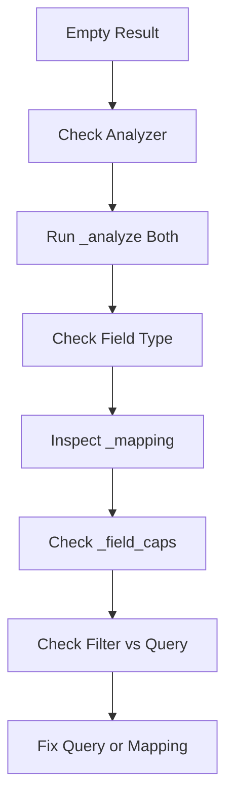

# What Happens When a Query Returns Nothing: Debugging Empty Results

## English

An empty result set is one of the most frustrating experiences in search, because the engine gives you no error — just zero hits. The trick is to treat 'no results' as a debugging problem with a known set of suspects, and to work through them in order rather than guessing. The first suspect is always the analyzer: if the text you indexed was tokenised differently from the text you searched, the terms will never line up. A classic case is indexing a field with the `standard` analyzer (which lowercases and splits on word boundaries) but searching with a `term` query using the original mixed-case string. The `term` query does not analyse its input, so `"Apple"` will not match a token that was stored as `apple`. Running the same text through `_analyze` with both the index-time and search-time analyzers side by side usually reveals the mismatch immediately.

The second suspect is the field itself. A `text` field is analysed and searchable by full-text queries, but it is not sortable or aggregatable, and a `keyword` field is the reverse. If you try to `term`-query a `text` field with a multi-word phrase, or `match`-query a `keyword` field, you will often get zero results without any warning. Checking the mapping with `GET /index/_mapping` and then checking `GET /index/_field_caps?fields=my_field` tells you exactly what the field can do. Many empty-result bugs are simply queries aimed at the wrong field type.

The third suspect is filtering versus querying. A `filter` clause inside a `bool` query must be satisfied, but it does not contribute to `_score`, and a filter on a field that was never indexed (for example because `index: false` was set, or because the field was added after documents were indexed) will silently exclude everything. Similarly, `exists` queries depend on the field actually being present in `_source` and indexed — a field with a `null` value is treated as absent. It is worth remembering that Elasticsearch does not store `null` in the inverted index at all.

The fourth suspect is the shard and the document. If you just indexed a document and immediately searched, the near-real-time refresh interval may not have elapsed yet, so the document is not visible. `GET /index/_refresh` forces visibility, and if the result suddenly appears, you have found the cause. If you suspect routing, remember that a custom routing key sends a document to a specific shard, and a search without that routing key still fans out to all shards — so routing usually causes missing results only when combined with `GET /index/_doc/id?routing=...` lookups. Working through these four suspects in order — analyzer, field type, filter/indexing, refresh/routing — turns a mysterious empty result into a short checklist.

## 中文

空結果集是搜尋中最令人沮喪的體驗之一，因為引擎不會給你任何錯誤——就只有零筆命中。訣竅是把「沒有結果」當成一個有已知嫌疑犯清單的除錯問題，按順序排查，而不是亂猜。第一個嫌疑犯永遠是分析器：如果你索引的文字與你搜尋的文字被切分成不同的 token，這些詞就永遠對不上。經典案例是用 `standard` 分析器索引欄位（會轉小寫並按詞邊界切分），卻用原始大小寫混合的字串做 `term` 查詢。`term` 查詢不會分析輸入，所以 `"Apple"` 不會匹配儲存為 `apple` 的 token。把同一段文字分別用索引時與搜尋時的分析器跑過 `_analyze` 並排比較，通常立刻就能看出不匹配。

第二個嫌疑犯是欄位本身。`text` 欄位會被分析、可用全文查詢搜尋，但不可排序也不可聚合；`keyword` 欄位則相反。如果你試圖用多詞片語對 `text` 欄位做 `term` 查詢，或對 `keyword` 欄位做 `match` 查詢，往往會得到零結果且沒有任何警告。用 `GET /index/_mapping` 檢查 mapping，再用 `GET /index/_field_caps?fields=my_field` 檢查，就能確切知道該欄位能做什麼。許多空結果的 bug 其實只是查詢打錯了欄位型別。

第三個嫌疑犯是過濾與查詢的差別。`bool` 查詢裡的 `filter` 子句必須被滿足，但它不貢獻 `_score`；而對一個從未被索引的欄位做 filter（例如設了 `index: false`，或欄位是在檔案索引之後才加入），會默默排除所有東西。同樣地，`exists` 查詢依賴欄位確實存在於 `_source` 且被索引——值為 `null` 的欄位會被視為不存在。值得記住的是，Elasticsearch 根本不會把 `null` 存進倒排索引。

第四個嫌疑犯是分片與檔案。如果你剛索引一份檔案就立刻搜尋，近即時的 refresh 間隔可能還沒過去，所以檔案還不可見。`GET /index/_refresh` 會強制讓它可見，如果結果突然出現，你就找到原因了。如果你懷疑是 routing，記住自訂 routing key 會把檔案送到特定分片，而不帶該 routing key 的搜尋仍會廣播到所有分片——所以 routing 通常只在搭配 `GET /index/_doc/id?routing=...` 查詢時才會造成缺結果。按順序排查這四個嫌疑犯——分析器、欄位型別、過濾與索引、refresh 與 routing——就能把神秘的空白結果變成一張簡短的檢查清單。

## Key Takeaway

Empty results are almost always one of four causes: analyzer mismatch, wrong field type, an unindexed or filtered-out field, or a document not yet refreshed.

## Related Concepts
- _analyze API
- field_caps API

## Diagram

