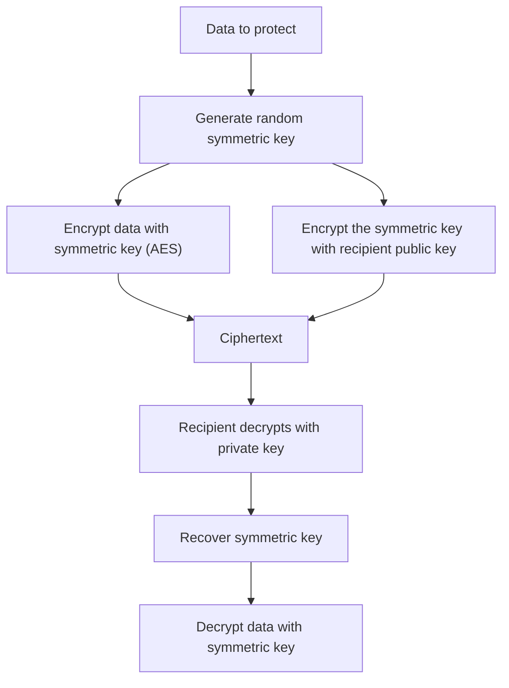

# Symmetric vs Asymmetric Encryption

### English

**Encryption** scrambles data so that only someone with the right key can read it; **decryption** reverses it. There are two broad families, and the difference is who holds the key.

**Symmetric encryption** uses a single shared secret for both directions. Encrypt with the key, decrypt with the same key. It is fast — modern CPUs have hardware instructions for AES, so gigabytes per second is routine — which makes it the right tool for bulk data: encrypting a large file, a database column, or the body of a session. Its weakness is key distribution: the sender and receiver must already share the secret, and the first time you send it you face the same problem the encryption was supposed to solve.

**Asymmetric encryption** uses a mathematically linked key pair. The **public key** can be handed to anyone and used to encrypt (or verify); the **private key** is kept secret and used to decrypt (or sign). Because the private key never travels, there is no key-distribution problem. But it is roughly 100–1000 times slower than symmetric encryption, so you would never encrypt a gigabyte with it.

Modern protocols therefore combine both. Use asymmetric encryption to protect a small, randomly generated symmetric key, then use that symmetric key for the actual bulk data. This is called **hybrid encryption**, and it is exactly what HTTPS does on every connection.

Rule of thumb: asymmetric for keys and identities, symmetric for content. A further detail worth knowing is the **initialisation vector (IV)**: symmetric schemes such as AES-CBC need a fresh, unpredictable IV per message, and reusing the same IV with the same key can leak information about the plaintext. This is why modern APIs such as `Fernet` or `AES-GCM` generate the IV and even the authentication tag for you.

### 中文

**加密**把資料打亂，只讓持有正確鑰匙的人讀得懂；**解密**則是反向操作。加密大致分兩大家族，差別在於「誰拿著鑰匙」。

**對稱加密**兩邊都用同一個共用秘密：拿鑰匙加密，也拿同一把鑰匙解密。它的速度很快——現代 CPU 對 AES 有硬體指令每秒處理數 GB 都家常便飯——因此適合處理大量資料：加密大檔案、資料庫欄位或 session 內容。它的弱點是**鑰匙分發**：雙方必須事先共享同一把秘密，而第一次傳送這把鑰匙時，你面對的正是加密原本要解決的問題。

**非對稱加密**使用一對數學上互相關聯的鑰匙。**公鑰**可以公開發給任何人，用來加密（或驗證）；**私鑰**保密保留，用來解密（或簽署）。由於私鑰從不外傳，鑰匙分發的問題自然消失。但它比對稱加密慢大約 100 至 1000 倍，所以絕不會拿它去加密一 GB 資料。

因此現代協定會把兩者結合：用非對稱加密保護一把隨機產生的對稱鑰匙，再用這把對稱鑰匙處理真正的資料內容。這稱為**混合加密**，也正是每次 HTTPS 連線都在做的事。

實用心法：非對稱用於鑰匙與身分，對稱用於內容。還有一個值得知道的細節：**初始化向量（IV）**。像 AES-CBC 這類對稱演算法，每則訊息都需要全新且不可預測的 IV；若同一把金鑰重複使用同一個 IV，就可能洩漏明文的資訊。因此像 `Fernet` 或 `AES-GCM` 這類現代 API 都會替你自動產生 IV，甚至連驗證標籤也一併處理。

## Key Takeaway
Symmetric encryption is fast but needs a shared secret in advance; asymmetric encryption solves key distribution but is slow, so real systems combine them.

## Related Concepts
- Symmetric and asymmetric keys
- Hybrid encryption
- AES and public-key cryptography
- Key distribution problem

## Diagram

