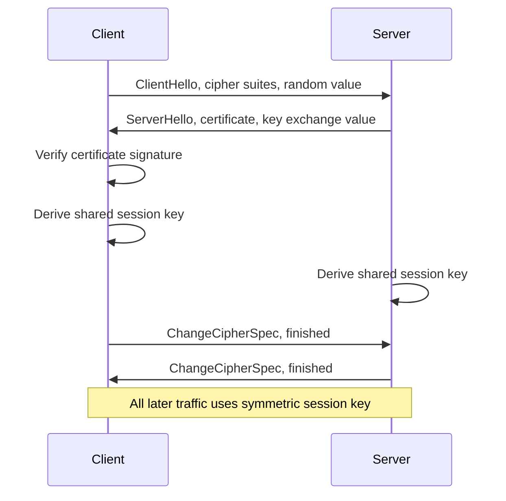

# Key Exchange and the TLS Handshake

### English

How do two parties agree on a secret key without ever sending it over the network, where someone might be listening? The modern answer is **key agreement**, and the best-known scheme is **Diffie–Hellman key exchange**.

In Diffie–Hellman, both sides pick a private number and combine it with a shared public number, then send their results. Each side computes the same final value because the underlying maths is commutative — but an eavesdropper sees only the two intermediate values, and reversing the computation to find the shared secret is a problem called the **discrete logarithm problem**, which is believed to be infeasible on classical computers. The private numbers never touch the network at all.

The raw scheme has a weakness: a man-in-the-middle could substitute their own values and read everything. The fix is to **authenticate** the exchange. Each side signs its value with a **digital signature** (see the next learning point) using a certificate issued by a trusted Certificate Authority, so both sides can verify they are talking to who they think they are.

Putting it together gives the **TLS handshake**, the ritual behind every `https://` connection. Roughly: the client offers a list of cipher suites (algorithms it supports); the server picks one and replies with its certificate and its key-agreement values; both sides derive a shared **session key**; then both switch to that symmetric key for the rest of the connection. In TLS 1.3 the certificate no longer carries the key exchange itself — the handshake is trimmed to a single round trip, and a separate **certificate verify** signature proves possession of the private key.

Modern protocols also use **forward secrecy**, typically via ephemeral Diffie–Hellman, meaning a fresh random key is generated for each connection. Even if the server's long-term private key is later stolen, previously captured traffic cannot be decrypted.

### 中文

兩方如何在從不把鑰匙送上網路（那裡可能有人在竊聽）的情況下，協商出一把共用秘密？現代的答案是**金鑰交換**，最著名的方案是 **Diffie–Hellman 金鑰交換**。

在 Diffie–Hellman 中，雙方各自挑一個私密數字，與一個共用的公開數字結合，再把各自的結果傳送。之所以雙方能算出同一個最終值，是因為底層數學具有交換性；但竊聽者只看得到兩個中間值，要反推出共用秘密就得解「**離散對數問題**」，據信在傳統電腦上不可行。私密數字從來沒有在網路上出現。

原始方案有個弱點：中間人可能替換掉雙方的數值，讀走所有內容。修正方法是**驗證**這次交換：雙方都用受信任的憑證簽發機構所核發的**憑證**（內含數位簽章）為自己的數值簽名，於是雙方都能確認對方身分無誤。

合起來就是 **TLS 交握**——每個 `https://` 連線背後的儀式。大致流程是：客戶端提出它支援的密碼套件清單；伺服器選一個，回覆自己的憑證與金鑰交換所需的數值；雙方導出共用的**工作階段金鑰**；然後整條連線改用這把對稱金鑰。在 TLS 1.3 裡，憑證不再攜帶金鑰交換本身——交握精簡到只需一個來回，並以獨立的 **certificate verify** 簽章來證明持有私鑰。

現代協定通常還採用**前向保密**，多是用臨時的 Diffie–Hellman，每次連線都產生全新隨機金鑰。即使日後伺服器的長期私鑰被盜走，先前截錄的流量仍然無法解密。

## Key Takeaway
Diffie–Hellman lets two sides agree on a secret without transmitting it, and signing the exchange with certificates prevents man-in-the-middle attacks.

## Related Concepts
- Diffie–Hellman key exchange
- Discrete logarithm problem
- TLS handshake
- Forward secrecy

## Diagram

