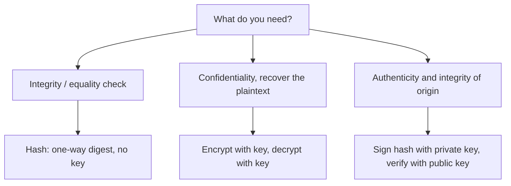

# Hashing vs Encryption vs Digital Signatures

### English

Three techniques look similar from outside but solve different problems, and confusing them is a common source of serious security bugs.

**Hashing** is a one-way function. Feed it any input and it produces a fixed-length **digest** (e.g. 256 bits), and there is no practical way to work backwards from the digest to the original input. Because the output space is finite, hashes can collide — two different inputs may share a digest — which is why cryptographic hashes like SHA-256 are designed so that finding such a collision is infeasible. You use hashing to detect accidental change, to store passwords safely, and to fingerprint files. Crucially, hashing is **not** encryption: there is no key, and no decryption step. An encrypted value can be turned back into plaintext by someone with the key; a hash never goes back.

**Encryption** provides confidentiality: readable only with the right key, as covered in the previous learning points.

**Digital signatures** provide **authenticity and integrity**. The signer hashes the message, encrypts the hash with their **private key** using an asymmetric algorithm, and attaches that signature. Anyone with the signer's **public key** can verify it: recompute the hash, decrypt the signature, and compare. If they match, the message genuinely came from the holder of that private key and has not been altered in transit. The private key never leaves the signer, which is why a signature cannot be forged by anyone else.

A useful test: if you need to get the original back, you need encryption; if you only need to compare two things for sameness, you need hashing; if you need to prove who sent something and that nobody altered it, you need a signature. Passwords should be hashed with a slow, salted algorithm such as **Argon2** or **bcrypt**, not encrypted and not stored with a plain fast hash, because slow hashing makes brute-force attacks expensive.

### 中文

三種技術外觀相似，但解決的是不同問題，混淆它們是嚴重安全錯誤的常見來源。

**雜湊（hashing）**是單向函式：輸入任何資料，都會產生固定長度的**摘要**（例如 256 位元），而幾乎沒有實際方法能從摘要反推回原始輸入。由於輸出空間有限，雜湊必然可能碰撞——不同的輸入可能產生相同摘要——因此像 SHA-256 這類密碼學雜湊特意設計成讓找出碰撞變得不可行。雜湊用來偵測意外變更、安全儲存密碼、指紋辨識檔案。關鍵是：**雜湊不是加密**——它沒有金鑰，也沒有解密步驟。加密值可由持有金鑰者還原成明文，雜湊則永遠回不去。

**加密**提供的是**機密性**：沒有正確金鑰就讀不到，這正是前面幾個學習點的主題。

**數位簽章**提供的是**真確性與完整性**。簽署者先把訊息做雜湊，再用非對稱演算法以自己的**私鑰**加密該雜湊，並把簽章附上。任何持有簽署者**公鑰**的人都能驗證：重新計算雜湊、解開簽章、兩者相比。若相符，就代表訊息確實來自該私鑰持有者，且傳送途中未被竄改。私鑰從不離開簽署者，因此簽章無法被他人偽造。

實用判斷法：需要還原原文就用加密；只需要比較兩者是否相同就用雜湊；需要證明是誰送出、並且內容未被改動，就用簽章。密碼應以**慢速且加鹽**的演算法如 **Argon2** 或 **bcrypt** 來雜湊，不可加密、也不可用普通快速雜湊直接儲存，因為慢速雜湊能令暴力破解的代價高昂。

## Key Takeaway
Hashing proves sameness irreversibly, encryption hides content reversibly, and signatures prove authorship and integrity — confusing them causes real vulnerabilities.

## Related Concepts
- Cryptographic hash functions and SHA-256
- Password hashing with Argon2 and bcrypt
- Digital signatures and public-key verification
- Confidentiality vs integrity

## Diagram

