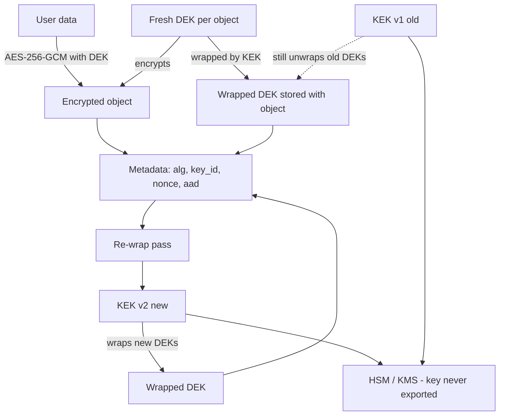

# Envelope Encryption, Key Rotation, and Key Management

### English

Asymmetric encryption is slow, and its keys are awkward to distribute. Symmetric encryption is fast but needs a shared secret. Modern systems resolve this with **envelope encryption**: a fresh symmetric key (the *data encryption key*, DEK) encrypts the actual data, and the DEK itself is encrypted with a separate long-lived key (the *key encryption key*, KEK) that lives in a KMS, an HSM, or a secret manager. Only the wrapped DEK travels with the data.

The distinction is worth spelling out because it explains the whole design. The KEK never touches user data. It only ever wraps and unwraps DEKs, so it can be stored in a hardware security module (HSM) — a tamper-resistant device that holds keys and performs operations without ever exporting them — and it can be rotated rarely. The DEK is used for bulk data and is cheap to create: you generate a fresh one per object, per file, per tenant, or per version. The blast radius of a leaked DEK is one object. The blast radius of a leaked KEK is everything, which is why it never leaves the HSM.

The metadata you store alongside the ciphertext matters as much as the cryptography. A typical record looks like:

```json
{
  "alg": "AES-256-GCM",
  "key_id": "dek-2026-10-23-a7f3",
  "wrapped_dek": "base64-of-KEK-encrypted-DEK",
  "nonce": "base64-12-bytes",
  "ciphertext": "base64-of-data-with-tag",
  "aad": "invoice:2026:1042"
}
```

The `alg` field is what makes a system **crypto-agile**: if AES-GCM is ever broken or you want to migrate to ChaCha20-Poly1305, you read the field and choose the algorithm accordingly, rather than hard-coding one into the code path. The `key_id` identifies *which* KEK version wrapped the DEK. The `aad` binds the ciphertext to its logical identity, so a ciphertext lifted from invoice 1042 cannot be replayed into invoice 1043.

**Key rotation** then becomes routine rather than an emergency. The procedure is: deploy a new KEK version alongside the old one, wrap new DEKs with the new key while still unwrapping old DEKs with the old key, wait for a re-encryption pass that re-wraps (or fully re-encrypts) existing data under the new key, then retire the old KEK once nothing references it. Because the DEK is wrapped, re-wrapping requires only a KMS *unwrap* and *wrap* call — the bulk data never needs to be decrypted and re-encrypted, which for terabytes of data is the difference between minutes and months. The key id in the metadata is what makes this safe: every record knows which KEK it needs.

Rotation and revocation are different operations. **Rotation** means new data uses a new key. **Revocation** means a key must stop working immediately — for example after a suspected leak. Revocation of a KEK means every DEK it ever wrapped must be re-wrapped under a surviving key, and if the leaked artefact is a *DEK*, every object encrypted under it must be re-encrypted. This is why DEKs should be short-lived and labelled with a scope, and why "log everything" beats "keep the key forever".

Where should the keys actually live? The hierarchy of options, from weakest to strongest: environment variables (fine for development, visible in process listings and crash dumps), a `.env` file in the repository (worse — it will eventually be committed), a cloud secret manager such as AWS Secrets Manager, Azure Key Vault, GCP Secret Manager, or a dedicated HSM via KMS (best). The `cryptography` library is unopinionated here: it will happily encrypt with a key you stored in a text file. The protection is architectural — the key should be fetched at startup, cached in memory, never logged, never serialised into a database row, and ideally never leave the process boundary at all.

A practical note on derivation. If the KEK or DEK originates from a human passphrase, it must be stretched with a **KDF** (PBKDF2, scrypt, or Argon2id) rather than used directly, because passphrases have far less entropy than machine-generated keys. For machine-generated secrets, `secrets.token_bytes(32)` is the correct generator; `random.random()` and `random.choice()` are Mersenne Twister outputs and are predictable, so never use them for key material.

Finally, think about what happens when the key is gone. An unbacked-up KEK means every object encrypted under it is permanently unreadable — the data has not been breached, it has been destroyed. Key management therefore includes backup and escrow: how a KEK is restored after a disaster, who is authorised to do it, and how that action is audited. Cryptographic agility without recovery planning is just a slower way to lose your data.

### 中文

非對稱加密速度慢，密鑰分派亦麻煩；對稱加密快，但需要雙方共有的秘密。現代系統用**信封加密（envelope encryption）**解決這個矛盾：用一把新鮮的對稱密鑰（**資料加密密鑰，DEK**）加密實際資料，而 DEK 本身再用另一把長壽命密鑰（**密鑰加密密鑰，KEK**）加密；KEK 存放在 KMS、HSM 或密鑰管理服務中。隨資料一起流動的，只有被包裝過的 DEK。

這個區分值得講清楚，因為它解釋了整個設計。KEK 從不直接接觸使用者資料，它只負責包裝與解包 DEK，因此可以安放在硬體安全模組（HSM，一種防篡改裝置，密鑰留在其中、運算也在其中完成而永不匯出）之中，輪換頻率也可以很低。DEK 則負責批量資料，而且非常便宜：你可以為每個物件、每個檔案、每個租戶、每個版本各產生一把新的。洩漏一把 DEK 的影響範圍是一個物件；洩漏一把 KEK 的影響範圍是全部資料——這正是 KEK 永遠不離開 HSM 的原因。

與密文一起存放的中繼資料，和密碼學本身同樣重要。一條典型的記錄長這樣：

```json
{
  "alg": "AES-256-GCM",
  "key_id": "dek-2026-10-23-a7f3",
  "wrapped_dek": "base64-of-KEK-encrypted-DEK",
  "nonce": "base64-12-bytes",
  "ciphertext": "base64-of-data-with-tag",
  "aad": "invoice:2026:1042"
}
```

`alg` 欄位令系統具備**演算法敏捷性（crypto-agility）**：萬一 AES-GCM 將來被破解，或你想遷移到 ChaCha20-Poly1305，只要讀取這個欄位就能選擇對應演算法，而不必把演算法硬寫在程式路徑裡。`key_id` 標示是哪一版 KEK 包裝了這把 DEK。`aad` 則把密文綁定到它的邏輯身份，令從發票 1042 偷來的密文無法被重放到發票 1043。

**密鑰輪換**因此變成例行工作而非緊急事故。流程是：先讓新一版 KEK 與舊版並行部署，新 DEK 用新 KEK 包裝，同時仍可用舊 KEK 解包舊 DEK；等一次重新包裝（re-wrap）把既有資料轉到新密鑰之下後，就退役舊 KEK。由於資料經由 DEK 加密，重新包裝只需在 KMS 做一次 *unwrap* 加一次 *wrap*，批次資料完全不需要解密再加密——對數 TB 的資料而言，這是數分鐘與數月之別。中繼資料裡的 key id 正是令這套流程安全的原因：每筆記錄都知道自己需要哪一把 KEK。

輪換與撤銷是兩回事。**輪換**是指新資料改用新密鑰；**撤銷**是指某把密鑰必須立即失效（例如懷疑外洩）。撤銷一把 KEK 意味著它包裝過的每一把 DEK 都要重新包裝到仍然有效的密鑰之下；若外洩的是 **DEK**，則用它加密的每一個物件都要重新加密。這正是 DEK 應該短命、並帶有範圍標籤的原因，也正是「全部記錄落盤」比「永遠保留密鑰」更好的理由。

密鑰究竟應該放在哪裡？由弱到強的選項層次：環境變數（開發環境尚可，但會出現在行程列表與當機報告之中）、放在版本庫的 `.env` 檔（更差，遲早會被提交）、雲端密鑰管理服務如 AWS Secrets Manager、Azure Key Vault、GCP Secret Manager，或者透過 KMS 連接專用 HSM（最佳）。`cryptography` 這個函式庫在此處並不opinionated：它很樂意用你存放在文字檔裡的密鑰來加密。真正的保護來自架構——密鑰應在啟動時取得、在記憶體中快取、永不寫入日誌、永不序列化進資料庫列，最好是永遠不離開行程邊界。

關於**導引**還有一點實務提醒。如果 KEK 或 DEK 源自人類輸入的通行碼，就必須先用 **KDF**（PBKDF2、scrypt 或 Argon2id）拉長，而不可直接使用，因為通行碼的熵遠低於機器生成的密鑰。機器生成的密鑰則應該用 `secrets.token_bytes(32)`；`random.random()` 與 `random.choice()` 產出的是 Mersenne Twister 序列，可被預測，絕不可用於產生密鑰。

最後要考慮密鑰消失時會怎樣。一把沒有備份的 KEK，代表它加密過的所有資料永久無法讀取——資料不是被入侵，而是被摧毀。因此密鑰管理也包含備份與託管：災難後如何還原 KEK、誰有權授權還原，以及這些操作如何被稽核。沒有復原計劃的演算法敏捷性，只不過是換個方式慢慢把資料弄丟。

## Key Takeaway
Envelope encryption separates a never-exported KEK from disposable per-object DEKs, so rotation is a cheap re-wrap operation and blast radius stays small — provided key ids, versions, and recovery plans are part of the design.

## Related Concepts
- Envelope encryption: KEK, DEK, and wrapping
- HSMs, KMS, and cloud secret managers
- Key rotation vs key revocation
- Crypto-agility and algorithm versioning in stored metadata
- Key derivation for passphrase-based keys; `secrets` over `random`

## Diagram

