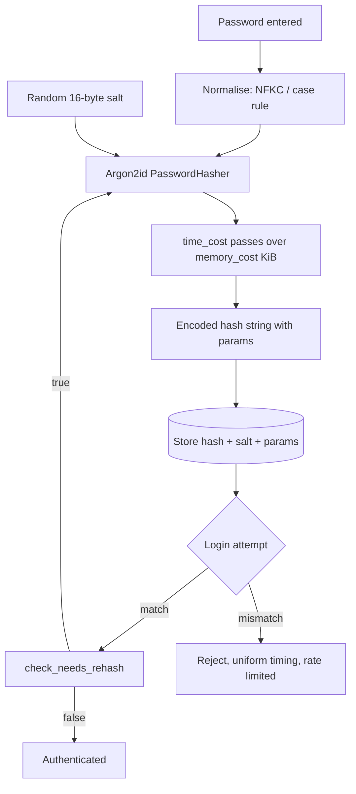

# Password Storage with Argon2id and Adaptive Password Hashing

### English

Passwords are a special case that breaks most encryption advice. You cannot encrypt a password and decrypt it later: to check whether a login attempt matches, you need the *hash* of the stored value, and a hash is by design one-way. So the question is not "how do I encrypt a password" but "how do I store something that resists guessing, while still letting me verify a guess".

The right tool is a **password hashing function** — deliberately slow, deliberately memory-hungry, and *adaptive*, meaning its cost parameters are stored inside the hash and can be raised later without invalidating old hashes. **Argon2id** is the current recommended choice: it won the Password Hashing Competition and is the algorithm behind `argon2-cffi`, the standard Python binding. Argon2 comes in three variants — Argon2d is data-dependent (resists GPU cracking but leaks timing), Argon2i is data-independent (side-channel resistant), and **Argon2id** is a hybrid that applies Argon2i for the first pass and Argon2d for subsequent passes, giving good resistance to both attacks. Since version 18.2 of `argon2-cffi`, Argon2id is the default.

The library's defaults are already sensible. `argon2.PasswordHasher()` uses Argon2id with `time_cost=3` iterations, `memory_cost=65536` KiB (64 MiB), `parallelism=4`, a 32-byte hash and a 16-byte random salt:

```python
from argon2 import PasswordHasher
from argon2.exceptions import VerifyMismatchError

ph = PasswordHasher()                     # defaults target ~40-50 ms per verify
hash = ph.hash("correct horse battery staple")

try:
    ph.verify(hash, "correct horse battery staple")
    login_ok = True
except VerifyMismatchError:
    login_ok = False
```

The three parameters map to real attacker resources, which is why the tuning guidance sounds like hardware advice. `time_cost` is the number of passes over memory — more passes means more CPU time. `memory_cost` in KiB is how much RAM each hash attempt occupies — this is the defence against GPUs and ASICs, which have enormous parallel compute but limited memory bandwidth and capacity per chip. `parallelism` is the number of lanes the algorithm uses, which lets it exploit multiple CPU cores. The rule is to aim for a verification time of roughly 50–200 ms on your production hardware and to set `memory_cost` as high as your servers can tolerate per concurrent login.

Two operational details are easy to get wrong. First, the parameters must be recorded **with the hash**, and `argon2-cffi` does this by encoding them in the hash string itself (`$argon2id$v=19$m=65536,t=3,p=4$...`), so verification automatically uses the parameters the hash was created with. When you later raise the cost, the library provides `check_needs_rehash(hash)` — after a successful verification, check it and, if true, re-hash the password with the new parameters so the stored hash upgrades lazily:

```python
if ph.verify(stored_hash, password) and ph.check_needs_rehash(stored_hash):
    stored_hash = ph.hash(password)      # upgrade transparently
```

Second, the salt is handled for you: every hash uses a fresh random 16-byte salt, so two users with the same password get different hashes, and precomputed rainbow tables are useless. Salts are not secret and are stored in the clear alongside the hash.

Always prefer a **KDF with a memory-hard parameter** over a plain general-purpose hash. SHA-256 of a password is instantaneous, so an attacker with a GPU can try billions of guesses per second; even a "salted SHA-256" scheme, which defeats rainbow tables but not brute force, is a poor choice today. PBKDF2 remains acceptable where FIPS 140 compliance is mandated, and its iteration count must be tuned for modern hardware — OWASP's current guidance is around 600,000 iterations of PBKDF2-HMAC-SHA256. scrypt is also acceptable and is memory-hard. Argon2id is the default recommendation when you have the freedom to choose.

Two mistakes dominate real breaches. **Hashing the password with a fast hash before passing it to Argon2** (a "pre-hash") is a bad idea: it collapses the input entropy to a fixed 256-bit value and defeats the memory-hard work factor. And **implementing your own scheme** — stretching with a loop, inventing a format — is how subtle bugs enter. Use a maintained library.

Two more practices round out the picture. Compare the timing of *rejected* logins to accepted ones so attackers cannot enumerate valid accounts by response time, and add rate limiting or progressive delays on the login endpoint. And normalise passwords before hashing — if you apply Unicode normalisation or NFKC and a case-folding rule consistently at both signup and login, you avoid the frustrating situation where the same typed password produces different bytes. Argon2 accepts `str` and encodes it as UTF-8 for you, but the normalisation decision is yours.

Finally, remember that a password hash is not the whole story. Because passwords are reused across sites, a database breach of hashes can be cracked offline and then replayed against other services. Strong password policy plus multi-factor authentication reduces this risk, and for high-value accounts, passkeys or hardware-backed keys beat passwords entirely.

### 中文

密碼是個特例，會令大部分加密建議失效。你不能把密碼加密後再解密：要判斷一次登入嘗試是否相符，你需要的是儲存值的**雜湊**，而雜湊按設計就是單向的。所以問題不是「怎樣加密密碼」，而是「怎樣儲存一個能抵抗猜測、但仍然容許我驗證猜測的東西」。

正確的工具是**密碼雜湊函數**——刻意地慢、刻意地耗記憶體，而且具備**自適應（adaptive）**特性：它的成本參數會一併儲存在雜湊值內，日後可以提高而無須作廢舊雜湊。**Argon2id** 是目前推薦的選擇：它是 Password Hashing Competition 的勝出者，也是 Python 標準繫結 `argon2-cffi` 背後的演算法。Argon2 有三個變體——Argon2d 依賴資料（能抵禦 GPU 破解，但會洩漏時序資訊）、Argon2i 與資料無關（抵抗側信道攻擊），而 **Argon2id** 是混合體，第一輪用 Argon2i、其後用 Argon2d，對兩類攻擊都有良好抵抗力。自 `argon2-cffi` 18.2 起，Argon2id 已是預設。

這個函式庫的預設值本身已相當合理。`argon2.PasswordHasher()` 使用 Argon2id，`time_cost=3`（迭代次數）、`memory_cost=65536` KiB（64 MiB）、`parallelism=4`、32 位元組雜湊長度與 16 位元組隨機 salt：

```python
from argon2 import PasswordHasher
from argon2.exceptions import VerifyMismatchError

ph = PasswordHasher()                     # 預設以每次驗證約 40-50 毫秒為目標
hash = ph.hash("correct horse battery staple")

try:
    ph.verify(hash, "correct horse battery staple")
    login_ok = True
except VerifyMismatchError:
    login_ok = False
```

三個參數對應攻擊者真實的資源，這也是調校指引聽起來像硬件建議的原因。`time_cost` 是掃過記憶體的次數——次數越多，耗用的 CPU 時間越多。`memory_cost`（單位 KiB）決定每次雜湊嘗試佔用多少 RAM——這正是抵抗 GPU 與 ASIC 的防線，因為那些裝置平行運算能力驚人，但每顆晶片的記憶體頻寬與容量有限。`parallelism` 是演算法使用的通道數，讓它能善用多核心。實務原則是：在正式環境的硬件上，把單次驗證時間調到約 50–200 毫秒，並把 `memory_cost` 設到伺服器在並行登入量下仍可承受的上限。

兩個操作細節很容易做錯。第一，參數必須與雜湊值**一起記錄**，`argon2-cffi` 會把它們編碼在雜湊字串內（`$argon2id$v=19$m=65536,t=3,p=4$...`），因此驗證時自動採用該雜湊建立時的參數。當你日後提高成本，函式庫提供 `check_needs_rehash(hash)`——在驗證成功之後檢查它，若為真就用新參數重新雜湊並更新儲存值，讓舊雜湊**惰性升級**：

```python
if ph.verify(stored_hash, password) and ph.check_needs_rehash(stored_hash):
    stored_hash = ph.hash(password)      # 透明地升級
```

第二，salt 由函式庫代辦：每次雜湊都使用全新的 16 位元組隨機 salt，因此相同密碼的兩名使用者會得到不同的雜湊值，預先計算好的彩虹表也毫無用處。salt 並非機密，可以明文與雜湊一起存放。

永遠應該採用具**記憶體硬性（memory-hard）參數**的 KDF，而不是一般用途的雜湊。對密碼做 SHA-256 是瞬間完成的，攻擊者用 GPU 每秒可嘗試數十億次；即使是「加鹽的 SHA-256」——能擋彩虹表卻擋不住暴力破解——在今天亦是差劣選擇。PBKDF2 在必須符合 FIPS 140 的情況下仍屬可接受，但其迭代次數要按現代硬件調校——OWASP 現行指引是 PBKDF2-HMAC-SHA256 約 600,000 次。scrypt 亦可接受，同樣具記憶體硬性。Argon2id 則是在有選擇餘地時的預設建議。

真實入侵事件中最常見的兩個錯誤是：**先用快速雜湊處理密碼再交給 Argon2**（即「預雜湊」），這很糟糕——它把輸入熵壓縮成固定的 256 位元值，等於架空了記憶體硬性的工作量因子；以及**自創方案**——自己寫迴圈拉長、自己發明格式——正是微妙 bug 的來源。請使用有人維護的函式庫。

另外兩項做法可補完整體系。讓**被拒絕**的登入與被接受的登入回應時間相近，避免攻擊者靠回應時間枚舉有效帳號；並在登入端點加上速率限制或漸進式延遲。此外，密碼在雜湊之前應先正規化——若你在註冊與登入兩邊都一致地套用 Unicode 正規化或 NFKC 與大小寫規則，就可避免「同一個輸入的密碼卻產生不同位元組」這種令人沮喪的情況。Argon2 接受 `str` 並替你編碼為 UTF-8，但正規化的決定權在你。

最後要記住，密碼雜湊並非全貌。由於密碼會在不同網站重用，雜湊資料庫被入侵後可被離線破解，再拿去重放到其他服務。嚴格的密碼政策加上多因素認證（MFA）可降低此風險；對高價值帳戶，通行鍵（passkey）或硬體支撐的密鑰則完全優於密碼。

## Key Takeaway
Passwords must be stored with an adaptive, memory-hard KDF such as Argon2id, whose cost parameters travel inside the hash so they can be raised later and re-hashed lazily on the next successful login.

## Related Concepts
- Password hashing vs encryption
- Argon2id and the `argon2-cffi` API
- `time_cost`, `memory_cost`, `parallelism` as attacker resources
- Salts, rainbow tables, and `check_needs_rehash`
- PBKDF2, scrypt, and OWASP iteration guidance
- Unicode normalisation and MFA/passkeys

## Diagram

