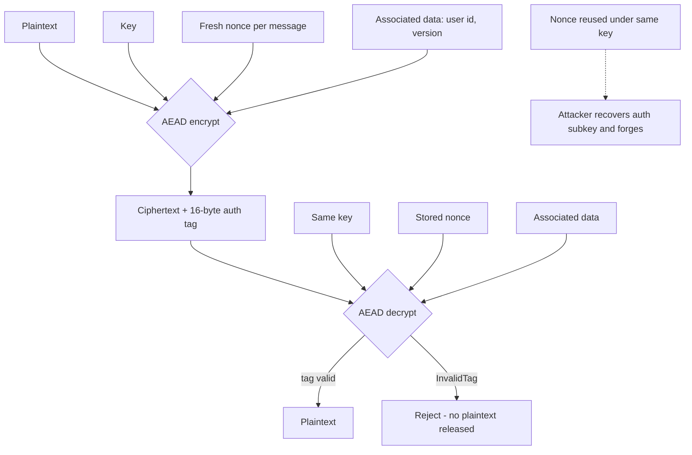

# Authenticated Encryption (AEAD): AES-GCM, ChaCha20-Poly1305, and Nonce Discipline

### English

Encryption and integrity used to be separate concerns. You would encrypt with AES in CBC mode and then compute an HMAC over the ciphertext to detect tampering — encrypt-then-MAC. That is two operations, two sets of parameters, and a well-known ordering rule, and it is exactly the kind of design that gets implemented wrongly. **Authenticated encryption with associated data (AEAD)** collapses both into a single primitive: one call that encrypts *and* authenticates, and fails loudly if either the ciphertext or the associated data was altered.

In AEAD terms, the **plaintext** is the data you want hidden; the **ciphertext** is what comes out; the **associated data (AAD)** is information that is authenticated but *not* encrypted; and the **authentication tag** is a short (16-byte for GCM) block that the receiver checks before releasing the plaintext. The tag is what makes decryption of a tampered message fail rather than return garbage — the decryption operation raises `InvalidTag` and the plaintext never exists in your process.

The two mainstream AEAD constructions are **AES-GCM** (Galois/Counter Mode) and **ChaCha20-Poly1305**. AES-GCM uses AES in counter mode and a GHASH-based authenticator; it is fast when the hardware has AES instructions (every modern x86 and ARM server, plus most phones), and NIST recommends a 96-bit nonce for best performance. ChaCha20-Poly1305 is a software-optimised stream cipher construction: it is fast even on hardware without AES support, and its nonce handling has no weak-key or nonce-reuse fragility. The rule of thumb used in practice: AES-GCM where AES hardware acceleration is guaranteed, ChaCha20-Poly1305 everywhere else (low-power IoT, some embedded devices).

In Python, `cryptography` (PyCA) is the de-facto standard library:

```python
import os
from cryptography.hazmat.primitives.ciphers.aead import AESGCM

key = AESGCM.generate_key(bit_length=256)   # 32 bytes
nonce = os.urandom(12)                        # 96-bit nonce, fresh every time
ciphertext = AESGCM(key).encrypt(nonce, b"secret payload", associated_data=b"user:42")
# ciphertext already contains the 16-byte tag appended
```

The single most important rule — and the most common way teams get into serious trouble — is **never reuse a nonce with the same key**. For AES-GCM this is not merely "slightly weaker". GCM derives its authentication subkey from the same keystream that the nonce generates, so encrypting two different messages under the same key and nonce lets an attacker who knows one plaintext recover that subkey and forge ciphertexts that pass verification. NIST SP 800-38D caps the number of random 96-bit nonces under one key at roughly 2^32 encryptions before collision risk becomes non-negligible; a busy service re-using one file-encryption key across millions of uploads blows through that quickly. The failures in real codebases all look the same: `nonce = os.urandom(12)` at module level, or a "session nonce" reused across calls to save a syscall. Fix it procedurally — never accept a nonce parameter with a default, generate it inside the encrypt function, and rotate the key well before the usage ceiling. A safer design for high-volume encryption is a per-file random prefix plus a counter: `base_nonce = os.urandom(8)` and `nonce = base_nonce + struct.pack(">I", counter)`, which guarantees uniqueness within a file without a syscall per chunk.

The **associated data** is the underrated feature of AEAD. Because it is authenticated but not encrypted, you can bind a ciphertext to its context — a user id, a record version, a table name — so that an attacker who copies a valid encrypted field from one row to another row causes decryption to fail rather than silently succeeding:

```python
AESGCM(key).decrypt(nonce, ciphertext, associated_data=b"user:42")   # OK
AESGCM(key).decrypt(nonce, ciphertext, associated_data=b"user:99")   # raises InvalidTag
```

This closes "cut-and-paste" attacks that no amount of encryption alone prevents, because encryption does not know what the ciphertext is supposed to mean.

For simple cases, `cryptography` also ships **Fernet**, a high-level recipe that internally uses AES-128-CBC plus HMAC-SHA256 and handles IV generation, timestamping and key rotation for you (`MultiFernet` tries several keys). It is far harder to misuse than raw AEAD, which is why it is a good default for tokens and simple secrets — but it is CBC-based, not GCM, and its ciphertexts are larger. Where you need control over nonce handling, associated data, or streaming large files, reach for `AESGCM` directly. Whatever you choose, the non-secret parameters — salt, nonce, algorithm version — must be stored alongside the ciphertext, and keys must live in a KMS or secret manager, never in the database next to the data they protect.

### 中文

加密與完整性原本是兩件分開的事。你會用 AES 的 CBC 模式加密，再對密文計算 HMAC 來偵測竄改——即 encrypt-then-MAC。這需要兩次運算、兩套參數，以及一條眾所周知的次序規則，而這類設計正是被實作錯誤的溫床。**帶關聯資料的認證加密（AEAD）**把兩者收合成單一基元：一次呼叫同時完成加密與認證，一旦密文或關聯資料被改動，就會明確報錯。

在 AEAD 的術語裡，**明文（plaintext）**是你想隱藏的資料，**密文（ciphertext）**是輸出結果，**關聯資料（AAD）**是「會被認證但不會被加密」的資訊，而**認證標籤（tag）**是一段短區塊（GCM 為 16 位元組），接收端在釋出明文之前先驗證它。正是這個標籤令被竄改的訊息解密時直接失敗，而不是交回一堆垃圾——解密操作會拋出 `InvalidTag`，明文根本不會出現在你的行程記憶體裡。

目前主流的兩種 AEAD 構造是 **AES-GCM** 與 **ChaCha20-Poly1305**。AES-GCM 以 counter mode 運作 AES，再用 GHASH 計算認證值；當硬件有 AES 指令集時它非常快（現代 x86、ARM 伺服器與大部分手機都有），NIST 亦建議使用 96 位元 nonce 以取得最佳效能。ChaCha20-Poly1305 則是為軟件最佳化的串流密文構造：即使硬件沒有 AES 支援仍然很快，而且 nonce 處理上沒有弱密鑰或 nonce 重用的致命脆弱性。實務上的經驗法則是：確保有 AES 硬件加速的地方用 AES-GCM，其餘（低功耗 IoT、部分嵌入式裝置）用 ChaCha20-Poly1305。

在 Python 之中，主流標準庫是 `cryptography`（PyCA）：

```python
import os
from cryptography.hazmat.primitives.ciphers.aead import AESGCM

key = AESGCM.generate_key(bit_length=256)   # 32 bytes
nonce = os.urandom(12)                        # 96-bit nonce, fresh every time
ciphertext = AESGCM(key).encrypt(nonce, b"secret payload", associated_data=b"user:42")
# ciphertext already contains the 16-byte tag appended
```

最重要、亦是最常被團隊搞出嚴重問題的規則，是**同一把密鑰下絕不重用 nonce**。對 AES-GCM 而言這不只是「弱一點」：GCM 的認證子密鑰正是由同一個 nonce 產生的 keystream 導出，因此若用相同密鑰與 nonce 加密兩段不同明文，任何知道其中一段明文的攻擊者都可解出該認證子密鑰，並偽造出能通過驗證的密文。NIST SP 800-38D 規定同一密鑰下隨機 96 位元 nonce 約 2^32 次加密後碰撞風險開始不可忽略；一個大量上傳檔案卻共用一把加密密鑰的繁忙服務，很容易就突破這條上限。真實專案中的失誤長相都一樣：在模組層級寫一次 `nonce = os.urandom(12)`，或為了省一次系統呼叫而重用「session nonce」。修正方法既是技術上的也是流程上的——絕不接受帶預設值的 nonce 參數、在 encrypt 函式內部生成、並在用量上限之前提早輪換密鑰。高頻加密較安全的設計是「每個檔案一個隨機前綴 + 計數器」：`base_nonce = os.urandom(8)`，`nonce = base_nonce + struct.pack(">I", counter)`，既保證同一檔案內唯一，又不必每個 chunk 都呼叫一次系統。

**關聯資料**是 AEAD 最容易被低估的功能。由於它被認證但不被加密，你可以把密文綁定到它的上下文——使用者 id、記錄版本、資料表名——攻擊者若把某列的有效加密欄位複製到另一列，解密就會失敗，而不是靜靜地成功：

```python
AESGCM(key).decrypt(nonce, ciphertext, associated_data=b"user:42")   # OK
AESGCM(key).decrypt(nonce, ciphertext, associated_data=b"user:99")   # raises InvalidTag
```

這堵上了「剪貼」式攻擊——單靠加密是擋不住的，因為加密並不知道密文本來應該代表甚麼。

對於簡單情境，`cryptography` 亦提供 **Fernet**：一個高層配方，內部使用 AES-128-CBC 加 HMAC-SHA256，替你處理 IV 生成、時間戳與密鑰輪換（`MultiFernet` 會依序嘗試多把密鑰）。它比原始 AEAD 難以用錯，因此很適合作為 token 與簡單機密的預設方案——但它是 CBC 而非 GCM，密文體積也較大。若你需要控制 nonce 處理、關聯資料，或要串流處理大檔案，就直接用 `AESGCM`。無論選哪一種，非機密的參數——salt、nonce、演算法版本——必須與密文一起存放，而密鑰必須留在 KMS 或密鑰管理服務中，絕不可與它保護的資料放在同一個資料庫。

## Key Takeaway
AEAD gives you encryption and tamper detection in one call, but the security rests entirely on never reusing a nonce under a key and on binding ciphertext to its context with associated data.

## Related Concepts
- Authenticated encryption with associated data (AEAD)
- AES-GCM and ChaCha20-Poly1305
- Nonce uniqueness and NIST SP 800-38D usage limits
- `InvalidTag` failure semantics
- Fernet as a high-level, hard-to-misuse recipe

## Diagram

