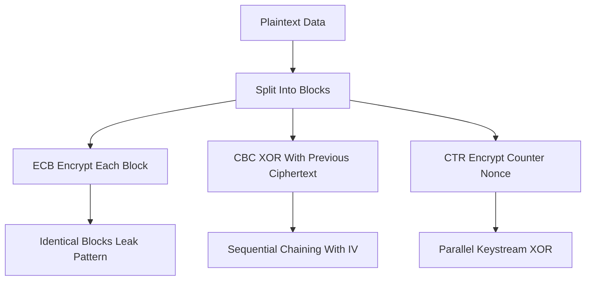

# Block Ciphers and Modes of Operation: How One Fixed-Size Function Becomes a Full Encryption Scheme

## English

A block cipher like AES is surprisingly narrow in what it does: it takes a fixed-size block of bits (128 bits for AES) and a key, and maps that block to another 128-bit block. That is the whole primitive. To encrypt something as ordinary as a photo or a chat message, you need a mode of operation — a recipe for applying that fixed-size block function repeatedly to arbitrary-length data. Electronic Codebook (ECB) is the naive mode: split the data into blocks and encrypt each independently. It is fatally broken for real data because identical plaintext blocks produce identical ciphertext blocks, so the structure of an image or a repeated message leaks straight through. You have probably seen the famous illustration of a bitmap encrypted with ECB where the outline of the picture is still visible.

Cipher Block Chaining (CBC) fixes that by XORing each plaintext block with the previous ciphertext block before encrypting, so identical plaintext blocks encrypt differently depending on their position. The catch is that CBC is inherently sequential — you cannot encrypt block N until block N-1 exists — and it needs a unique, unpredictable initialization vector (IV) for the first block. CBC also gives you confidentiality only; it says nothing about tampering, which is why padding-oracle attacks against CBC-based protocols have been so damaging historically.

Counter (CTR) mode turns the block cipher into a stream cipher: you encrypt a sequence of counter values (nonce plus incrementing number) and XOR the resulting keystream with your plaintext. Because each counter block is independent, CTR is fully parallelizable and you can jump to any offset — which is exactly why it is used for random-access disk encryption. The trade-off is that CTR is extremely brittle about nonce reuse: encrypt two messages with the same key and nonce and the XOR of the two ciphertexts equals the XOR of the two plaintexts, which leaks enormous amounts of structure.

Galois/Counter Mode (GCM) combines CTR-mode encryption with a polynomial-based authentication tag computed over both the ciphertext and any associated data, giving you authenticated encryption in one pass. That is why AES-GCM is the default choice in TLS 1.3 and most modern protocols. The lesson from all of this: the block cipher is the engine, but the mode is the vehicle — and a good engine in a badly designed vehicle still crashes. Choosing a mode is not a detail you leave to chance; it determines whether your system is secure, fast, parallelizable, and safe against tampering.

## 中文

像 AES 這類分組密碼（block cipher）其實功能非常狹窄：它接收一個固定大小的位元區塊（AES 是 128 位元）和一把金鑰，然後把這個區塊映射成另一個 128 位元的區塊。整個原語（primitive）就只有這樣。要加密一張相片或一段聊天訊息這種長度不定的資料，你需要的是運作模式（mode of operation）——一套把這個固定大小的區塊函數反覆套用到任意長度資料上的配方。電子密碼本模式（ECB）是最天真的做法：把資料切成區塊，逐塊獨立加密。它對真實資料來說是致命地不安全，因為相同的明文區塊會產生相同的密文區塊，於是圖片或重複訊息的結構會直接洩漏出去。你大概看過那張著名的示意圖：用 ECB 加密的點陣圖，圖片的輪廓依然清晰可見。

密碼區塊鏈結模式（CBC）透過在加密前把每個明文區塊與前一個密文區塊做 XOR 來修正這個問題，於是相同的明文區塊會因為所在位置不同而加密成不同的結果。代價是 CBC 本質上是循序的——沒有第 N-1 塊就無法加密第 N 塊——而且第一塊需要一個唯一且不可預測的初始化向量（IV）。CBC 也只提供機密性，對篡改毫無防備，這正是歷史上針對 CBC 協定的填充預言攻擊（padding-oracle attack）如此具破壞力的原因。

計數器模式（CTR）把分組密碼變成串流密碼：你加密一連串計數器值（nonce 加上遞增編號），再把產生的金鑰流與明文做 XOR。因為每個計數器區塊彼此獨立，CTR 完全可平行化，也可以跳到任意位置——這正是它被用於隨機存取磁碟加密的原因。取捨是 CTR 對 nonce 重用極度敏感：用同一把金鑰和同一個 nonce 加密兩段訊息，兩個密文的 XOR 就等於兩個明文的 XOR，會洩漏大量結構。

Galois/計數器模式（GCM）把 CTR 模式加密與一個基於多項式的驗證標籤結合，該標籤同時涵蓋密文與附加資料，一趟就給你認證加密。這就是 AES-GCM 成為 TLS 1.3 及大多數現代協定預設選擇的原因。這一切的教訓是：分組密碼是引擎，但模式才是車體——好引擎裝在設計不良的車體裡照樣會撞車。選擇模式不是你隨便留給運氣的細節；它決定你的系統是否安全、快速、可平行化，以及能否抵抗篡改。

## Key Takeaway

A block cipher only encrypts one fixed-size block; the mode of operation decides whether the overall scheme is secure, parallelizable, and tamper-resistant.

## Related Concepts
- Authenticated Encryption (AEAD)
- Initialization Vectors and Nonces

## Diagram

