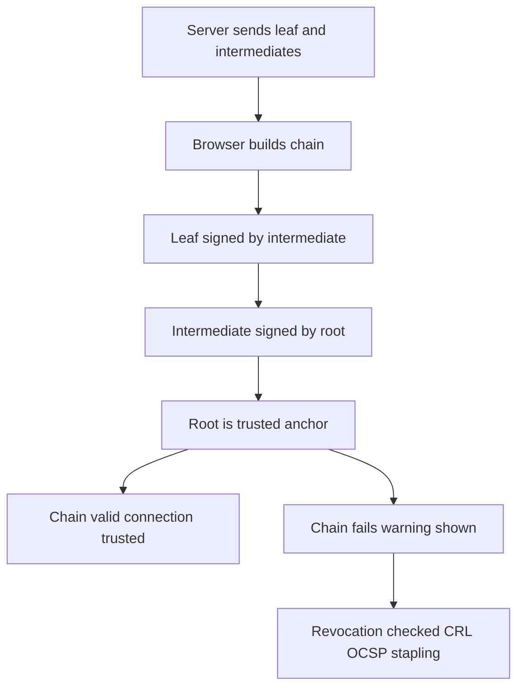

# Public Key Infrastructure and the Chain of Trust: Why Your Browser Believes a Stranger

## English

Asymmetric cryptography has a bootstrapping problem. If you receive a public key claiming to belong to your bank, how do you know it actually does? Anyone can generate a key pair and label it with any name. Digital signatures solve integrity, but only once you already trust the signing key. Public Key Infrastructure (PKI) is the social and technical scaffolding that answers this question. At its centre are certificate authorities (CAs) — entities whose public keys are pre-installed in your operating system or browser as trust anchors. A CA signs a certificate that binds a public key to an identity (typically a domain name), and your browser accepts that binding because it trusts the CA.

An X.509 certificate is a structured document containing the subject's public key, the identity it is bound to, a validity period, and a signature from an issuer. When you visit a site, the server sends its certificate plus any intermediate certificates. Your browser builds a chain: the leaf certificate is signed by an intermediate, the intermediate is signed by another intermediate or directly by a root, and the root is one of the trust anchors already on your machine. If any link is missing, expired, revoked, or signed with an algorithm the browser no longer accepts, the chain fails and you get a warning. This is why you sometimes see a valid site break because an intermediate certificate expired — the leaf was fine, but the chain was not.

Revocation is the famously awkward part. Certificate Revocation Lists (CRLs) are bulky and stale; the Online Certificate Status Protocol (OCSP) lets a browser ask the CA in real time but leaks browsing activity and adds latency. Modern deployments increasingly rely on OCSP stapling (the server fetches a fresh signed status and presents it during the handshake) and on Certificate Transparency logs, which are append-only public records of issued certificates so that mis-issuance can be detected after the fact. The tension is fundamental: revocation has to be fast, private, and reliable, and those goals pull against each other.

Beyond the web, PKI shows up in code signing, email encryption (S/MIME), VPN authentication, and enterprise device management. The recurring lesson is that cryptography alone never establishes trust in an identity — trust comes from governance, audit, and the operational discipline of the CAs and the software that ships their roots. When people say 'the padlock means the site is safe', the accurate statement is narrower: the padlock means the connection is encrypted and the certificate chain validates against your trust store. It says nothing about whether the site is honest.

## 中文

非對稱密碼學有一個啟動難題（bootstrapping problem）。如果你收到一把聲稱屬於你銀行的公開金鑰，你怎麼知道它真的是？任何人都可以生成一對金鑰並貼上任何名字。數位簽章能解決完整性問題，但前提是你已經信任那把簽章金鑰。公開金鑰基礎建設（PKI）就是回答這個問題的社會與技術支架。它的核心是憑證授權機構（CA）——其公開金鑰已預先安裝在你的作業系統或瀏覽器中、作為信任錨點（trust anchor）的實體。CA 會簽發一份憑證，把一把公開金鑰綁定到某個身分（通常是網域名稱），而你的瀏覽器之所以接受這個綁定，是因為它信任那個 CA。

X.509 憑證是一份結構化文件，內含主體的公開金鑰、它所綁定的身分、有效期限，以及來自簽發者的簽章。當你造訪某個網站，伺服器會送出它的憑證以及任何中間憑證。你的瀏覽器會建立一條鏈：葉憑證由中間憑證簽發，中間憑證再由另一個中間憑證或直接由根憑證簽發，而根憑證是你機器上已有的信任錨點之一。若任何一環缺失、過期、被撤銷，或用瀏覽器已不再接受的演算法簽署，鏈就會斷掉，你會看到警告。這就是為何你偶爾會看到一個本來有效的網站掛掉，原因是某個中間憑證過期了——葉憑證本身沒問題，但鏈不是。

撤銷（revocation）是出了名難搞的部分。憑證撤銷清單（CRL）笨重又過時；線上憑證狀態協定（OCSP）讓瀏覽器即時向 CA 查詢，但會洩漏瀏覽活動並增加延遲。現代部署越來越倚賴 OCSP stapling（伺服器先取得最新的已簽章狀態，並在握手時一併呈上）以及憑證透明度（Certificate Transparency）日誌——這是只可追加的公開紀錄，記載所有已簽發的憑證，讓錯誤簽發能在事後被偵測出來。這裡的張力是根本性的：撤銷必須快速、私密又可靠，而這幾個目標彼此拉扯。

在網頁之外，PKI 也出現在程式碼簽章、電子郵件加密（S/MIME）、VPN 認證和企業裝置管理之中。反覆出現的教訓是：單靠密碼學永遠無法建立對某個身分的信任——信任來自治理、稽核，以及 CA 和發佈其根憑證的軟體在營運上的紀律。當人們說「鎖頭代表網站安全」時，準確的說法其實更窄：鎖頭代表連線已加密，且憑證鏈對你的信任儲存驗證通過。它對網站是否誠實，完全沒有說明。

## Key Takeaway

PKI turns a bare public key into a trusted identity through a chain of CA signatures, and the hard problems are revocation, governance, and knowing exactly what the padlock does and does not promise.

## Related Concepts
- X.509 Certificates
- Certificate Transparency

## Diagram

