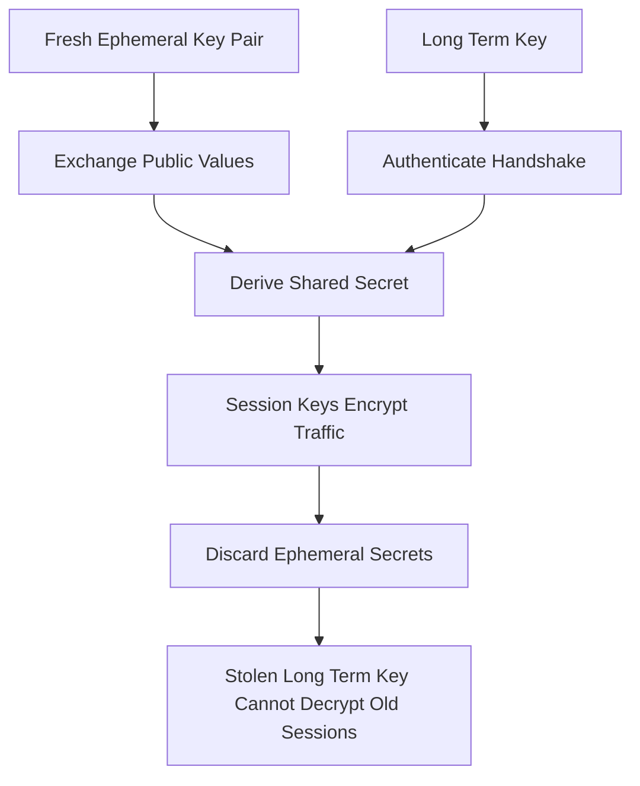

# Forward Secrecy and Key Compromise: Designing for the Day the Key Leaks

## English

Most encryption discussions assume the key stays secret forever. Real systems have to assume the opposite: keys get copied to backups, logged by accident, stolen by malware, subpoenaed, or extracted from a decommissioned server. Forward secrecy (also called perfect forward secrecy) is a design property that limits the blast radius of such a compromise. The idea is that the long-term key is used only to authenticate a fresh, ephemeral key exchange, and the session keys derived from that exchange are then discarded. If an attacker records your encrypted traffic today and steals the server's long-term private key next year, they still cannot decrypt the old sessions, because the ephemeral secrets were never stored anywhere.

The classic mechanism is Diffie-Hellman ephemeral (DHE) or its elliptic-curve variant ECDHE. In a TLS handshake, each side generates a fresh key pair for that session, exchanges public values, and derives a shared secret that only the two participants can compute. The server then signs the handshake transcript with its long-term key to prove it really is the server. The long-term key authenticates but does not encrypt, so its later theft does not retroactively unlock past sessions. TLS 1.3 goes further and mandates ephemeral key exchange for all cipher suites, removing the older static RSA key transport that lacked this property.

Forward secrecy does not protect against compromise of the session itself. If malware is running on the endpoint while the session is active, it can read plaintext before encryption or after decryption, and no protocol can prevent that. It also does not protect against an attacker who compromises the server's random number generator, or who can actively man-in-the-middle the handshake at the time it happens. Forward secrecy is specifically about retrospective decryption: it converts a single catastrophic future event into a bounded one.

Measuring the property is subtle. A system may claim forward secrecy but cache session keys for resumption, or log them to a debugging endpoint, or use a key derivation scheme where the same secret is reused across sessions. Auditing means asking concrete questions: where do session keys live, how long do they persist, are they ever written to disk, and does the key exchange actually generate fresh randomness per session? The broader principle generalises beyond TLS — any system that derives short-lived credentials from a long-lived root should ask what happens when the root leaks, and design so that the answer is 'the damage is limited to the present, not the past'.

## 中文

大多數關於加密的討論都假設金鑰永遠保密。真實系統卻必須假設相反的情況：金鑰會被複製到備份、意外被記錄、被惡意軟體竊取、被傳票要求交出，或從退役的伺服器上被提取出來。前向保密（forward secrecy，也叫完美前向保密）是一種設計屬性，用來限制這類外洩的波及範圍。它的想法是：長期金鑰只用來認證一次全新的、短暫的金鑰交換，而由該交換衍生出來的會話金鑰隨後就被丟棄。如果攻擊者今天錄下你的加密流量，明年偷走伺服器的長期私鑰，他們仍然無法解密舊的會話，因為那些短暫的秘密從未被儲存在任何地方。

經典機制是短暫 Diffie-Hellman（DHE）或其橢圓曲線變體 ECDHE。在 TLS 握手過程中，雙方各自為該會話生成一對全新的金鑰、交換公開值，並推匯出只有兩位參與者能算出的共享秘密。接著伺服器用它的長期金鑰對握手紀錄簽章，以證明它真的是那臺伺服器。長期金鑰只負責認證、不負責加密，所以它日後被竊，不會追溯性地解鎖過去的會話。TLS 1.3 更進一步，強制所有加密套件都使用短暫金鑰交換，移除了舊式、缺乏此屬性的靜態 RSA 金鑰傳輸。

前向保密並不保護會話本身被入侵。如果會話進行時端點上正跑著惡意軟體，它可以在加密前或解密後讀取明文，任何協定都擋不住。它也無法防禦入侵伺服器隨機數產生器的攻擊者，或能在握手當下主動中間人攻擊的人。前向保密專門針對回溯解密：它把一個未來發生的單一災難性事件，轉化成一個有界的事件。

衡量這個屬性並不容易。一個系統可能聲稱有前向保密，卻為了會話恢復而快取會話金鑰、把它記錄到除錯端點，或使用同一秘密跨會話重用的金鑰衍生方案。稽核意味著問具體的問題：會話金鑰存在哪裡、留存多久、會不會被寫到磁碟、金鑰交換是否真的每次會話都產生新的隨機數？這個更廣泛的原則可以推廣到 TLS 之外——任何從長期根憑證衍生短期憑證的系統，都應該問：當根洩漏時會怎樣？並設計成答案是「損害僅限於現在，而非過去」。

## Key Takeaway

Forward secrecy limits the damage of a future key compromise to future sessions only, by authenticating with long-term keys but encrypting with ephemeral ones that are discarded.

## Related Concepts
- Ephemeral Diffie-Hellman
- TLS 1.3

## Diagram

