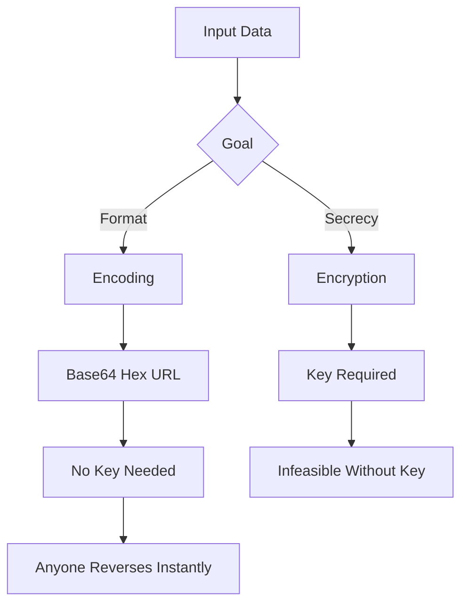

# Encoding Is Not Encryption: Base64, Hex, and the Illusion of Secrecy

## English

A surprising number of real-world security incidents come from one confusion: treating encoding as if it were encryption. Encoding is a reversible transformation whose only goal is to fit data into a different format — usually one that survives transport through systems that only accept certain characters. Base64, for example, takes arbitrary bytes and maps every 3 bytes into 4 printable ASCII characters drawn from a 64-character alphabet. Hex encoding maps each byte to two characters from 0-9 and a-f. URL encoding replaces unsafe characters with percent escapes. None of these use a secret key, and anyone who knows the scheme (which is public and standardised) can reverse it instantly with a single function call.

Encryption is fundamentally different because it requires a key. Without that key, reversing the transformation is designed to be computationally infeasible. If you Base64-decode a string, you get the original bytes back with zero effort. If you try to 'decode' AES ciphertext without the key, you get noise. This is why seeing a long string of letters, digits, and equals signs in a config file does not mean the value is protected — it may simply be Base64, which is the cryptographic equivalent of writing your password in a different font.

The confusion is understandable because encoded data looks scrambled. A JWT (JSON Web Token) is a classic trap: its three dot-separated segments are Base64url-encoded, so the header and payload are readable by anyone who pastes them into a decoder. Only the signature portion is cryptographic, and even that only proves integrity — the payload itself is not encrypted. Many developers have shipped JWTs containing sensitive claims believing them to be secret, only to discover that a browser extension or a quick command-line decode reveals everything. The lesson is to look at the data structure and ask: is there a key anywhere? If not, it is not encryption.

A useful mental model is to separate three jobs. Encoding is about representation: how do I move these bytes through a text-only channel? Compression is about size: how do I make this data smaller? Encryption is about confidentiality: how do I make this data unreadable to anyone without the key? These are orthogonal concerns, and you often apply all three in sequence — compress, then encrypt, then encode — but each step solves a different problem. Skipping the encryption step while keeping the encoding step is a common and dangerous shortcut, especially when the encoded blob is stored somewhere users can read it, like a client-side cookie or a mobile app bundle.

To build good instincts, practise this test on any suspicious string: try decoding it as Base64 or hex and see if recognisable text appears. If it does, the data was never secret. Then check whether the system that produced it documents a key, a nonce, and an authentication tag — the hallmarks of real encryption. Encoding has an important and legitimate role in cryptography (transport, storage, interoperability), but it is never a substitute for it. Treating the two as interchangeable is one of the cheapest mistakes an attacker can exploit.

## 中文

現實世界中有唔少安全事故，都源自同一個混淆：將編碼（encoding）當成加密（encryption）。編碼係一種可逆嘅轉換，目的只係將資料塞入另一個格式，通常係為咗令佢可以安全透過只接受某些字元嘅系統。例如 Base64，會將任意位元組每 3 個對映成 4 個可列印 ASCII 字元，用一個 64 字元嘅字母表。十六進位編碼就將每個位元組變成兩個字元（0-9 同 a-f）。URL 編碼就將唔安全嘅字元換成百分比轉義。呢啲方法全部都唔使用金鑰，而且方案本身係公開同標準化嘅，任何人識個方案就可以一個函式呼叫即刻還原。

加密就根本唔同，因為佢需要一條金鑰。冇咗條金鑰，要還原個轉換喺設計上係計算上不可行嘅。你 Base64 解碼一條字串，零功夫就攞返原本嘅位元組。你想喺冇金鑰嘅情況下「解碼」AES 密文，你只會得到一堆雜訊。所以，喺設定檔見到一長串字母、數字同等號，唔代表個值受到保護——佢可能只係 Base64，喺密碼學上等於用另一個字型寫你嘅密碼。

呢個混淆可以理解，因為編碼咗嘅資料睇落好似亂曬。JWT（JSON Web Token）就係經典陷阱：佢三個用點分隔嘅段落都係 Base64url 編碼，所以 header 同 payload 任何人都讀得到，只要貼入解碼器就得。只有簽名部分係密碼學嘅，而且簽名只係證明完整性——payload 本身冇加密。好多開發者運送含敏感宣告嘅 JWT，以為佢哋係秘密，點知一個瀏覽器擴充功能或者一行命令就揭曬出嚟。教訓係：睇嚇個資料結構，問一句：邊度有金鑰？如果冇，就唔係加密。

一個好用嘅心智模型，係將三件事分開。編碼關乎表示法：我點樣將呢啲位元組經純文字通道運送？壓縮關乎大小：我點樣令資料細啲？加密關乎保密性：我點樣令冇金鑰嘅人讀唔明？呢三樣係正交嘅關注點，你經常會依次做齊——壓縮、再加密、再編碼——但每一步解決唔同問題。跳過加密步驟但保留編碼步驟，係常見又危險嘅捷徑，尤其係當嗰舊編碼資料擺喺使用者讀得到嘅地方，例如客戶端 cookie 或者手機 app 嘅 bundle。

要建立好嘅直覺，可以對任何可疑字串做個測試：試嚇用 Base64 或者十六進位解碼，睇嚇會唔會出現可辨識嘅文字。如果會，即係啲資料從來都唔係秘密。然後檢查產生佢嘅系統有冇記錄金鑰、nonce 同認證標籤（authentication tag）——呢啲先係真加密嘅特徵。編碼喺密碼學入面有重要而正當嘅角色（傳輸、儲存、互通性），但佢永遠唔可以代替加密。將兩者當成可互換，係攻擊者最容易利用嘅錯誤之一。

## Key Takeaway

Encoding changes the format of data with no secret key, so anyone can reverse it; only encryption with a key provides confidentiality.

## Related Concepts
- Base64 and hexadecimal encoding
- JWT structure and claims

## Diagram

