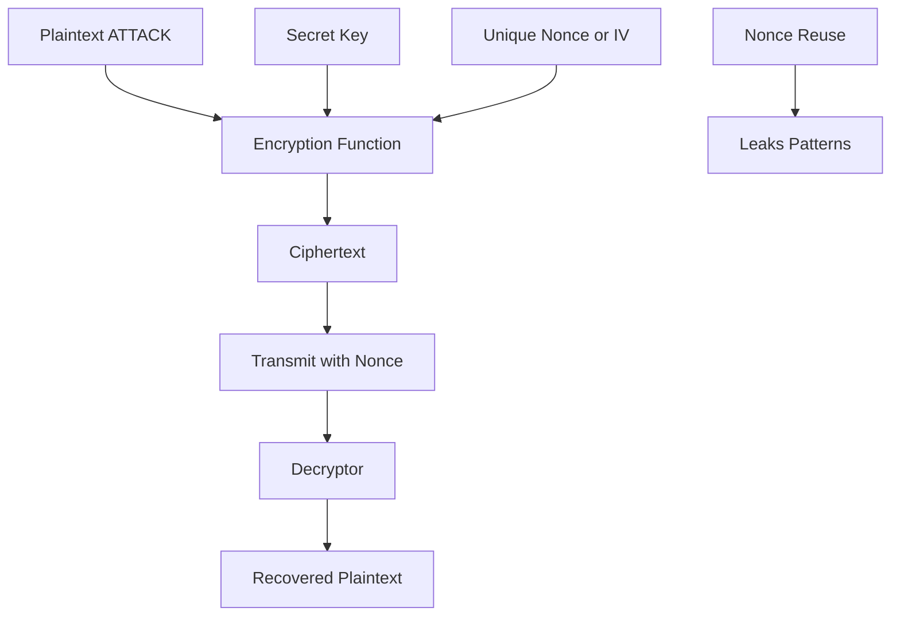

# Initialization Vectors and Nonces: Why Encrypting the Same Message Twice Should Look Different

## English

Imagine you encrypt the word 'ATTACK' today and again tomorrow, using the same key and the same algorithm. If the two ciphertexts are byte-for-byte identical, an eavesdropper learns something valuable even without breaking the encryption: the plaintexts are the same. This is called a deterministic encryption scheme, and it leaks patterns. In a database of encrypted salaries, everyone earning the same amount would produce identical ciphertexts, letting an attacker cluster and rank employees without ever decrypting a single record. Real encryption must be randomised so that encrypting the same plaintext twice produces completely different outputs.

The tool that provides this randomness is called an initialization vector (IV) in older literature, or more generally a nonce — a number used once. It is an extra input to the encryption function alongside the key and the plaintext, and it does not need to be secret. What it does need is to be unique for each encryption operation under a given key, or in some modes, unpredictable. The IV is typically stored or transmitted alongside the ciphertext, often as a prefix, because the decryptor needs the exact same value to reverse the operation. The security guarantee is subtle but powerful: as long as nonces never repeat, identical plaintexts yield unrelated ciphertexts.

Different modes of operation have different rules, and getting them wrong is catastrophic rather than merely inconvenient. In CBC mode, the IV must be unpredictable (ideally random), and reusing an IV across two messages leaks information about the XOR of their first blocks. In CTR and stream-cipher-like modes such as GCM, the nonce must never repeat under the same key — full stop. Reusing a nonce in GCM does not just leak a little; it can allow an attacker to recover the authentication key and forge messages. This is why nonce management is treated as a first-class engineering problem, not an afterthought.

A classic historical failure illustrates the stakes. The WEP protocol for Wi-Fi used short, often reused IVs, and researchers showed that collecting enough ciphertexts with repeated IVs allowed statistical recovery of the keystream and eventually the key. Modern protocols like WPA2 and TLS avoid this by using long random or counter-based nonces and by rotating keys before the nonce space could plausibly be exhausted. The general principle is to size your nonce space so that, given the number of messages you expect to encrypt, the probability of a collision stays astronomically small.

In practice, good libraries handle most of this for you, but you must understand the contract. For AES-GCM, generate a fresh random 96-bit nonce for every message unless you have a carefully designed counter scheme, and never reuse one. For CBC, generate a random IV per message and do not derive it from the plaintext. Store the IV or nonce with the ciphertext, because it is not secret. If you are ever tempted to hard-code a nonce 'just for testing', remember that test code has a habit of reaching production. Treat nonce uniqueness as a hard invariant, the way you would treat memory safety, because the failure mode is silent and total.

## 中文

想像你今日加密「ATTACK」呢個字，聽日又加密一次，用同一條金鑰同同一個演算法。如果兩個密文逐位元組一模一樣，竊聽者就算破解唔到加密，都學到有價值嘅嘢：兩個明文係一樣嘅。呢種叫確定性加密（deterministic encryption），會洩漏模式。喺一個加密咗嘅人工資料庫入面，所有賺同一份糧嘅人會產生相同密文，攻擊者唔使解密任何一條紀錄，就分得出邊個打邊個、排到次序。真正嘅加密一定要隨機化，令同一段明文加密兩次會得出完全唔同嘅輸出。

提供呢種隨機性嘅工具，舊文獻叫初始化向量（initialization vector，IV），更通用嘅講法係 nonce——只用一次嘅數字。佢係加密函式除咗金鑰同明文之外嘅額外輸入，而且唔需要保密。佢需要嘅係喺同一條金鑰之下，每次加密都獨一無二，或者喺某些模式下要不可預測。IV 通常會同密文一齊儲存或者傳送，好多時做字首，因為解密方需要完全相同嘅值先可以還原。個保安保證好微妙但好強大：只要 nonce 唔重複，相同嘅明文就會得出冇關聯嘅密文。

唔同嘅運作模式有唔同規則，搞錯咗係災難性而唔止係麻煩。喺 CBC 模式，IV 必須不可預測（最好隨機），喺兩條訊息重用同一個 IV 會洩漏佢哋第一個區塊 XOR 嘅資訊。喺 CTR 同 GCM 呢類流密碼式模式，nonce 喺同一條金鑰之下絕對唔可以重複——就係咁。喺 GCM 重用 nonce 唔止洩漏少少；可以令攻擊者還原認證金鑰同偽造訊息。所以 nonce 管理被當成頭等工程問題，唔係事後補救。

一個經典嘅歷史失敗說明咗箇中風險。Wi-Fi 嘅 WEP 協定用短而且經常重用嘅 IV，研究人員證明收集足夠多含重複 IV 嘅密文，就可以統計式咁還原 keystream，最終攞到金鑰。現代協定好似 WPA2 同 TLS 就避免呢點，用長嘅隨機或者計數器式 nonce，並且喺 nonce 空間可能耗盡之前輪換金鑰。一般原則係：按你預期加密幾多條訊息，去決定 nonce 空間大細，令碰撞機率維持喺極微。

實務上，好嘅函式庫會幫你處理大部分，但你要明白個合約。用 AES-GCM，每條訊息都產生一個全新隨機 96 位元 nonce，除非你有精心設計嘅計數器方案，否則永遠唔好重用。用 CBC，每條訊息產生隨機 IV，唔好由明文推匯出嚟。將 IV 或者 nonce 同密文一齊儲存，因為佢唔係秘密。如果你曾經想過「淨係測試用」而寫死一個 nonce，記住測試碼好容易流入生產環境。將 nonce 唯一性當成硬性不變數，好似你對待記憶體安全咁，因為佢嘅失敗模式係無聲而且徹底嘅。

## Key Takeaway

A nonce or IV is a per-message random input that makes encryption probabilistic, and reusing it can break confidentiality or authentication entirely.

## Related Concepts
- Block cipher modes of operation
- AES-GCM authenticated encryption

## Diagram

