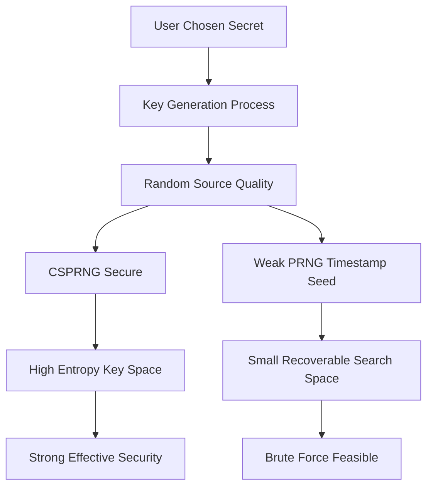

# Entropy and Key Strength: Why Key Length Is Not the Whole Story

## English

People often ask whether a 256-bit key is 'twice as strong' as a 128-bit key. The answer reveals a lot about how cryptographic strength actually works. Key length is measured in bits, but strength is measured in entropy — the number of genuinely unpredictable possibilities an attacker must search. A 256-bit key drawn from a proper random source has 2^256 possible values, which is astronomically larger than 2^128. But a 256-bit key generated by hashing the string 'password123' has far less than 256 bits of entropy, because the set of plausible human-chosen strings is tiny. The attacker does not search the key space; they search the password space, which is much smaller.

This is why the quality of the random number generator matters as much as the key length. Cryptographic systems rely on a cryptographically secure pseudorandom number generator (CSPRNG), which produces output indistinguishable from true randomness to any feasible test. Ordinary random functions in programming languages, like those seeded by the current time, are designed for simulations and games, not secrets. If an attacker can guess or observe the seed, they can reproduce the entire keystream. There are documented cases of keys generated from timestamps or process IDs being recovered because the search space was small enough to brute-force.

Entropy also explains why 'military-grade 512-bit encryption' marketing is meaningless. If a system uses AES with a 256-bit key, the effective security is bounded by the key's entropy, not by the number of bits printed on the box. In fact, doubling the key length from 128 to 256 bits squares the search space, which sounds enormous, but against a well-designed cipher both are already far beyond brute-force reach. The practical bottleneck is almost never the cipher; it is key management, implementation bugs, or weak randomness. Attacker economics favour finding the cheapest path, and that is rarely a frontal assault on AES.

A useful analogy is a combination lock. A lock with a million possible combinations sounds strong, but if the manufacturer ships every lock set to 000000 and most users never change it, the effective entropy is one. Similarly, a 2048-bit RSA key is only as strong as the difficulty of factoring the product of two primes — the bit length describes the size of the modulus, not a direct count of guesses. Cryptographic strength is always relative to the best known attack against that specific primitive, which is why algorithm choice and key size are separate decisions.

To reason about strength, ask three questions. First, how was the key generated — from a CSPRNG with sufficient entropy, or from something guessable? Second, what is the best known attack on this algorithm at this key size, and how does it scale? Third, how long must the secret stay safe — because a key that is fine for a session lasting minutes may be inadequate for data that must remain confidential for decades. Answering these honestly is more valuable than memorising bit-length tables, and it keeps you focused on where real systems actually break.

## 中文

好多人會問，256 位元金鑰係咪比 128 位元「強一倍」？答案揭示咗密碼學強度實際上點運作。金鑰長度以位元計，但強度以熵（entropy）計——即係攻擊者要搜尋幾多個真正不可預測嘅可能性。一條由真正隨機來源抽出嘅 256 位元金鑰有 2^256 個可能值，比 2^128 大天文數字咁多。但一條由雜湊字串「password123」產生嘅 256 位元金鑰，熵遠遠少過 256 位元，因為人類會揀嘅字串集合好細。攻擊者唔係搜尋金鑰空間，而係搜尋密碼空間，後者細好多。

所以隨機數產生器嘅質素同金鑰長度一樣重要。密碼系統依賴密碼學安全偽隨機數產生器（CSPRNG），佢嘅輸出對任何可行測試嚟講都同真正隨機冇分別。程式語言入面普通嘅 random 函式，例如用當前時間做種子嗰啲，係為模擬同遊戲而設，唔係為秘密而設。如果攻擊者估到或者觀察到種子，佢就可以重現成條 keystream。有文獻記載嘅案例，係用時間戳或者行程 ID 產生嘅金鑰被還原，因為搜尋空間細到可以暴力破解。

熵亦解釋咗點解「軍用級 512 位元加密」呢類宣傳冇意義。如果系統用 AES 配 256 位元金鑰，實際安全性受金鑰嘅熵限制，唔係受包裝盒上印嘅位元數限制。事實上，由 128 位元加到 256 位元會令搜尋空間平方化，聽落好巨大，但對一個設計良好嘅密碼嚟講，兩者都已經遠超暴力破解可及範圍。實際瓶頸幾乎永遠唔係密碼本身，而係金鑰管理、實作錯誤，或者弱隨機性。攻擊者嘅經濟學傾向搵最便宜嘅路徑，而嗰條路好少係正面強攻 AES。

一個好用嘅比喻係密碼鎖。一個有一百萬個組合嘅鎖聽落好強，但如果製造商出貨時每個鎖都設做 000000，而大部分使用者唔改，實際熵就係一。同樣，一條 2048 位元 RSA 金鑰嘅強度，只等於分解兩個質數乘積嘅難度——位元長度描述嘅係模數大細，唔係直接嘅猜測次數。密碼學強度永遠相對於針對嗰個特定原語嘅最佳已知攻擊，所以演算法選擇同金鑰大小係兩個分開嘅決定。

要推理強度，問三個問題。第一，條金鑰係點產生——由有足夠熵嘅 CSPRNG，定係由估得到嘅嘢？第二，喺呢個金鑰大小之下，呢個演算法嘅最佳已知攻擊係咩，佢點樣隨規模變化？第三，個秘密要安全幾耐——因為一個夠用幾分鐘 session 嘅金鑰，對於要保密幾十年嘅資料可能唔夠。誠實回答呢三條問題，比背位元長度表更有價值，亦令你專注喺真實系統真正會斷嘅地方。

## Key Takeaway

Cryptographic strength depends on the entropy of the key and the best known attack, not just the number of bits in the key.

## Related Concepts
- Cryptographically secure pseudorandom number generators
- Key management and rotation

## Diagram

