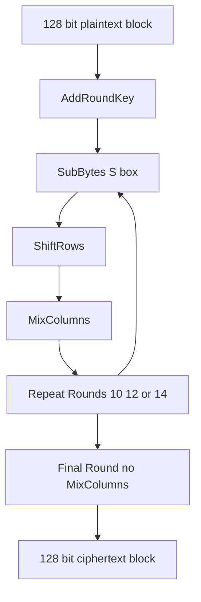

# AES in Practice: The Substitution-Permutation Network and Why the S-Box Matters

## English

AES (Advanced Encryption Standard) is a block cipher, meaning it encrypts fixed 128-bit chunks of data at a time. Internally it repeats a series of rounds — 10 for a 128-bit key, 12 for 192-bit, 14 for 256-bit — and each round applies four operations: SubBytes, ShiftRows, MixColumns, and AddRoundKey. The most conceptually interesting is SubBytes, which replaces each byte with a different byte using a lookup table called the S-box. This nonlinear substitution is what gives AES its resistance to linear and differential cryptanalysis, the two most powerful mathematical attacks on block ciphers. Without the S-box, AES would be a linear transformation and would collapse under algebra.

The S-box is not arbitrary. It is derived from the multiplicative inverse in the finite field GF(2^8) followed by an affine transformation. That construction gives it very specific algebraic properties: every output byte depends on every input byte in a nonlinear way, and the mapping is a bijection (every input maps to a unique output, so it is reversible). The designers chose this structure partly to make the cipher easy to analyse mathematically — which sounds counterintuitive, but a cipher whose weaknesses are known and studied is safer than one whose weaknesses are hidden.

ShiftRows and MixColumns provide diffusion: they spread the influence of one input byte across many output bytes so that flipping a single bit of plaintext changes roughly half the bits of the ciphertext (the avalanche effect). AddRoundKey XORs the round key into the state. The final round omits MixColumns to make decryption structurally symmetric with encryption, which simplifies hardware implementations. In practice, modern CPUs implement AES in dedicated silicon (the AES-NI instruction set on x86, ARMv8 Crypto Extensions), so a laptop can encrypt gigabytes per second with negligible CPU cost.

What this means for a developer: you almost never call AES directly. You call a library like OpenSSL, libsodium, or your language's crypto module, and you should never implement AES yourself for production use. The S-box lookup table is also a side-channel risk: a naive table-based implementation leaks timing information that can reveal the key on shared hardware. That is why constant-time implementations and hardware acceleration matter, and why authenticated modes (covered separately) are mandatory — AES alone does not detect tampering.

A useful mental model: AES is a blender. Each round stirs the input with a secret ingredient (the round key) and a fixed mechanical pattern (the S-box and mixing), and after enough rounds the output looks statistically indistinguishable from random. The security comes from the combination of nonlinearity (S-box) and diffusion (ShiftRows, MixColumns) repeated many times, not from any single step.

## 中文

AES（進階加密標準）是一種分組密碼，意思是它一次只加密固定 128 位元的資料區塊。內部會重複執行一系列輪次——128 位元金鑰做 10 輪、192 位元做 12 輪、256 位元做 14 輪——每一輪套用四個運算：SubBytes、ShiftRows、MixColumns 和 AddRoundKey。概念上最有趣的是 SubBytes，它用一個稱為 S-box 的查表，把每個位元組換成另一個位元組。這種非線性替換正是 AES 能抵抗線性與差分密碼分析（當今對分組密碼最強大的兩種數學攻擊）的原因。沒有 S-box，AES 就會變成線性變換，在代數攻擊下瞬間崩潰。

S-box 並非任意設計。它是由有限體 GF(2^8) 中的乘法反元素，再經過一個仿射變換推導而來。這個構造賦予它非常特定的代數性質：每個輸出位元組都以非線性方式依賴每個輸入位元組，而且這個對映是雙射（每個輸入對應唯一輸出，因此可逆）。設計者選擇這個結構，部分原因是讓密碼在數學上容易分析——聽起來反直覺，但一個弱點已知且被研究透徹的密碼，比一個把弱點藏起來的密碼更安全。

ShiftRows 和 MixColumns 提供擴散：它們把單一輸入位元組的影響散佈到許多輸出位元組，使明文翻轉一個位元，密文大約有一半位元跟著改變（雪崩效應）。AddRoundKey 則把輪金鑰 XOR 進狀態。最後一輪省略 MixColumns，讓解密在結構上與加密對稱，簡化硬體實作。實務上，現代 CPU 用專屬矽晶實作 AES（x86 的 AES-NI 指令集、ARMv8 的加密擴充），所以一部筆電每秒可加密數 GB，CPU 成本幾乎可忽略。

對開發者而言：你幾乎不會直接呼叫 AES。你會呼叫 OpenSSL、libsodium 或你所用語言的 crypto 模組，而且絕不該在生產環境自行實作 AES。S-box 查表本身也是側通道風險：以表格為基礎的樸素實作會洩漏計時資訊，在共享硬體上可被用來還原金鑰。這就是為什麼常數時間實作與硬體加速很重要，也是為什麼必須搭配認證模式（另篇討論）——AES 本身不會偵測竄改。

一個好用的心智模型：AES 是一部果汁機。每一輪用秘密材料（輪金鑰）和固定機械模式（S-box 與混合）攪拌輸入，攪夠多輪之後，輸出在統計上與隨機無法區分。安全性來自非線性（S-box）與擴散（ShiftRows、MixColumns）反覆多次的組合，而不是任何單一步驟。

## Key Takeaway

AES security comes from repeated rounds of nonlinear substitution (S-box) and diffusion, which is why you should always use a vetted library and hardware-accelerated implementations rather than rolling your own.

## Related Concepts
- Substitution-Permutation Network
- Side-channel attacks

## Diagram

