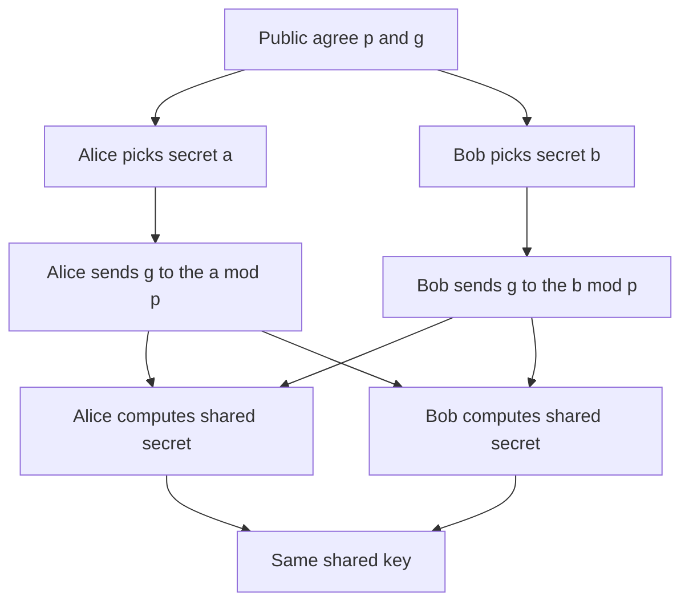

# Key Exchange in Plain Sight: Diffie-Hellman and the Discrete Logarithm Problem

## English

The key exchange problem is deceptively simple: two parties who have never met want to agree on a shared secret key, over a channel that an eavesdropper is listening to. Diffie-Hellman, published in 1976, solves this with a trick so elegant it feels like cheating. Both parties agree publicly on a large prime number p and a generator g. Alice picks a secret random number a and sends g^a mod p to Bob. Bob picks a secret random number b and sends g^b mod p to Alice. Alice computes (g^b)^a mod p, Bob computes (g^a)^b mod p, and both arrive at the same value g^(ab) mod p — without ever transmitting a or b.

An eavesdropper sees g, p, g^a mod p, and g^b mod p, but recovering a or b from g^a mod p is the discrete logarithm problem: given g, p, and y = g^x mod p, find x. For a well-chosen prime (typically 2048 bits or more, or using elliptic curves where the equivalent is much smaller), this is believed to be computationally infeasible. The security rests on a mathematical assumption, not on secrecy of the algorithm — an idea that was radical in the 1970s and is now standard.

Diffie-Hellman alone is unauthenticated: it stops passive eavesdroppers but not active attackers. In a classic man-in-the-middle attack, Mallory intercepts Alice's g^a, sends her her own g^m, and does the same to Bob. Alice and Bob each think they share a key with the other, but actually share separate keys with Mallory, who relays and reads everything. This is why real protocols combine Diffie-Hellman with authentication — TLS uses certificates to sign the exchange, and Signal uses pre-shared identity keys. The combination of an ephemeral Diffie-Hellman exchange with authentication is what gives you forward secrecy, discussed separately.

Modern deployments almost always use elliptic-curve Diffie-Hellman (ECDH) rather than finite-field Diffie-Hellman, because a 256-bit curve gives roughly the same security as a 3072-bit prime, which is much faster and produces smaller keys. The X25519 curve is especially popular because it is designed to be fast, constant-time, and resistant to certain implementation pitfalls. TLS 1.3 supports only ephemeral Diffie-Hellman key exchange (no static RSA key transport), which is a strong signal of where the field has landed.

A useful analogy: Alice and Bob each have a bucket of paint. They publicly agree on a shared color (yellow). Alice secretly adds her private color (red) and sends the mixture. Bob secretly adds his private color (blue) and sends his mixture. Each then adds their own private color to the other's mixture. Both end up with yellow+red+blue, but an eavesdropper who only sees yellow, yellow+red, and yellow+blue cannot separate the mixtures back into their components. The paint-mixing analogy is imperfect (real paint mixing is irreversible, whereas the math is reversible with the secret), but it captures the essential idea: public mixing, private ingredients.

## 中文

金鑰交換問題看似簡單：兩個從未見過面的人，想在一條被竊聽者監聽的通道上，協議出一把共享的秘密金鑰。1976 年發表的 Diffie-Hellman 用一個優雅到近乎作弊的技巧解決了它。雙方公開同意一個大質數 p 和一個生成元 g。Alice 選一個秘密隨機數 a，把 g^a mod p 傳給 Bob。Bob 選一個秘密隨機數 b，把 g^b mod p 傳給 Alice。Alice 計算 (g^b)^a mod p，Bob 計算 (g^a)^b mod p，雙方都得到同一個值 g^(ab) mod p——而過程中從未傳送過 a 或 b。

竊聽者看得到 g、p、g^a mod p 和 g^b mod p，但要從 g^a mod p 還原 a 或 b，就是離散對數問題：已知 g、p 和 y = g^x mod p，求 x。對於精心挑選的質數（通常 2048 位元以上，或使用橢圓曲線，等效強度下金鑰小得多），這被認為在計算上不可行。安全性建立在一個數學假設上，而不是演演算法的保密——這在 1970 年代是激進的想法，如今已是標準。

單獨的 Diffie-Hellman 是未經認證的：它能阻擋被動竊聽者，卻擋不住主動攻擊者。在典型的中間人攻擊中，Mallory 攔截 Alice 的 g^a，送給她自己的 g^m，對 Bob 也如法炮製。Alice 和 Bob 各自以為與對方共享金鑰，實際上卻分別與 Mallory 共享，Mallory 轉發並讀取一切。這就是為什麼真實協定會把 Diffie-Hellman 與認證結合——TLS 用憑證簽署交換，Signal 用預共享的身分金鑰。臨時 Diffie-Hellman 交換加上認證，正是提供前向保密（另篇討論）的來源。

現代部署幾乎都使用橢圓曲線 Diffie-Hellman（ECDH），而非有限體 Diffie-Hellman，因為 256 位元曲線的強度大約等於 3072 位元質數，速度快得多，金鑰也小得多。X25519 曲線特別受歡迎，因為它被設計成快速、常數時間，並能抵抗某些實作陷阱。TLS 1.3 只支援臨時 Diffie-Hellman 金鑰交換（不再有靜態 RSA 金鑰傳輸），強烈顯示了領域的走向。

一個好用的類比：Alice 和 Bob 各有一桶顏料。他們公開同意一個共享顏色（黃色）。Alice 偷偷加入她的私人顏色（紅色）並送出混合物。Bob 偷偷加入他的私人顏色（藍色）並送出他的混合物。然後各自把私人顏色加入對方的混合物。雙方最後都得到黃+紅+藍，但只看到黃色、黃+紅、黃+藍的竊聽者，無法把混合物分離回成分。油漆混合的類比並不完美（真實油漆混合不可逆，而數學在知道秘密時可逆），但它抓住了核心概念：公開混合，私下配料。

## Key Takeaway

Diffie-Hellman lets two strangers agree on a shared secret over a public channel, but it must be paired with authentication (certificates or pre-shared identity keys) to stop man-in-the-middle attacks.

## Related Concepts
- Discrete logarithm problem
- Man-in-the-middle attack

## Diagram

