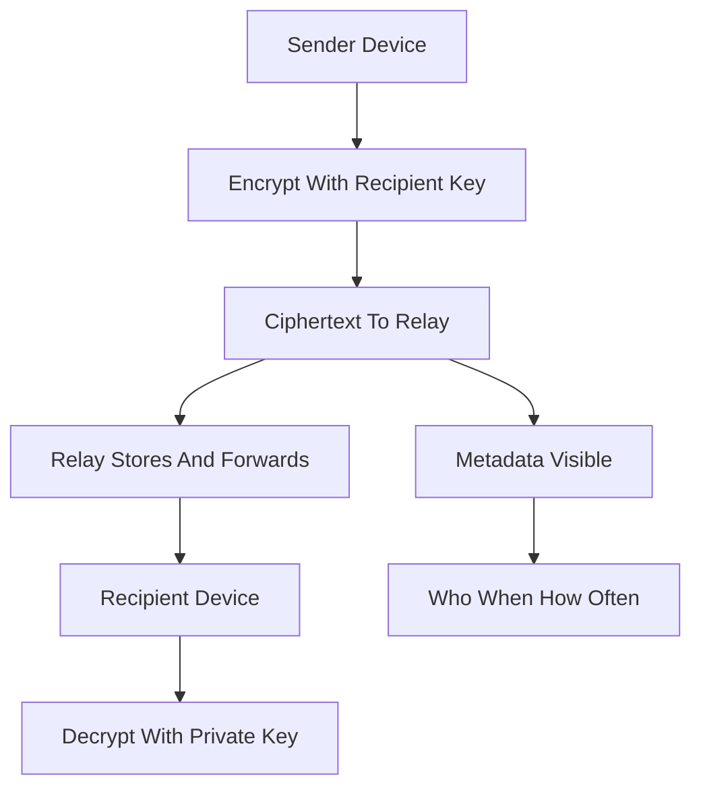

# End-to-End Encryption: Threat Models and Why Metadata Still Leaks

## English

End-to-end encryption (E2EE) means the message is encrypted on the sender's device and decrypted only on the recipient's device, with no server in between able to read it. This is a stronger guarantee than transport encryption (like HTTPS), where the server terminates TLS and can see plaintext. In E2EE, the service provider — whether a messaging app, a backup service, or a file-sharing tool — is reduced to a relay that stores and forwards ciphertext it cannot decrypt. The threat model is fundamentally different: you are now defending against the service provider itself, not just against network eavesdroppers.

Achieving E2EE properly is harder than it sounds. You need a way to establish keys between parties who may be offline, a way to handle multiple devices per user, a way to recover from lost devices without breaking security, and a way to verify that the person you are talking to is really who they claim. Signal's Double Ratchet protocol solves several of these by combining a Diffie-Hellman ratchet (new key pairs per message exchange) with a symmetric-key ratchet (new message keys per message), giving forward secrecy and post-compromise security. Group messaging is harder still: you need to distribute keys to many recipients efficiently, which is why protocols like MLS (Messaging Layer Security) exist.

Even with perfect E2EE, metadata leaks. Who talked to whom, when, how often, message sizes, and timing patterns are all visible to the relay server and often to network observers. This metadata can be extraordinarily revealing: a sudden burst of messages at 3 a.m. between two accounts, followed by silence, tells a story even if the content is opaque. Defending against metadata analysis requires techniques like cover traffic, padding, and mix networks — which are expensive and rarely deployed in consumer apps. This is a key limitation to understand: E2EE protects content, not the fact that communication happened.

Another subtlety is key verification. E2EE protocols typically give you a fingerprint or safety number you can compare out-of-band (in person, over a phone call) to confirm you are talking to the right person and not a man-in-the-middle. Most users never do this, which means in practice E2EE often relies on trust in the key directory service — the very party E2EE was supposed to protect you from. Some apps mitigate this with transparency logs or automatic key verification across devices, but the fundamental tension between usability and verification remains.

A useful mental model: E2EE is like sending a locked box through a courier. The courier can see the box, weigh it, note when you dropped it off and where it went, but cannot open it. That is a real and valuable guarantee — but it does not hide the fact that you sent a box, how big it was, or who received it. Understanding what E2EE does and does not protect is essential for reasoning about real-world security claims.

## 中文

端對端加密（E2EE）是指訊息在寄件者裝置上加密，只在收件者裝置上解密，中間沒有任何伺服器能讀取。這比傳輸加密（如 HTTPS）的保證更強——HTTPS 由伺服器終止 TLS，因此伺服器看得到明文。在 E2EE 中，服務提供者——無論是通訊 app、備份服務或檔案分享工具——被降級成一個只能儲存與轉發密文的轉送者，無法解密。威脅模型從根本上不同：你現在防禦的是服務提供者本身，而不只是網路竊聽者。

正確實作 E2EE 比聽起來難得多。你需要一種方法，讓可能離線的雙方建立金鑰；需要處理每位使用者的多個裝置；需要在裝置遺失時恢復而不破壞安全性；還需要驗證與你對話的人真的是他本人。Signal 的 Double Ratchet 協定結合了 Diffie-Hellman 棘輪（每次訊息交換產生新金鑰對）與對稱金鑰棘輪（每則訊息產生新訊息金鑰），同時提供前向保密與洩漏後恢復。群組訊息更難：你需要有效率地把金鑰分發給眾多收件者，這正是 MLS（Messaging Layer Security）這類協定存在的原因。

即使 E2EE 完美無缺，中介資料仍會洩漏。誰與誰通話、何時、多頻繁、訊息大小與時間模式，全都對轉送伺服器可見，也常對網路觀察者可見。這些中介資料可能極具揭示性：兩個帳號在凌晨三點突然大量訊息往來，然後歸於沉寂，即使內容不透明，也訴說了一個故事。防禦中介資料分析需要掩護流量、填充與混合網路等技術——成本高昂，消費級 app 很少部署。這是必須理解的關鍵限制：E2EE 保護內容，不保護「通訊發生過」這件事實。

另一個微妙之處是金鑰驗證。E2EE 協定通常會給你一組指紋或安全碼，讓你可以在頻外（當面、電話中）比對，確認你對話的物件正確，而非中間人。大多數使用者從不這麼做，這意味著實務上 E2EE 往往依賴對金鑰目錄服務的信任——而這正是 E2EE 原本要保護你免受其害的那一方。有些 app 用透明度日誌或跨裝置自動金鑰驗證來緩解，但可用性與驗證之間的根本張力依然存在。

一個好用的心智模型：E2EE 就像透過快遞寄一個上鎖的箱子。快遞員看得到箱子、可以秤重、記錄你何時寄出、送到哪裡，但打不開它。這是真實且有價值的保證——但它不會隱藏你寄了箱子、箱子多大、誰收到。理解 E2EE 保護什麼、不保護什麼，對於判斷現實世界的安全宣稱至關重要。

## Key Takeaway

End-to-end encryption protects message content from the service provider itself, but metadata (who, when, how often) still leaks, and key verification remains a usability challenge most users skip.

## Related Concepts
- Threat modeling
- Metadata leakage

## Diagram

