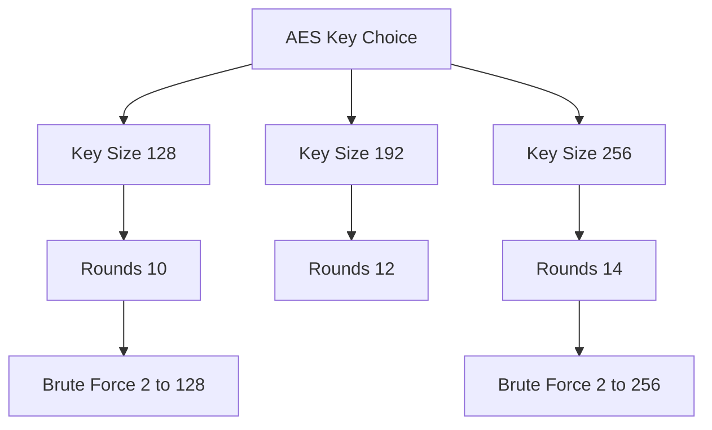

# AES Key Sizes and Why 128 Bits Is Already Plenty

## English

AES (Advanced Encryption Standard) is a block cipher standardised by NIST in 2001 that accepts three key sizes: 128, 192, and 256 bits. A common misconception is that AES-128 is 'weak' and AES-256 is 'twice as strong'. In reality, the difference is not a factor of two but a factor of 2^128 — an astronomically large number. AES-128 already requires 2^128 operations to brute-force by exhaustive key search, which is far beyond the total computational capacity of humanity for the foreseeable future. AES-256 raises that to 2^256, which is overkill for most threats but useful in specific contexts such as defence against future quantum computers (Grover's algorithm theoretically halves effective key strength, so AES-256 becomes roughly 128-bit-equivalent post-quantum).

The number of rounds also scales with key size: AES-128 uses 10 rounds, AES-192 uses 12, and AES-256 uses 14. Each round applies SubBytes (the S-box), ShiftRows, MixColumns, and AddRoundKey. More rounds provide more mixing and diffusion, but the 10 rounds of AES-128 are already believed to be sufficient against all known classical attacks. No practical attack on full AES-128 has ever been demonstrated — the best published results are on reduced-round variants.

So why do people choose AES-256? There are legitimate reasons: compliance requirements (e.g. some standards mandate 256-bit keys), defence in depth against hypothetical cryptanalytic breakthroughs, and post-quantum considerations. But there are also trade-offs. AES-256 is slower than AES-128 on CPUs without AES-NI hardware acceleration, and in some implementations AES-256 has a larger key schedule that can be a minor performance cost. AES-128 with a properly random key is already unbreakable by brute force.

The real attack surface is almost never the key size. It's nonce reuse, weak random number generation, side-channel leaks (timing, power consumption), implementation bugs, or key management failures. A system using AES-128 with proper nonce discipline and strong key management is far more secure than one using AES-256 with a nonce reused across messages. This is why security engineers say 'AES-128 is fine' — not because 256 is bad, but because the marginal benefit is negligible compared to getting the basics right.

A useful mental model: key length is like the length of a combination lock. A 128-digit combination is already impossible to guess by brute force. Making it 256 digits doesn't help if someone can photograph the lock, find the combination written on a sticky note, or exploit a flaw in the lock mechanism. In cryptography, the 'photograph the lock' equivalents are side channels, weak randomness, and protocol mistakes.

## 中文

AES（Advanced Encryption Standard，進階加密標準）係 NIST 喺 2001 年標準化嘅分組密碼，接受三種密鑰長度：128、192 同 256 位元。好多人有個誤解，以為 AES-128 係「弱」嘅，AES-256 就「強一倍」。實際上，差距唔係兩倍，而係 2^128 倍——一個天文數字。AES-128 已經需要 2^128 次操作先可以暴力破解（即係逐個密鑰試），遠遠超出人類喺可見將來嘅總計算能力。AES-256 將呢個數字推到 2^256，對大部分威脅嚟講係殺雞用牛刀，但喺某啲情境下有用，例如防禦未來嘅量子電腦（Grover 演算法理論上會將有效密鑰強度減半，所以 AES-256 喺後量子時代大約等於 128 位元嘅安全性）。

輪數亦都隨密鑰長度增加：AES-128 用 10 輪，AES-192 用 12 輪，AES-256 用 14 輪。每一輪會做 SubBytes（S-box 替換）、ShiftRows（行移位）、MixColumns（列混合）同 AddRoundKey（加輪密鑰）。多啲輪數代表多啲混合同擴散，但 AES-128 嘅 10 輪已經被認為足以抵抗所有已知嘅古典攻擊。完整嘅 AES-128 從來冇被實際破解過——最好嘅公開結果都只係針對減少輪數嘅變體。

咁點解仲有人揀 AES-256？有合理原因：合規要求（例如某啲標準強制用 256 位元密鑰）、對假想密碼分析突破嘅縱深防禦，同埋後量子考量。但亦有取捨。喺冇 AES-NI 硬件加速嘅 CPU 上，AES-256 比 AES-128 慢，而且喺某啲實作入面，AES-256 嘅密鑰排程（key schedule）比較大，會帶嚟少少效能成本。AES-128 配一個真正隨機嘅密鑰，已經係暴力破解唔到嘅。

真正嘅攻擊面幾乎從來都唔係密鑰長度，而係 nonce 重用（同一條 nonce 用兩次）、弱隨機數生成、側通道洩漏（時序、功耗）、實作 bug，或者密鑰管理失誤。一個用 AES-128、有正確 nonce 紀律同強密鑰管理嘅系統，遠遠安全過一個用 AES-256 但 nonce 喺多條訊息之間重用嘅系統。所以安全工程師會話「AES-128 夠喇」——唔係因為 256 唔好，而係因為同做好基本功相比，邊際效益微不足道。

一個好用嘅心智模型：密鑰長度就好似密碼鎖嘅組合長度。128 位嘅組合已經冇可能靠暴力猜中。整到 256 位都幫唔到，如果有人可以影低個鎖、喺便利貼度搵到組合，或者利用鎖嘅機制漏洞。喺密碼學入面，「影低個鎖」嘅等價物就係側通道、弱隨機性同協議錯誤。

## Key Takeaway

AES-128 is already computationally unbreakable by brute force; real security depends far more on nonce discipline, randomness quality, and key management than on choosing 256-bit keys.

## Related Concepts
- Block ciphers and modes of operation
- Entropy and key strength

## Diagram

