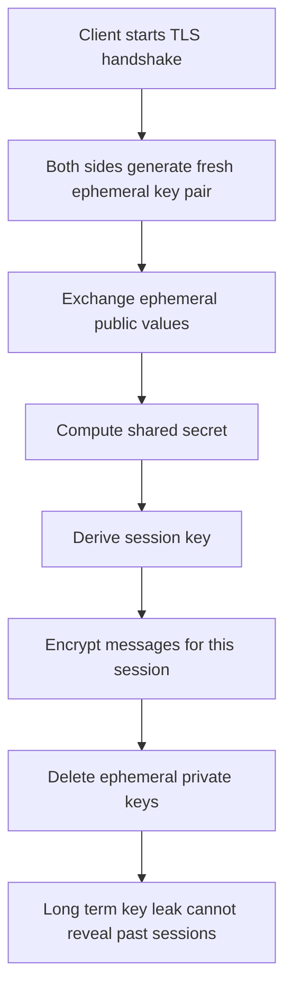

# Perfect Forward Secrecy and Session Keys: Why One Leak Should Not Unlock the Past

## English

Imagine you record every encrypted message between two people for years. Later, you steal one of their long-term private keys. Can you decrypt everything you recorded? Without forward secrecy, yes — because the session keys for each conversation were derived from that long-term key. With forward secrecy (also called perfect forward secrecy, PFS), no — because each session used an ephemeral key pair that was generated fresh and then discarded, never derivable from the long-term key alone. This property is one of the most important design goals in modern secure protocols.

The mechanism usually involves an ephemeral Diffie-Hellman exchange (often ECDHE, Elliptic Curve Diffie-Hellman Ephemeral). During the TLS handshake, each side generates a fresh key pair, exchanges public values, and computes a shared secret. That shared secret becomes the session key. Crucially, the ephemeral private keys exist only in memory for the duration of the handshake and are then deleted. Even if an attacker later compromises the server's long-term certificate key, they cannot reconstruct the ephemeral secrets — those were never stored anywhere.

The trade-off is that forward secrecy protects past sessions but not future ones. If an attacker compromises the long-term key and can also perform an active man-in-the-middle attack (intercepting and impersonating the server), they can establish new sessions with the client. Forward secrecy is about limiting the blast radius of a key compromise, not preventing all attacks. It's a damage-control property, not a prevention property.

Forward secrecy also has costs. Ephemeral key generation requires more computation than static key exchange, which is why older hardware sometimes disabled it for performance. Modern CPUs handle ECDHE cheaply, so the cost is negligible. There's also a subtlety: if the server's random number generator is broken, ephemeral keys can be predictable, defeating the purpose. Forward secrecy depends on high-quality randomness at the moment of key generation.

In practice, forward secrecy is now the default in TLS 1.3 — the protocol mandates ephemeral key exchange (typically ECDHE) and removed static RSA key exchange entirely. When you see 'ECDHE' in a cipher suite name (e.g. TLS_ECDHE_RSA_WITH_AES_128_GCM_SHA256), that's the forward-secret key exchange. If you see 'RSA' alone as the key exchange (TLS_RSA_WITH_...), that's the old non-forward-secret style, and it's deprecated. The lesson: design protocols so that compromising one key today doesn't retroactively unlock years of recorded traffic.

## 中文

想像你幾年嚟記錄低兩個人之間每一條加密訊息。之後，你偷到佢哋其中一個長期私鑰。你可唔可以解密你記錄低嘅所有嘢？如果冇前向保密（forward secrecy），可以——因為每次對話嘅會話密鑰都係由嗰個長期密鑰衍生出嚟。如果有前向保密（又叫完美前向保密，PFS），就唔可以——因為每次會話都用一對臨時密鑰，即場生成之後就丟棄，單靠長期密鑰係推導唔到嘅。呢個特性係現代安全協議最重要嘅設計目標之一。

機制通常涉及臨時 Diffie-Hellman 交換（通常係 ECDHE，即橢圓曲線 Diffie-Hellman 臨時版）。喺 TLS 握手期間，每一方生成一對新密鑰、交換公開值、計出共享秘密。嗰個共享秘密就成為會話密鑰。關鍵係，臨時私鑰只喺握手期間存在於記憶體，之後就刪除。即使攻擊者後來攻陷咗伺服器嘅長期憑證密鑰，佢都重構唔到臨時秘密——因為嗰啲秘密從來冇存喺任何地方。

取捨係：前向保密保護過去嘅會話，但唔保護將來嘅。如果攻擊者攻陷咗長期密鑰，同時可以做主動中間人攻擊（攔截並冒充伺服器），佢就可以同客戶端建立新會話。前向保密係關於限制密鑰洩漏嘅爆炸半徑，唔係防止所有攻擊。佢係一個損害控制特性，唔係預防特性。

前向保密亦有成本。臨時密鑰生成比靜態密鑰交換需要更多計算，所以舊硬件有時會為咗效能而停用佢。現代 CPU 處理 ECDHE 好便宜，所以成本微不足道。仲有個微妙之處：如果伺服器嘅隨機數生成器壞咗，臨時密鑰就可能被預測，令前向保密失效。前向保密依賴生成密鑰嗰一刻嘅高質素隨機性。

喺實務上，前向保密而家係 TLS 1.3 嘅預設——協議強制用臨時密鑰交換（通常係 ECDHE），並且完全移除咗靜態 RSA 密鑰交換。當你見到 cipher suite 名入面有「ECDHE」（例如 TLS_ECDHE_RSA_WITH_AES_128_GCM_SHA256），嗰個就係前向保密嘅密鑰交換。如果你見到淨係「RSA」做密鑰交換（TLS_RSA_WITH_...），嗰個就係舊式、冇前向保密嘅做法，已經被棄用。教訓係：設計協議嗰陣，要令今日洩漏一條密鑰唔會追溯解鎖幾年嚟記錄低嘅流量。

## Key Takeaway

Forward secrecy uses ephemeral per-session keys that are discarded after use, so compromising a long-term key later cannot retroactively decrypt previously recorded traffic.

## Related Concepts
- Key exchange in plain sight: Diffie-Hellman
- Key exchange and the TLS handshake

## Diagram

