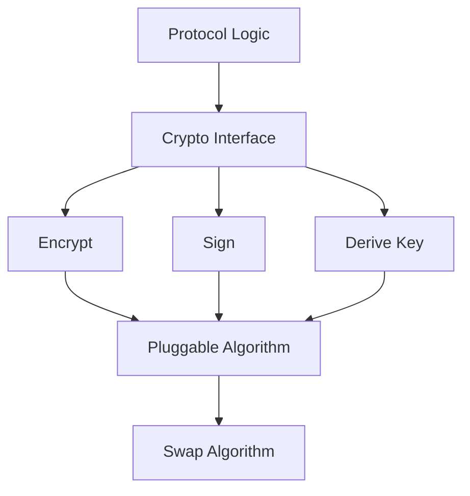

# Cryptographic Agility: Designing Systems That Can Swap Algorithms

## English

Cryptographic agility is the ability of a system to change its cryptographic algorithms — cipher, hash, key exchange, signature scheme — without a major redesign. It sounds like an engineering nicety, but history shows it's a survival requirement. MD5 was once considered secure for signatures; it was broken. SHA-1 was once the standard for certificates; it was broken. RC4 was once ubiquitous in TLS; it was broken. DES was once the US government standard; it was broken in 56-bit form. Every algorithm eventually falls, and systems that hard-coded one algorithm had to be rewritten under pressure.

The classic cautionary tale is the TLS protocol itself. Early TLS versions hard-wired a specific handshake structure, and changing the key exchange or hash required protocol version bumps. TLS 1.3 was a major redesign specifically to make the handshake more flexible and to remove legacy algorithms. Similarly, the 'cipher suite' concept in TLS was designed so that client and server could negotiate which algorithms to use. But negotiation itself has pitfalls: if a client offers a weak algorithm and the server accepts it, an attacker can downgrade the connection. TLS 1.3 addressed this by restricting the negotiation to a small set of modern, safe algorithms and by signing the handshake transcript to prevent tampering.

Agility is not just about swapping algorithms — it's about separating the algorithm from the protocol logic. Good designs treat cryptography as a pluggable component behind a clean interface: 'encrypt this', 'sign this', 'derive a key'. The protocol code calls the interface; the interface implementation can be swapped. This is how libraries like OpenSSL, BoringSSL, and language-level crypto APIs work. It's also why cryptographic standards bodies publish algorithm identifiers (OIDs in X.509, cipher suite codes in TLS) so that peers can agree on what's in use.

But agility has a dark side: too much flexibility creates attack surface. If a system supports twenty algorithms, an attacker can try downgrade attacks, algorithm confusion attacks (e.g. tricking a verifier into treating an RSA key as an HMAC key), and implementation bugs in rarely-used code paths. The modern consensus is 'cryptographic agility with a small, curated menu': support a handful of well-vetted modern algorithms, deprecate old ones aggressively, and make the negotiation resistant to downgrade. TLS 1.3's approach — a fixed short list, no negotiation of weak options — is the model.

For developers, practical agility means: never hard-code a single algorithm name in application logic; read the algorithm from configuration or protocol negotiation; use well-maintained crypto libraries rather than rolling your own; and have a plan for migration. When SHA-1 was deprecated, systems that had stored SHA-1 hashes needed a migration path — either re-hashing on next login or accepting both during a transition window. Systems without agility faced emergency rewrites. The lesson: assume your algorithm will be broken, and design so that swapping it is a configuration change, not a rewrite.

## 中文

密碼學敏捷性（cryptographic agility）係指一個系統可以轉換佢用嘅密碼學演算法——密碼、雜湊、密鑰交換、簽名方案——而唔需要大規模重新設計。聽落似係工程上嘅小確幸，但歷史顯示呢個係生存必需。MD5 曾經被認為可以用嚟做簽名，後來被破解。SHA-1 曾經係憑證嘅標準，後來被破解。RC4 曾經喺 TLS 入面無處不在，後來被破解。DES 曾經係美國政府標準，56 位元版本後來被破解。每個演算法最終都會倒下，而硬編碼單一演算法嘅系統就要喺壓力下重寫。

經典嘅警示故事就係 TLS 協議本身。早期 TLS 版本硬性規定咗特定嘅握手結構，要改密鑰交換或者雜湊就要升級協議版本。TLS 1.3 係一次重大重新設計，專門令握手更有彈性，並移除舊有演算法。同樣，TLS 入面嘅「cipher suite」（密碼套件）概念就係設計到客戶端同伺服器可以協商用邊啲演算法。但協商本身都有陷阱：如果客戶端提供一個弱演算法而伺服器接受咗，攻擊者就可以降級連接。TLS 1.3 透過將協商限制喺一小撮現代、安全嘅演算法，並且對握手 transcript 簽名以防止篡改，嚟解決呢個問題。

敏捷性唔止係換演算法——而係將演算法同協議邏輯分離。好嘅設計會將密碼學視為一個可插拔嘅組件，藏喺乾淨嘅介面後面：「加密呢個」、「簽呢個」、「衍生密鑰」。協議代碼呼叫介面；介面嘅實作可以替換。OpenSSL、BoringSSL 同各語言層級嘅 crypto API 就係咁運作。呢個亦係點解密碼學標準組織會發佈演算法識別碼（X.509 入面嘅 OID、TLS 入面嘅 cipher suite 代碼），等對等方可以就住用緊乜嘢達成共識。

但敏捷性有陰暗面：太多彈性會製造攻擊面。如果一個系統支援二十種演算法，攻擊者可以試降級攻擊、演算法混淆攻擊（例如誤導驗證器將 RSA 密鑰當成 HMAC 密鑰），同埋罕用代碼路徑入面嘅實作 bug。現代共識係「有密碼學敏捷性，但餐牌要細同精選」：支援一小撮經過充分審查嘅現代演算法，積極棄用舊嘅，並令協商抵抗降級。TLS 1.3 嘅做法——固定嘅短清單、唔協商弱選項——就係模範。

對開發者嚟講，實用嘅敏捷性意味住：永遠唔好喺應用邏輯硬編碼單一演算法名；從配置或者協議協商讀取演算法；用維護良好嘅 crypto 庫而唔係自己造輪子；同埋要有遷移計劃。當年 SHA-1 被棄用嗰陣，存咗 SHA-1 雜湊嘅系統需要遷移路徑——一係下次登入時重新雜湊，一係喺過渡期同時接受兩者。冇敏捷性嘅系統就要緊急重寫。教訓係：假設你嘅演算法終會被破解，設計到換演算法係一個配置改動，而唔係重寫。

## Key Takeaway

Every cryptographic algorithm eventually breaks, so systems should treat algorithms as swappable configuration rather than hard-coded logic — while keeping the menu small to avoid downgrade and confusion attacks.

## Related Concepts
- Public key infrastructure and the chain of trust
- Hashing vs encryption vs digital signatures

## Diagram

