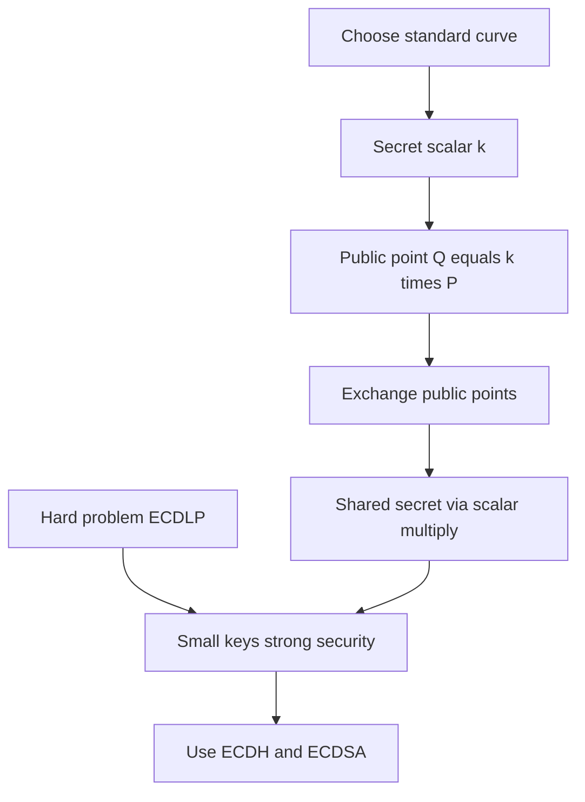

# Elliptic Curve Cryptography: Why Smaller Keys Can Be Stronger

## English

Classical public-key systems like RSA rest on the difficulty of factoring a huge number that is the product of two primes. Elliptic Curve Cryptography (ECC) rests on a different hard problem: given a point P on a carefully chosen curve and another point Q = k·P (meaning P added to itself k times using special curve arithmetic), finding the integer k is believed to be computationally infeasible. This is called the Elliptic Curve Discrete Logarithm Problem. The key consequence is that ECC reaches the same security level as RSA with dramatically smaller numbers, which is why a 256-bit ECC key is roughly comparable in strength to a 3072-bit RSA key. Smaller keys mean less computation, less bandwidth, and less storage, which matters enormously on phones, smart cards, and IoT sensors.

The curve is not arbitrary. It must satisfy specific mathematical properties, and the parameters (the curve equation, the base point, the order) are published as named standards such as P-256 or Curve25519. If someone hands you a curve and base point they invented, they may have embedded a trapdoor that lets them solve the discrete log for your key. This is why "nothing up my sleeve" curves like Curve25519, whose parameters were chosen in a transparent, easily verifiable way, are preferred in modern protocols. The famous Dual_EC_DRBG scandal showed that even a standardised random number generator can hide a backdoor in its constants, so verifiability of parameters is a real security property, not paranoia.

In practice, the two operations you care about are ECDH (Elliptic Curve Diffie-Hellman) for key agreement and ECDSA or EdDSA for signatures. In ECDH, Alice and Bob each pick a secret scalar, multiply the shared base point by it to get a public point, exchange public points, and then multiply the received point by their own secret. Both arrive at the same shared point because scalar multiplication commutes: a·(b·P) = b·(a·P). That shared point's x-coordinate, run through a key derivation function, becomes the symmetric session key. EdDSA (Ed25519 is the most common variant) is a signature scheme designed to avoid the fragile random-number generation that has historically broken ECDSA implementations.

One subtle trap is that not every point on a curve is valid. Curves have a small number of "low-order" points that, if accepted as a public key, can leak bits of your secret. Implementations defend against this with point validation and cofactor multiplication. Another trap is nonce reuse in ECDSA: if you sign two different messages with the same random nonce k, anyone can recover your private key with simple algebra. This has actually happened in the wild with poorly seeded random number generators on embedded devices. The lesson is that ECC is mathematically elegant but operationally unforgiving, and the safest path is to use well-audited libraries and modern curves rather than rolling your own.

So when you see a modern TLS certificate using an ECDSA key, or an SSH key labelled ed25519, you are looking at the practical payoff of a different hard problem. ECC did not replace RSA by being simpler to understand; it replaced it by offering equivalent security with far less computational and bandwidth cost, which is decisive on constrained devices and high-volume servers. Understanding which hard problem underpins a scheme tells you what an attacker would need to solve, and that framing is more useful than memorising key sizes.

## 中文

古典公開金鑰系統（例如 RSA）的安全性，建立在「把一個由兩個質數相乘而成的大數分解回質數」這件事很難之上。橢圓曲線密碼學（Elliptic Curve Cryptography, ECC）則建立在另一個難題上：給定一條精心挑選的曲線上的一點 P，以及另一點 Q = k·P（意思是用曲線特有的加法，把 P 自己加 k 次），要找出整數 k 被認為在計算上不可行。這叫做橢圓曲線離散對數問題。關鍵後果是：ECC 用細得多的數字，就能達到與 RSA 同等的安全強度，所以一條 256 位元的 ECC 金鑰，強度大致相當於 3072 位元的 RSA 金鑰。金鑰細，代表運算少、頻寬少、儲存少，這對手機、智能卡和物聯網感測器來說差別極大。

曲線不是隨便挑的。它必須滿足特定的數學性質，而曲線參數（曲線方程式、基點、階數）會以具名標準的形式公佈，例如 P-256 或 Curve25519。如果有人交給你一條他自己發明的曲線和基點，他可能在裡面埋了後門，讓他可以解出你的金鑰對應的離散對數。這就是為什麼像 Curve25519 這種「袖子裡沒藏東西」（nothing up my sleeve）的曲線較受現代協定青睞——它的參數用透明、容易驗證的方式選出來。著名的 Dual_EC_DRBG 事件就顯示，即使是一個標準化的隨機數產生器，也可以在常數裡藏後門，所以「參數可驗證」是實實在在的安全屬性，不是多疑。

實務上你只需關心兩個操作：用於金鑰協商的 ECDH（橢圓曲線 Diffie-Hellman），以及用於簽章的 ECDSA 或 EdDSA。在 ECDH 裡，Alice 和 Bob 各自選一個秘密純量，把它乘上共用的基點得到自己的公開點，交換公開點之後，再把自己收到的點乘上自己的秘密。雙方會得到同一個共享點，因為純量乘法可交換：a·(b·P) = b·(a·P)。這個共享點的 x 座標，經過金鑰衍生函數處理後，就成為對稱工作階段金鑰。EdDSA（最常見的變體是 Ed25519）是一種簽章方案，設計上避開了 ECDSA 歷史上常因隨機數產生不穩而導致的脆弱性。

一個微妙的陷阱是：曲線上不是每一點都合法。曲線上有少數「低階」點，如果被當成公鑰接受，可以洩漏你秘密的某些位元。實作會用點驗證和餘因子乘法來防禦。另一個陷阱是 ECDSA 的重用 nonce：如果你用同一個隨機 nonce k 簽署兩份不同的訊息，任何人用簡單的代數就能還原你的私鑰。這種事在嵌入式裝置上因為隨機數種子品質差而真實發生過。教訓是：ECC 數學上優雅，但操作上毫不寬容，最安全的路是使用經過審核的程式庫和現代曲線，而不是自己動手造。

所以當你看到現代 TLS 憑證使用 ECDSA 金鑰，或看到標記為 ed25519 的 SSH 金鑰時，你看到的是「換一個難題」所帶來的實際回報。ECC 不是因為比較容易理解而取代 RSA，而是因為它用遠少的運算和頻寬成本提供同等安全，這在資源受限的裝置和高流量的伺服器上是決定性的優勢。理解一個方案背後是哪個難題，能告訴你攻擊者需要解決什麼，而這個框架比背誦金鑰長度有用得多。

## Key Takeaway

ECC trades RSA's factoring problem for the elliptic curve discrete logarithm problem, giving equivalent security with much smaller keys, but it demands careful parameter choices and disciplined nonce handling.

## Related Concepts
- Elliptic Curve Diffie-Hellman
- Elliptic Curve Discrete Logarithm Problem

## Diagram

