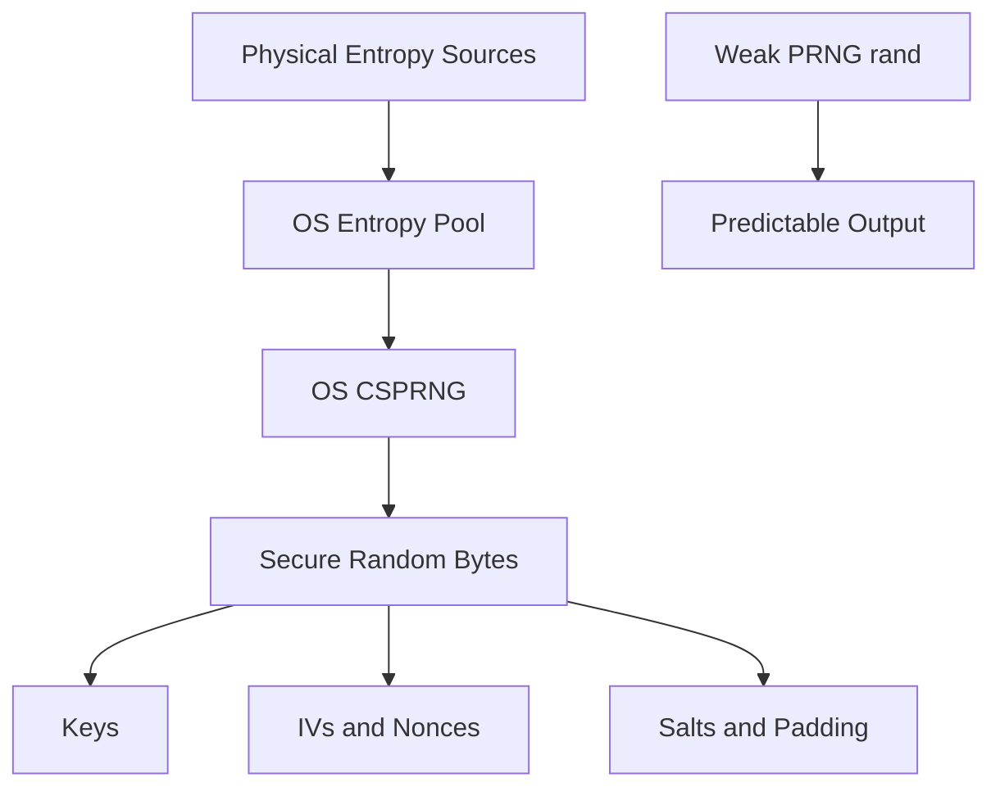

# Cryptographic Randomness: Where Keys Actually Come From

## English

Every encryption scheme assumes one thing you cannot see in the algorithm: that the key was chosen unpredictably. If an attacker can guess or narrow down your key, the mathematics of AES or ChaCha20 does not save you. This is why the quality of randomness is often the weakest link in real systems. There are two very different kinds of randomness you need to distinguish. A pseudorandom number generator (PRNG) is a deterministic algorithm seeded with some initial value; given the same seed, it produces the same sequence. A cryptographically secure pseudorandom number generator (CSPRNG) is a PRNG designed so that observing its output gives you no practical way to predict future or past output or to recover the seed.

Where does the seed come from? The operating system gathers entropy from physical sources: timing jitter between hardware interrupts, disk seek times, network packet arrival patterns, and on modern CPUs dedicated hardware instructions. Linux exposes this through the getrandom() system call and /dev/urandom, and since kernel 5.6 the blocking behaviour of /dev/random was aligned with getrandom() so that once the pool is initialised, reads do not block. The important discipline is to use the operating system's CSPRNG rather than language-level functions like rand() or Math.random(), which are designed for simulations and games and are trivially predictable. A classic real-world failure was Debian's OpenSSL bug in 2006–2008, where a code change removed most of the entropy feeding the PRNG, silently shrinking the effective key space of generated keys to a few thousand possibilities for over a year.

Once you have a CSPRNG, you use it for everything security-sensitive: generating keys, choosing initialisation vectors and nonces, creating salts, and producing padding. Each of these has different requirements. A salt for password hashing only needs to be unique, not secret, so a random 16-byte value stored alongside the hash is fine. A nonce for AES-GCM must never repeat under the same key, because nonce reuse in GCM catastrophically breaks both confidentiality and authenticity. An IV for CBC mode must be unpredictable to the attacker at encryption time, which is stricter than merely unique. Mixing these up is a common source of vulnerabilities that have nothing to do with the cipher itself.

There is also the question of what "random" means when you have no hardware entropy. Virtual machines, containers, and freshly booted embedded devices can start with a nearly empty entropy pool. Modern kernels handle this by crediting the boot process and by using CPU cycle counters and other sources, but the historical lesson is that early-boot key generation is risky. Some systems use a hardware random number generator (HRNG) or a trusted platform module to seed the pool. Others deliberately block until enough entropy has been collected, which is why some services hang on first boot in a VM. The tradeoff is between availability and the risk of generating weak keys.

A useful mental model: the cipher is a lock, the key is the combination, and the CSPRNG is the locksmith who chooses the combination. A perfect lock with a combination of "0000" is worthless. When you audit a system, ask where its keys come from, whether it uses the OS CSPRNG, whether nonces and IVs are generated with the same source, and whether any code path falls back to a non-cryptographic generator. Those questions catch more real bugs than staring at the cipher specification ever will.

## 中文

每一個加密方案都假設了一件演算法本身看不到的事：金鑰是被不可預測地選出來的。如果攻擊者能猜中或大幅縮小你的金鑰範圍，AES 或 ChaCha20 的數學也救不了你。這就是為什麼隨機性的品質往往是真實系統中最弱的一環。你需要區分兩種非常不同的隨機性。偽隨機數產生器（pseudorandom number generator, PRNG）是一個確定性演算法，用某個初始種子啟動；給同樣的種子，它就產生同樣的序列。密碼學安全偽隨機數產生器（cryptographically secure pseudorandom number generator, CSPRNG）則是設計成：即使觀察到它的輸出，你也沒有實際辦法預測它未來或過去的輸出，或還原種子。

種子從哪裡來？作業系統從物理來源收集熵（entropy）：硬體中斷之間的時間抖動、磁碟尋道時間、網路封包抵達的模式，以及現代 CPU 上的專用硬體指令。Linux 透過 getrandom() 系統呼叫和 /dev/urandom 把這些暴露出來；自核心 5.6 起，/dev/random 的阻塞行為已與 getrandom() 對齊，也就是說一旦熵池初始化完成，讀取就不會再阻塞。重要的紀律是：使用作業系統的 CSPRNG，而不是語言層級的 rand() 或 Math.random()——那些是為模擬和遊戲設計的，可預測性極高。現實中的經典失敗是 2006 至 2008 年 Debian 的 OpenSSL 錯誤：一次程式碼改動移除了大部分餵給 PRNG 的熵，讓產生的金鑰有效金鑰空間悄悄縮小到只剩幾千種可能，持續超過一年。

有了 CSPRNG 之後，所有安全敏感的事都用它：產生金鑰、挑選初始化向量和 nonce、建立鹽、產生填充。每一項的要求都不同。密碼雜湊用的鹽只需要唯一、不需要保密，所以隨機的 16 位元組值與雜湊一起儲存就行。AES-GCM 的 nonce 在同一把金鑰下絕不能重複，因為 GCM 的 nonce 重用會災難性地同時破壞機密性和真實性。CBC 模式的 IV 在加密時必須對攻擊者不可預測，這比「只要唯一」更嚴格。把這些混為一談，是與密碼本身無關的常見漏洞來源。

還有一個問題：當你沒有硬體熵時，「隨機」是什麼意思？虛擬機、容器和剛開機的嵌入式裝置，可能一開始熵池幾乎是空的。現代核心會透過計入開機過程、使用 CPU 週期計數器和其他來源來處理，但歷史教訓是：開機初期產生金鑰是有風險的。有些系統用硬體隨機數產生器（HRNG）或可信平台模組來為熵池播種。另一些則刻意阻塞，直到收集到足夠的熵——這就是為什麼有些服務在虛擬機第一次開機時會卡住。取捨在於可用性與產生弱金鑰的風險之間。

一個有用的心智模型：密碼是鎖，金鑰是密碼鎖的號碼組合，而 CSPRNG 是挑選號碼組合的鎖匠。一把完美的鎖配上「0000」的號碼組合，毫無價值。當你審核一個系統時，要問：它的金鑰從哪裡來？有沒有用作業系統的 CSPRNG？nonce 和 IV 是否用同一個來源產生？有沒有任何程式路徑會退回非密碼學的產生器？這些問題抓到的真實錯誤，比盯著密碼規格看要多得多。

## Key Takeaway

The strongest cipher is useless if its key was predictable, so always generate keys, nonces, IVs, and salts from the operating system's CSPRNG and never from general-purpose random functions.

## Related Concepts
- Cryptographically Secure Pseudorandom Number Generator
- Entropy Pool

## Diagram

