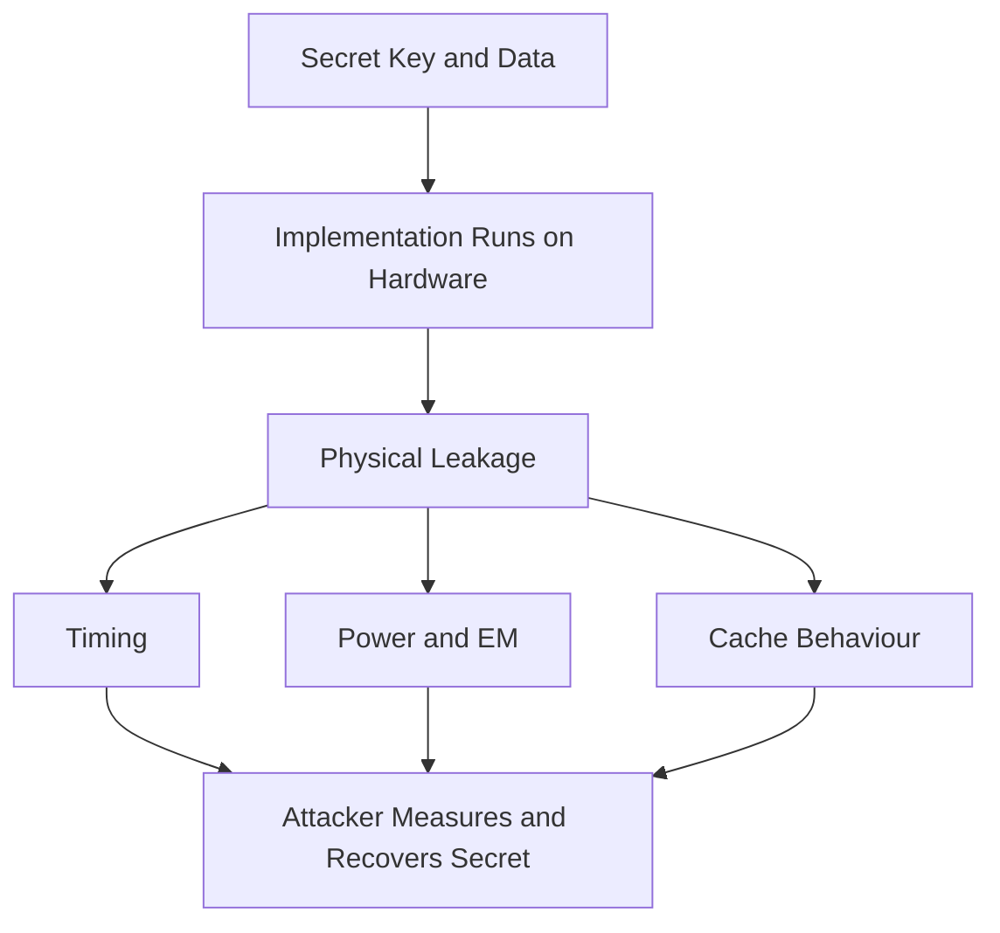

# Side-Channel Attacks: When the Math Is Fine but the Timing Is Not

## English

Cryptography is usually analysed as pure mathematics: given a ciphertext and no key, how hard is it to recover the plaintext? But real implementations run on real hardware, and that hardware leaks information through timing, power consumption, electromagnetic emissions, and cache behaviour. A side-channel attack ignores the mathematical hardness entirely and instead measures something physical about the computation. This is why a perfectly secure algorithm can still be broken by a bad implementation, and why cryptographic libraries are written with obsessive care about branches, memory access patterns, and instruction timing.

A classic example is a timing attack on a naive comparison. Suppose a server checks a message authentication code (MAC) with code that returns early as soon as it finds a mismatched byte. An attacker who can measure how long the comparison takes learns how many leading bytes were correct, and can recover the MAC one byte at a time instead of guessing all of it at once. The fix is a constant-time comparison that always examines every byte, regardless of where the first mismatch is. Many standard libraries now provide something like constant-time equality functions precisely for this reason, and using ordinary string comparison for secrets is a known antipattern.

Branches and table lookups are the other big leak. If your AES implementation uses a lookup table indexed by secret data, the memory address accessed depends on the key, and an attacker sharing the same CPU cache (for example, another tenant on the same cloud host, or JavaScript running in the same browser process) can observe which cache lines were touched. This is the basis of cache-timing attacks against table-based AES. The defence is either to use bitsliced or vectorised implementations that avoid secret-dependent memory access, or to use ciphers like ChaCha20 that are naturally friendly to constant-time software implementation because they rely only on addition, rotation, and XOR.

Power analysis is even more direct. By measuring the electrical power drawn by a smart card while it performs a cryptographic operation, an attacker can correlate power fluctuations with the data being processed. Simple power analysis might reveal the sequence of operations; differential power analysis uses statistical methods over many traces to recover secret bits. Smart cards, hardware security modules, and TPMs therefore include countermeasures such as randomising the order of operations, adding dummy cycles, and shielding. These defences are about making the physical signal noisy rather than making the algorithm different.

For a working developer, the practical takeaways are modest but important. Use well-audited cryptographic libraries instead of implementing primitives yourself, because those libraries have already absorbed decades of side-channel lessons. Prefer modern authenticated encryption constructions that are designed to be constant-time in software. Never compare secrets with ordinary equality operators, and be wary of any code path whose timing depends on secret values. When you read about a new vulnerability in a widely used library, it is often a side channel rather than a break of the underlying mathematics, and that pattern is worth internalising.

## 中文

密碼學通常被當成純數學來分析：給定密文而沒有金鑰，還原明文有多難？但真實的實作跑在真實的硬體上，而硬體會透過時間、功耗、電磁輻射和快取行為洩漏資訊。側通道攻擊（side-channel attack）完全不理會數學上的困難度，轉而測量運算過程中的某種物理現象。這就是為什麼一個數學上完美安全的演算法，仍可能被糟糕的實作攻破，也是為什麼密碼學程式庫在分支、記憶體存取模式和指令時間上會異常小心。

經典例子是對樸素比較法的計時攻擊。假設伺服器用一段程式碼檢查訊息驗證碼（message authentication code, MAC），一發現某個位元組不符就立刻回傳。能測量比較耗時多久的攻擊者，就能得知前面有多少個位元組是對的，於是能一個位元組一個位元組地還原 MAC，而不必一次猜中全部。修法是使用常數時間比較（constant-time comparison），無論第一個不符出現在哪裡，都一律檢查每一個位元組。許多標準程式庫現在都提供常數時間的相等比較函式，正是為此；用普通的字串比較來比對機密，是公認的反模式。

分支和查表是另一個大漏洞。如果你的 AES 實作使用以機密資料為索引的查表，被存取的記憶體位址就取決於金鑰，而與你共用同一個 CPU 快取的攻擊者（例如同一台雲端主機上的另一個租戶，或同一個瀏覽器行程裡執行的 JavaScript）就能觀察到哪些快取行被碰過。這就是針對查表式 AES 的快取計時攻擊的原理。防禦方式有兩種：使用位元切片（bitsliced）或向量化的實作，避免依機密決定的記憶體存取；或者改用 ChaCha20 這類天生適合常數時間軟體實作的密碼，因為它只依賴加法、旋轉和 XOR。

功耗分析更直接。藉由測量智能卡在執行密碼運算時所抽取的電力，攻擊者可以把功率波動與正在處理的資料關聯起來。簡單功耗分析可能揭露運算的順序；差分功耗分析則用統計方法處理大量軌跡，還原出機密的位元。因此智能卡、硬體安全模組和 TPM 都會加入反制措施，例如隨機化運算順序、插入假週期、加屏蔽。這些防禦的重點是讓物理訊號變吵雜，而不是改變演算法本身。

對實務開發者而言，實際的啟示不大但很重要。使用經過審核的密碼學程式庫，而不是自己實作基本元件，因為那些程式庫已經吸收了數十年的側通道教訓。優先選用現代的可認證加密構造，它們在軟體中被設計成常數時間。絕不要用普通的相等運算子比較機密，並對任何耗時會隨機密值改變的程式路徑保持警覺。當你讀到某個廣泛使用的程式庫出現新漏洞時，那往往是側通道，而不是底層數學被攻破——這個模式值得記在心裡。

## Key Takeaway

Side-channel attacks exploit timing, power, and cache behaviour rather than breaking the mathematics, so use constant-time, well-audited libraries and never let secret data influence branches or memory addresses.

## Related Concepts
- Constant-Time Comparison
- Cache-Timing Attack

## Diagram

