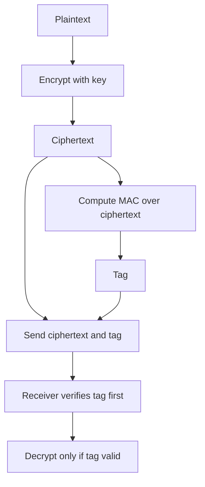

# Encrypt-Then-MAC: How Authentication and Encryption Are Combined Safely

## English

When you encrypt a message, the ciphertext alone protects confidentiality but says nothing about whether an attacker tampered with it. To get integrity as well, you must combine encryption with a message authentication code (MAC) — a keyed checksum that detects modification. The trouble is that there are several ways to combine them, and only some are safe. The three classic orders are Encrypt-and-MAC, MAC-then-Encrypt, and Encrypt-then-MAC, and decades of cryptanalysis have shown that only the last is robust in general.

In Encrypt-and-MAC, you MAC the plaintext and then encrypt the plaintext separately, sending both. Because the MAC is computed over the message before encryption, the tag is itself a deterministic function of the plaintext, which can leak information (for instance, identical messages produce identical tags). Worse, the receiver must decrypt before it can verify, so it is processing unauthenticated data — a recipe for padding-oracle attacks in block cipher modes that use padding.

MAC-then-Encrypt computes the MAC over the plaintext, appends it, and then encrypts the whole bundle. This was the historical design in TLS (the so-called MAC-then-Encrypt ciphersuites), and it is the root of the famous Lucky Thirteen and POODLE-style attacks. The receiver decrypts first, then checks the tag, meaning it again touches unauthenticated plaintext and may reveal through timing or error messages whether the padding or the tag was wrong. The attacker learns a little bit per query and can eventually recover plaintext.

Encrypt-then-MAC fixes this by encrypting the plaintext first, then computing the MAC over the ciphertext (and usually the associated data) and appending the tag. The receiver verifies the tag before doing any decryption. If the tag fails, it discards the message immediately — no decryption, no padding check, no timing leak from the cipher internals. This is the standard construction recommended by cryptographers and used in modern AEAD schemes like AES-GCM and ChaCha20-Poly1305, which essentially build Encrypt-then-MAC into a single primitive.

A concrete example: suppose Alice sends Bob a message with AES-CBC plus HMAC-SHA256. In Encrypt-then-MAC, Alice encrypts with AES-CBC, then runs HMAC-SHA256 over the resulting ciphertext (plus any header bytes) with a separate MAC key, and sends ciphertext || tag. Bob computes HMAC over the received ciphertext, compares it in constant time to the tag, and only decrypts if it matches. The two keys must be independent — deriving both from one master key via a KDF is fine, but reusing the same key for encryption and MAC is not. This separation is why key derivation and key management matter so much.

## 中文

當你加密一段訊息，密文本身只保護了機密性，卻完全無法告訴你攻擊者有否篡改過它。要同時得到完整性，你必須把加密與訊息認證碼（MAC，一種帶金鑰的校驗碼，用來偵測竄改）結合起來。問題是，結合的方式有好幾種，而只有部分方式安全。三種經典次序是「先加密再 MAC」、「先 MAC 再加密」和「先加密後 MAC」，而數十年的密碼分析顯示，一般而言只有最後一種穩健可靠。

在「先加密再 MAC」（Encrypt-and-MAC）中，你對明文計算 MAC，然後另外加密明文，兩者一併送出。由於 MAC 是在加密之前對訊息計算，標籤本身就是明文的確定性函數，可能洩漏資訊（例如相同訊息會產生相同標籤）。更糟的是，接收方必須先解密才能驗證，等於在處理未經認證的資料——對於使用填充的區塊加密模式而言，這是填充預言攻擊（padding-oracle attack）的溫床。

「先 MAC 再加密」（MAC-then-Encrypt）先對明文計算 MAC、附加在後，再把整個組合加密。這是 TLS 歷史上（所謂 MAC-then-Encrypt 密碼套件）的設計，也是著名的 Lucky Thirteen 與 POODLE 類攻擊的根源。接收方先解密、再檢查標籤，意味著它同樣先接觸未經認證的明文，並可能透過時間差或錯誤訊息洩漏究竟是填充出錯還是標籤出錯。攻擊者每次查詢只學到一點點，最終卻能還原明文。

「先加密後 MAC」（Encrypt-then-MAC）修正了這點：先加密明文，再對密文（通常連同相關資料）計算 MAC 並附加標籤。接收方在進行任何解密之前先驗證標籤。若標籤不符，立即丟棄訊息——不解密、不檢查填充、不從加密內部產生時間洩漏。這是密碼學家推薦的標準構造，也是現代 AEAD 方案（如 AES-GCM 與 ChaCha20-Poly1305）所採用，它們基本上把「先加密後 MAC」內建成單一原語。

具體例子：假設 Alice 用 AES-CBC 加 HMAC-SHA256 傳訊息給 Bob。在「先加密後 MAC」中，Alice 先用 AES-CBC 加密，再用獨立的 MAC 金鑰對所得密文（連同任何標頭位元組）計算 HMAC-SHA256，然後送出 密文 || 標籤。Bob 對收到的密文計算 HMAC，以常數時間比較標籤，只有相符才解密。兩把金鑰必須獨立——用 KDF 從同一把主金鑰衍生兩者可以，但把同一把金鑰同時用於加密與 MAC 則不行。這種分離正是金鑰衍生與金鑰管理如此重要的原因。

## Key Takeaway

Always authenticate ciphertext (Encrypt-then-MAC or an AEAD mode) and verify the tag before decrypting, because decrypting unauthenticated data invites padding-oracle and timing attacks.

## Related Concepts
- Authenticated Encryption (AEAD)
- Padding Oracle Attacks

## Diagram

