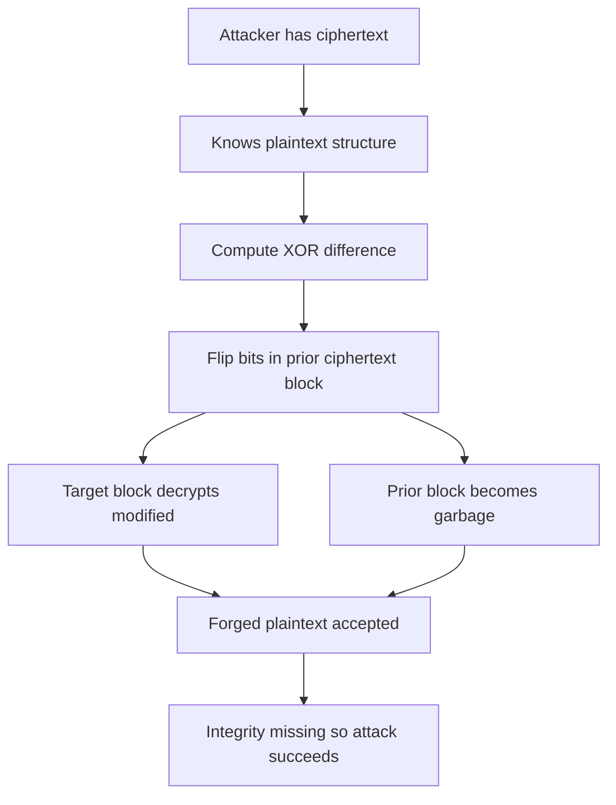

# Malleability and Why Bit-Flipping Attacks Work on Naive Encryption

## English

A cipher is called malleable if an attacker can take a ciphertext and produce a related ciphertext that decrypts to a predictably modified plaintext, all without knowing the key. Many classical modes of operation are malleable by design. For example, in AES-CBC (Cipher Block Chaining), each ciphertext block is XORed with the previous ciphertext block before decryption. If an attacker flips a bit in ciphertext block C(i-1), the decryption of block C(i) will have exactly that same bit flipped in the resulting plaintext, and the only other damage is that block C(i-1) decrypts to garbage. If the attacker knows the plaintext structure — say a session cookie or a bank transfer amount — they can surgically alter it.

A classic demonstration: suppose a message contains a field like 'admin=0' encrypted in CBC. The attacker knows the plaintext of some block and can compute the XOR difference needed to turn '0' into '1'. By flipping the corresponding bits in the preceding ciphertext block, they change the decrypted plaintext without ever learning the key. The block containing the modified byte decrypts cleanly; the previous block becomes random noise, but if that block is padding or a field the application ignores, the attack succeeds silently. This is the essence of the BEAST and POODLE attacks and many real-world cookie-tossing exploits.

Stream ciphers and counter modes like AES-CTR are even more directly malleable: encryption is just ciphertext = plaintext XOR keystream. Flipping any bit of the ciphertext flips exactly the corresponding bit of the plaintext, with no collateral damage at all. This makes CTR mode trivially forgeable unless it is paired with a MAC. The lesson is that confidentiality without integrity is often worse than useless, because the application may act on attacker-controlled plaintext believing it came from a trusted source.

The defence is authenticated encryption: either an AEAD mode like AES-GCM or ChaCha20-Poly1305, or a separate MAC applied over the ciphertext (Encrypt-then-MAC). The MAC binds the entire ciphertext together, so any single-bit change causes verification to fail and the message is rejected before the application sees it. This is why modern cryptographic libraries steer developers toward AEAD by default and why 'raw' CBC or CTR without a MAC is considered a footgun.

There is a subtlety: AEAD modes are themselves only secure if used correctly. AES-GCM, for instance, catastrophically fails if the same nonce is ever reused with the same key — an attacker can recover the authentication key and forge messages. So malleability defence depends on nonce discipline and key management, not just on choosing the right primitive. The broader principle is that cryptographic properties are compositional: you need confidentiality, integrity, and correct usage together, and any one missing breaks the whole.

## 中文

若攻擊者能在不知道金鑰的情況下，把一段密文變成另一段相關密文，而解密後得到可預測地修改過的明文，這個加密方案就稱為「可延展」（malleable）。許多古典操作模式在設計上就是可延展的。例如在 AES-CBC（密碼區塊鏈結）中，每個密文區塊在解密前會先與前一個密文區塊 XOR。若攻擊者翻轉密文區塊 C(i-1) 的某一位元，區塊 C(i) 解密後所得的明文就會有完全相同的位元被翻轉，唯一的其他損害是 C(i-1) 解密成亂碼。若攻擊者知道明文結構——例如 session cookie 或轉帳金額——就能精準地改動它。

經典示範：假設訊息含有像 'admin=0' 這樣的欄位並以 CBC 加密。攻擊者知道某區塊的明文，就能算出把 '0' 變成 '1' 所需的 XOR 差值。只要翻轉前一個密文區塊中對應的位元，就能改變解密後的明文，而完全不需要知道金鑰。含被改位元組的區塊解密得乾乾淨淨；前一區塊變成隨機雜訊，但若該區塊是填充或應用程式忽略的欄位，攻擊就無聲地成功了。這正是 BEAST 與 POODLE 攻擊，以及許多現實中 cookie 投擲漏洞的精髓。

串流加密與計數器模式（如 AES-CTR）更直接可延展：加密不過是 密文 = 明文 XOR 金鑰流。翻轉密文的任何位元，就會精確翻轉明文中對應的位元，毫無附帶損害。這使 CTR 模式在未搭配 MAC 時可被輕易偽造。教訓是：只有機密性而沒有完整性，往往比無用更糟，因為應用程式可能依據攻擊者控制的明文行動，卻以為它來自可信來源。

防禦方法是認證加密：要麼用 AEAD 模式如 AES-GCM 或 ChaCha20-Poly1305，要麼對密文另外施加 MAC（先加密後 MAC）。MAC 把整段密文綁在一起，任何單一位元改動都會令驗證失敗，訊息在應用程式看到之前就被拒絕。這就是為何現代密碼函式庫默認引導開發者使用 AEAD，而「裸」CBC 或 CTR 不配 MAC 被視為陷阱。

有個微妙之處：AEAD 模式本身也只有正確使用才安全。例如 AES-GCM 若在同一金鑰下重用同一 nonce，就會災難性失效——攻擊者可還原認證金鑰並偽造訊息。所以防禦可延展性不僅取決於選對原語，還取決於 nonce 紀律與金鑰管理。更廣泛的原則是：密碼性質是組合性的，機密性、完整性與正確用法必須同時具備，缺一即全盤皆破。

## Key Takeaway

Unkeyed modes like CBC and CTR are malleable, so an attacker can flip plaintext bits without the key — always pair encryption with authentication.

## Related Concepts
- Authenticated Encryption (AEAD)
- Cipher Block Chaining (CBC)

## Diagram

