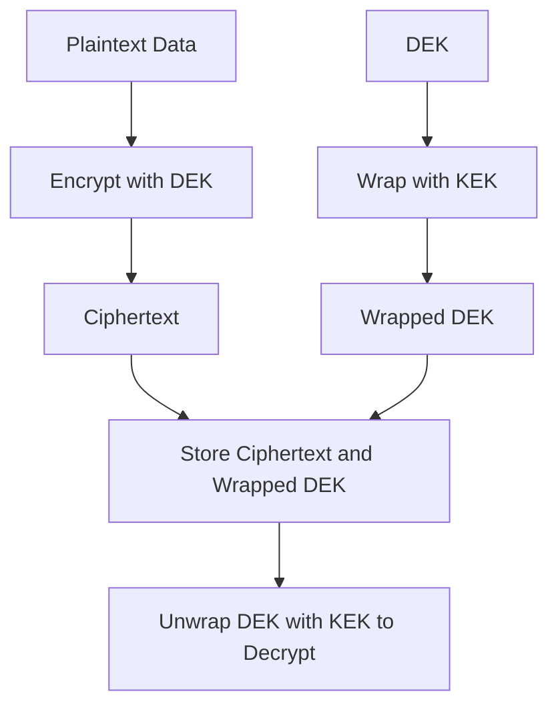

# Key Wrapping and Envelope Encryption: Protecting the Keys Themselves

## English

Encryption ultimately protects data with keys, but keys are themselves data that must be stored and transported securely. If you store a data-encryption key (DEK) in plaintext next to the ciphertext, you have gained nothing. The solution is envelope encryption: encrypt your data with a DEK, then encrypt the DEK with a separate key-encryption key (KEK), and store only the wrapped DEK alongside the ciphertext. This is the same idea as putting a letter in a locked box, then putting the box's key in a second, stronger locked box.

Key wrapping is the specific cryptographic operation of encrypting a key. It is not just 'encrypt the key bytes with AES-CBC' — dedicated wrapping modes exist because keys have special requirements. NIST specifies AES Key Wrap (KW) and AES Key Wrap with Padding (KWP) in publications like SP 800-38F. These are deterministic authenticated encryption schemes designed so that the wrapped key is the same length as the key plus a small overhead, and so that any tampering is detected. Wrapping a 256-bit key with AES-KW yields a wrapped blob of 40 bytes, which is compact enough to store in a database column or configuration file.

Envelope encryption is the pattern that cloud key-management services (KMS) are built around. A KMS holds a master key in hardware security modules (HSMs) and never exports it. When your application needs to encrypt a file, it asks the KMS to generate a DEK or to wrap a DEK you supply. The KMS returns the wrapped DEK, which you store next to the ciphertext. To decrypt, you send the wrapped DEK back to the KMS, which unwraps it and returns the plaintext DEK — but only if the caller is authorized. The master key never leaves the HSM, and the DEK exists in plaintext only briefly in your process memory.

This design has several practical advantages. First, key rotation becomes cheap: to rotate the KEK, you only need to re-wrap the DEKs, not re-encrypt the actual data. Second, access control is centralized at the KMS, so you can audit who unwrapped which key and when. Third, blast radius is limited: if one DEK leaks, only the data encrypted under that DEK is exposed, while other files remain safe under their own DEKs. Fourth, the KMS can enforce policy — for example, refusing to unwrap keys outside business hours or from unexpected IP ranges.

The trade-off is dependency: if the KMS is unavailable, decryption stops. Systems therefore often cache unwrapped DEKs for a short time and use envelope encryption hierarchically — a root key wraps intermediate keys, which wrap DEKs. This is exactly how disk encryption, database encryption, and cloud storage services are typically architected, and it is why 'key management' is often described as the hardest part of applied cryptography.

## 中文

加密最終是用金鑰保護資料，但金鑰本身也是資料，必須安全地儲存與傳輸。若你把資料加密金鑰（DEK）以明文與密文放在一起，就等於白做。解法是信封加密（envelope encryption）：用 DEK 加密資料，再用另一把金鑰加密金鑰（KEK）加密 DEK，然後只把「被包裹的 DEK」與密文一起儲存。這就像把信放進上鎖的箱子，再把箱子的鑰匙放進另一個更堅固的上鎖箱子。

金鑰包裹（key wrapping）就是加密金鑰這個特定密碼操作。它不只是「用 AES-CBC 加密金鑰位元組」——因為金鑰有特殊要求，所以有專用的包裹模式。NIST 在 SP 800-38F 等出版物中規定了 AES Key Wrap（KW）與帶填充的 AES Key Wrap（KWP）。這些是確定性認證加密方案，設計成包裹後的金鑰長度只比原金鑰多一點點開銷，且任何篡改都會被偵測到。用 AES-KW 包裹 256 位元金鑰，得到 40 位元的包裹結果，足夠緊湊，可存進資料庫欄位或設定檔。

信封加密是雲端金鑰管理服務（KMS）所圍繞建構的模式。KMS 把主金鑰保存在硬體安全模組（HSM）中，永不匯出。當應用程式需要加密檔案時，它請 KMS 產生 DEK，或包裹你提供的 DEK。KMS 回傳被包裹的 DEK，你把它與密文一起儲存。解密時，你把被包裹的 DEK 送回 KMS，KMS 解開並回傳明文 DEK——但僅限呼叫者已獲授權。主金鑰從不離開 HSM，而明文 DEK 只短暫存在於你的程序記憶體中。

這設計有幾項實際優點。第一，金鑰輪換變得便宜：要輪換 KEK，只需重新包裹各 DEK，不需重新加密實際資料。第二，存取控制集中於 KMS，可稽核誰在何時解開了哪把金鑰。第三，爆炸半徑有限：若某個 DEK 洩漏，只有該 DEK 下的資料暴露，其他檔案仍在各自 DEK 下安全。第四，KMS 可強制執行政策——例如拒絕在非營業時間或來自意外 IP 範圍的解開請求。

代價是依賴性：若 KMS 不可用，解密就停止。因此系統常短暫快取已解開的 DEK，並層層使用信封加密——根金鑰包裹中間金鑰，中間金鑰再包裹 DEK。磁碟加密、資料庫加密與雲端儲存服務通常正是這樣架構的，這也是為何「金鑰管理」常被形容為應用密碼學中最難的部分。

## Key Takeaway

Envelope encryption wraps each data key with a master key held in a KMS or HSM, so the master never leaves secure hardware and key rotation only requires re-wrapping keys, not re-encrypting data.

## Related Concepts
- Key Management Systems (KMS)
- Hardware Security Modules (HSM)

## Diagram

